# Independent Architecture Review — Critical Gap Analysis
**Project:** Print Studio Ledger (`print-studio-app`)  
**Document Identifier:** `ARCHITECTURE_GAP_ANALYSIS.md`  
**Reviewer:** Independent Principal Software Architect, Database Architect, Security Engineer & Technical Auditor  
**Scope:** Critical evaluation of `EXISTING_SYSTEM_ARCHITECTURE_AUDIT.md` and `TARGET_SYSTEM_ARCHITECTURE.md`  
**Status:** READ-ONLY Architectural Critique & Gap Rectification  

---

## Executive Summary & Review Verdict

The target architecture outlined in `TARGET_SYSTEM_ARCHITECTURE.md` presents a compelling product vision: transforming a standalone 3D printing workshop tracker into a three-tiered ecosystem spanning **Bambu Management (Production)**, **Business Management (Commercial)**, and a **Public Storefront**.

However, an independent architectural and security audit reveals **critical structural vulnerabilities, high-risk migration traps, database integrity bugs, and Next.js 16 edge-case incompatibilities** that will lead to production outages, data corruption, or security breaches if implemented as currently written.

### Top Critical Risks Identified:
1. **Catastrophic Big-Bang Migration Risk:** Attempting to migrate the existing `ledger_collections` table into normalized relational tables in Phase 1 directly breaks the 8,451-line `ledgerCore.js` and live Bambu Cloud synchronization.
2. **Product Bridge Constraint Flaw:** The proposed unique constraint `UNIQUE (production_product_id, business_product_id)` fails to prevent duplicate commercial products; it allows one production design to spawn infinite commercial products.
3. **Authentication Bypass in Middleware:** The proposed Next.js middleware checks only the *presence* of a cookie (`__Host-session`), meaning any unauthenticated attacker with an arbitrary cookie value bypasses the admin security boundary.
4. **App Router Route Group Rewrite Bug:** Next.js App Router route groups (e.g. `/(app)` and `/(storefront)`) are stripped from path resolution at compile time; rewriting to `/(app)${pathname}` causes 404 routing failures in Next.js 16.
5. **Inventory Concurrency Deadlocks:** Concurrent multi-item orders locking rows with `SELECT ... FOR UPDATE` without deterministic sorting will trigger PostgreSQL deadlocks and drop customer orders under concurrent load.
6. **UAE FTA VAT Display Non-Compliance:** The storefront pricing model does not account for mandatory UAE Federal Tax Authority (FTA) consumer pricing regulations (B2C prices displayed to the public must be strictly VAT-inclusive).

---

## 1. Routing & Next.js 16 App Router Compatibility

### Finding 1.1: Route Group Path Rewriting Incompatibility
- **Severity:** `Critical`
- **Current Proposal:** `TARGET_SYSTEM_ARCHITECTURE.md` (Section 2.2) proposes Next.js middleware rewriting:
  ```typescript
  return NextResponse.rewrite(new URL(`/(storefront)${url.pathname}${url.search}`, req.url));
  // and
  return NextResponse.rewrite(new URL(`/(app)${url.pathname}${url.search}`, req.url));
  ```
- **Technical Problem:** In Next.js App Router (versions 13 through 16), parenthesized folder names like `(storefront)` and `(app)` are **Route Groups**. Route groups are purely organizational conventions that Next.js's compiler omits from URL path matching. When `NextResponse.rewrite()` rewrites a URL to `/(storefront)/products`, the Next.js router looks for a literal path segment named `(storefront)`. Because no literal folder exists, Next.js returns a **404 Not Found**.
- **Recommended Solution:** Use dynamic path parameterization or explicit sub-paths for domain multiplexing. In the App Router, the battle-tested pattern for multi-tenant and multi-domain routing is:
  ```
  src/app/
  ├── [domain]/          <-- Captures the rewritten hostname
  │   ├── app/           <-- Admin workspace routes
  │   └── store/         <-- Public storefront routes
  └── api/               <-- Global API routes
  ```
  Alternatively, keep the route groups, but rewrite the request to a unique internal path prefix:
  ```typescript
  // Rewrite www.yourdomain.com/products -> /store/products
  // Rewrite app.yourdomain.com/orders   -> /admin/orders
  ```
  Where `src/app/(storefront)/store/` and `src/app/(app)/admin/` handle the respective domains.
- **Affected Components:** `src/middleware.ts`, `src/app/(storefront)/*`, `src/app/(app)/*`.
- **Acceptance Criteria:** Navigating to `http://localhost:3000` (or local domain aliases) loads the target route without 404 errors or infinite rewrite loops.

---

### Finding 1.2: Insecure Middleware Authentication Check
- **Severity:** `Critical`
- **Current Proposal:** Section 2.2 gates `app.yourdomain.com` with:
  ```typescript
  const sessionToken = req.cookies.get("__Host-session")?.value;
  if (!sessionToken && !isAuthRoute) {
    return NextResponse.redirect(new URL("/login", req.url));
  }
  ```
- **Technical Problem:** This is an authentication illusion. The middleware only verifies that the cookie *exists*, not that it is valid, unexpired, or cryptographically authentic. An attacker can set `Cookie: __Host-session=fake` in their browser console or curl request and completely bypass the middleware redirect, gaining access to administrative pages and triggering downstream server components.
- **Recommended Solution:** 
  1. Next.js Edge Middleware cannot reliably query PostgreSQL on every request without latency and connection overhead. Instead, verify an HMAC signature or lightweight signed stateless JWT in middleware for coarse gating:
     ```typescript
     const sessionToken = req.cookies.get("__Host-session")?.value;
     const isValidSignature = verifySessionTokenSignature(sessionToken, process.env.SESSION_SECRET);
     if (!isValidSignature && !isAuthRoute) {
       return NextResponse.redirect(new URL("/login", req.url));
     }
     ```
  2. **Crucial Rule:** Never treat middleware checks as authoritative authentication. Every administrative Server Action, Server Component, and API route must execute authoritative session validation against the PostgreSQL `sessions` table.
- **Affected Components:** `src/middleware.ts`, `src/lib/auth.ts`, all `/api/business/*` and `/api/bambu/*` endpoints.
- **Acceptance Criteria:** Requests with forged, expired, or tampered `__Host-session` cookies are rejected with HTTP 401 at both the middleware and API route levels.

---

### Finding 1.3: Static Asset & Image Optimization Proxy Collision
- **Severity:** `High`
- **Current Proposal:** Middleware matcher excludes `/_next/`, but does not handle Next.js Image Optimization (`/_next/image`), public static icons, or R2 custom CDN domains under subdomain rewrites.
- **Technical Problem:** When `www.yourdomain.com` requests an image via `<Image src="/logo.svg" />`, Next.js routes this through `/_next/image`. If the middleware matcher or rewrite regex accidentally captures image routes, image transformations fail with 400/500 errors. Furthermore, local static files in `/public` will collide if the domain rewrite prepends `/(storefront)`.
- **Recommended Solution:** Formulate an explicit, strict exclusion regex in `src/middleware.ts`:
  ```typescript
  export const config = {
    matcher: [
      "/((?!api/|_next/static|_next/image|assets|favicon.ico|robots.txt|sitemap.xml|.*\\.(?:svg|png|jpg|jpeg|webp|ico|css|js)$).*)",
    ],
  };
  ```
- **Affected Components:** `src/middleware.ts`, `next.config.ts`.
- **Acceptance Criteria:** `next/image` delivers AVIF/WebP assets on both `www.` and `app.` subdomains without 400 Bad Request errors.

---

### Finding 1.4: Local Development Hostname Multi-Tenancy Breakdown
- **Severity:** `Medium`
- **Current Proposal:** Relies on production hostnames (`yourdomain.com`, `app.yourdomain.com`) with a vague fallback to `localhost:3000`.
- **Technical Problem:** Developers cannot test the Product Bridge, Workspace Switcher, and Storefront simultaneously on `localhost:3000` because the middleware cannot distinguish `www` from `app` on a single port without hostname aliases.
- **Recommended Solution:** 
  1. Support local subdomain simulation using `/etc/hosts` or `lvh.me` (which resolves `*.lvh.me` to `127.0.0.1`):
     - `app.lvh.me:3000` -> Admin App
     - `www.lvh.me:3000` -> Public Storefront
  2. Add an environment variable `NEXT_PUBLIC_ROOT_DOMAIN=localhost:3000` and dynamically strip the port during middleware hostname comparison:
     ```typescript
     const hostname = req.headers.get("host")?.replace(/:\d+$/, "") || "";
     ```
- **Affected Components:** `src/middleware.ts`, `.env.local`, local development documentation.
- **Acceptance Criteria:** Both workspaces and storefront can be simultaneously tested in separate browser tabs on local development machines.

---

## 2. Existing Production System Preservation vs. Dual-Engine Architecture

### Finding 2.1: The Big-Bang Schema Migration Disaster
- **Severity:** `Critical`
- **Current Proposal:** `TARGET_SYSTEM_ARCHITECTURE.md` (Section 10, Phase 1) proposes migrating the existing `ledger_collections` table into normalized tables (`production_products`, `print_jobs`, `filament_stock`) right away.
- **Technical Problem:** 
  - The existing codebase is not a modular React application; it is driven by **`ledgerCore.js` (8,451 lines)**.
  - `ledgerCore.js` executes hundreds of queries against `GET /api/data`, `POST /api/data`, `DELETE /api/data`, and `POST /api/bambu/sync`, all expecting the exact schema and JSONB shape of `ledger_collections`.
  - Migrating `ledger_collections` into normalized tables in Phase 1 forces the team to **rewrite all 8,451 lines of `ledgerCore.js` and all Bambu sync logic simultaneously**. If a single field in the 220 historical print records or 79 products is mapped incorrectly, live studio operations and Bambu Cloud sync break immediately.
- **Recommended Solution: The Dual-Engine (Strangler Fig) Architecture**
  - **Do NOT migrate or touch `ledger_collections` in Phase 1 or Phase 2.**
  - Keep `ledger_collections` running 100% untouched for Workspace A (Bambu Management).
  - Provision the new relational tables (`business_products`, `finished_goods_inventory`, `orders`, `customers`, `invoices`, `payments`) **alongside** `ledger_collections` in the same PostgreSQL database.
  - The Product Bridge will simply read from `ledger_collections` (`collection_name = 'products'`) and insert into `business_products`!
  - **Comparison Matrix:**

| Dimension | Option A: Big-Bang Migration (Target Doc) | Option B: Dual-Engine Strangler (Recommended) |
|---|---|---|
| **Production Disruption** | High: Rewrites all existing API routes and UI | Zero: Existing Bambu sync and UI continue working |
| **Risk of Data Loss** | High: Complex migration script with zero rollback | Zero: Production JSONB records remain intact |
| **Development Velocity** | Blocked: Commercial features blocked by rewrite | Fast: Commercial features built immediately |
| **Refactoring Safety** | High cognitive load across 17 modules | Gradual, module-by-module extraction |

- **Affected Components:** `src/app/api/data/route.ts`, `src/app/api/bambu/sync/route.ts`, `src/components/ledgerCore.js`.
- **Acceptance Criteria:** Bambu Cloud sync runs successfully with zero downtime while the new commercial tables are created.

---

## 3. Product Bridge Integrity & Concurrency

### Finding 3.1: Flawed Unique Constraint on Bridge Links
- **Severity:** `Critical`
- **Current Proposal:** Section 7.1 specifies:
  ```sql
  CREATE TABLE IF NOT EXISTS product_bridge_links (
      id UUID PRIMARY KEY DEFAULT gen_random_uuid(),
      production_product_id TEXT NOT NULL REFERENCES production_products(id) ON DELETE RESTRICT,
      business_product_id UUID NOT NULL REFERENCES business_products(id) ON DELETE CASCADE,
      imported_at TIMESTAMPTZ NOT NULL DEFAULT NOW(),
      CONSTRAINT uq_production_business_link UNIQUE (production_product_id, business_product_id)
  );
  ```
- **Technical Problem:** A composite unique constraint on `(production_product_id, business_product_id)` does **NOT** enforce that one production product creates at most one commercial product!
  - It allows:
    - `('prod_123', 'uuid-aaaa')`
    - `('prod_123', 'uuid-bbbb')`
    - `('prod_123', 'uuid-cccc')`
  - Every click of "Add to Business" generates a new `business_product_id`, so the composite pair is always unique! This violates the primary business rule that a production design cannot be duplicated in the commercial catalog.
- **Recommended Solution:** Enforce uniqueness strictly on `production_product_id`:
  ```sql
  CREATE TABLE IF NOT EXISTS product_bridge_links (
      id UUID PRIMARY KEY DEFAULT gen_random_uuid(),
      production_product_id TEXT NOT NULL, -- references ledger_collections record_id
      business_product_id UUID NOT NULL REFERENCES business_products(id) ON DELETE CASCADE,
      imported_at TIMESTAMPTZ NOT NULL DEFAULT NOW(),
      CONSTRAINT uq_single_commercial_product_per_production UNIQUE (production_product_id)
  );
  ```
- **Affected Components:** `src/lib/bridge.ts`, database DDL.
- **Acceptance Criteria:** Executing two concurrent import requests for the same production product results in exactly one commercial draft product.

---

### Finding 3.2: Race Condition on Concurrent Import Requests
- **Severity:** `High`
- **Current Proposal:** The sequence diagram checks `if existing bridge link exists`, then performs `INSERT INTO business_products` followed by `INSERT INTO product_bridge_links`.
- **Technical Problem:** In a multi-tab or rapid double-click scenario, two requests execute the check simultaneously. Both find no existing link, both insert a new `business_products` row, and the second one crashes on the unique constraint, leaving an orphaned commercial product.
- **Recommended Solution:** Execute the import within an atomic PostgreSQL transaction using `ON CONFLICT` resolution:
  ```sql
  BEGIN;
  -- 1. Check if already bridged with FOR UPDATE lock
  SELECT business_product_id FROM product_bridge_links 
  WHERE production_product_id = $1 FOR UPDATE;

  -- 2. If found, return existing business_product_id immediately.
  -- 3. If not found, insert business product and link atomically:
  WITH new_biz AS (
      INSERT INTO business_products (slug, title, status, retail_price_aed)
      VALUES ($slug, $title, 'draft', $price)
      RETURNING id
  )
  INSERT INTO product_bridge_links (production_product_id, business_product_id)
  SELECT $1, id FROM new_biz
  ON CONFLICT (production_product_id) DO NOTHING;
  COMMIT;
  ```
- **Affected Components:** `/api/bridge/import/route.ts`.
- **Acceptance Criteria:** Stress-testing the import endpoint with 10 concurrent requests for the same item returns HTTP 200 with the exact same `businessProductId` for all 10 calls.

---

## 4. Inventory Integrity & Concurrency Hardening

### Finding 4.1: Concurrency Deadlocks on Multi-Product Orders
- **Severity:** `High`
- **Current Proposal:** Section 5.3 uses `SELECT ... FOR UPDATE` on `finished_goods_inventory` during order reservation.
- **Technical Problem:** If Customer A places an order containing `[Product 1, Product 2]`, and Customer B simultaneously places an order containing `[Product 2, Product 1]`:
  - Transaction A locks Product 1 and waits for Product 2.
  - Transaction B locks Product 2 and waits for Product 1.
  - **PostgreSQL triggers a Deadlock Detected error (`40P01`) and aborts one or both transactions.**
- **Recommended Solution:** Always sort `product_id`s deterministically (e.g., UUID ascending order) in application code before locking rows:
  ```typescript
  const sortedProductIds = [...new Set(items.map(i => i.productId))].sort();
  // Execute SELECT ... FOR UPDATE WHERE product_id = ANY(sortedProductIds) ORDER BY product_id ASC;
  ```
- **Affected Components:** `src/lib/inventory.ts`, `/api/business/orders/route.ts`.
- **Acceptance Criteria:** Simulated concurrent multi-item checkout tests execute cleanly without PostgreSQL deadlock errors.

---

### Finding 4.2: Missing Stock Reservation Expiry & Abandoned Inventory
- **Severity:** `High`
- **Current Proposal:** When an order is drafted or confirmed, units are marked as `reserved` in `finished_goods_inventory`.
- **Technical Problem:** In conversational commerce (WhatsApp/invoicing), customers often request quotes or draft orders but never complete payment. If stock is reserved indefinitely without an expiration timestamp, physical inventory becomes permanently locked and cannot be sold to other walk-in or online buyers.
- **Recommended Solution:** 
  1. Introduce a dedicated `stock_reservations` table with an `expires_at` column:
     ```sql
     CREATE TABLE IF NOT EXISTS stock_reservations (
         id UUID PRIMARY KEY DEFAULT gen_random_uuid(),
         order_id UUID NOT NULL REFERENCES orders(id) ON DELETE CASCADE,
         product_id UUID NOT NULL REFERENCES business_products(id) ON DELETE CASCADE,
         quantity INTEGER NOT NULL CHECK (quantity > 0),
         status TEXT NOT NULL DEFAULT 'active' CHECK (status IN ('active', 'fulfilled', 'expired', 'released')),
         expires_at TIMESTAMPTZ NOT NULL DEFAULT (NOW() + INTERVAL '48 hours'),
         created_at TIMESTAMPTZ NOT NULL DEFAULT NOW()
     );
     ```
  2. Implement an automated background task (or edge cron) that queries expired reservations:
     ```sql
     -- Release expired reservations back to available pool
     UPDATE finished_goods_inventory f
     SET reserved = f.reserved - r.quantity
     FROM stock_reservations r
     WHERE r.product_id = f.product_id 
       AND r.status = 'active' 
       AND r.expires_at < NOW();
     
     UPDATE stock_reservations SET status = 'expired' WHERE status = 'active' AND expires_at < NOW();
     ```
- **Affected Components:** `src/lib/inventory.ts`, `scripts/cron-release-reservations.ts`.
- **Acceptance Criteria:** Reservations older than 48 hours automatically release their hold on stock.

---

### Finding 4.3: Missing Idempotency Keys on Stock Mutations
- **Severity:** `Medium`
- **Current Proposal:** Stock receipts and fulfillment directly execute `UPDATE finished_goods_inventory`.
- **Technical Problem:** If a warehouse manager clicks "Log Production Receipt" and experiences a network timeout or browser stutter, they will click the button a second time. Without an idempotency key, the stock will be incremented twice (+8 instead of +4).
- **Recommended Solution:** Require a client-generated UUID `idempotency_key` on all inventory mutation APIs and store it in `inventory_transactions`:
  ```sql
  ALTER TABLE inventory_transactions ADD COLUMN idempotency_key UUID UNIQUE;
  ```
  If a duplicate `idempotency_key` is submitted within 10 minutes, the server ignores the mutation and returns the cached previous result.
- **Affected Components:** `/api/business/inventory/receipts/route.ts`, `inventory_transactions`.
- **Acceptance Criteria:** Submitting the exact same receipt payload twice results in only a single inventory increment.

---

## 5. Customer Privacy & KYC Security Hardening

### Finding 5.1: Sensitive PII Exposure (UAE Data Protection Law)
- **Severity:** `High`
- **Current Proposal:** Customer Emirates IDs, Passports, and Trade Licenses are stored in `customer_kyc` and referenced by raw R2 keys in `studio-private-vault`.
- **Technical Problem:** Under UAE Federal Decree-Law No. 45 of 2021 regarding Personal Data Protection (PDPL), processing identity records without granular access logging and encryption violates compliance standards. If an administrator account is compromised or an insider inspects network requests, identity documents can be exfiltrated.
- **Recommended Solution:** 
  1. Never return presigned download URLs in list views (`GET /api/business/customers`).
  2. Only generate a presigned download URL when an authorized manager clicks "View Document", and log an immutable entry in `audit_logs`:
     ```sql
     INSERT INTO audit_logs (user_id, action, target_type, target_id, ip_address)
     VALUES ($user_id, 'KYC_DOCUMENT_VIEWED', 'customer_kyc', $kyc_id, $ip);
     ```
  3. Server-side encryption at rest in Cloudflare R2 using custom AES-256 keys.
- **Affected Components:** `/api/business/customers/[id]/kyc/route.ts`, `audit_logs`.
- **Acceptance Criteria:** Every document view is recorded in `audit_logs` with the viewing user's ID and timestamp.

---

### Finding 5.2: Malicious 3D CAD Uploads (RFQ Funnel Vulnerabilities)
- **Severity:** `High`
- **Current Proposal:** Storefront allows visitors to upload `.stl`, `.step`, `.3mf`, `.obj` files up to 100MB into R2.
- **Technical Problem:** 
  - `.3mf` files are standard ZIP archives containing XML manifests and slicing assets. Attackers can upload **ZIP Bombs** (tiny files that expand to 50GB when opened in Bambu Studio / slicer) or embed malicious external entity XML attacks (XXE).
  - Malicious users can upload arbitrary executables disguised with a `.stl` extension.
- **Recommended Solution:** 
  1. Validate magic file bytes on the server before issuing presigned upload keys.
  2. Enforce strict `Content-Length-Range` in the R2 presigned PUT signature (e.g. maximum 50MB).
  3. Isolate customer 3D uploads into a quarantine folder: `studio-private-vault/quarantine/`.
  4. Block executable extensions (`.exe`, `.sh`, `.bat`, `.html`, `.js`) unconditionally.
- **Affected Components:** `/api/storage/presign/route.ts`, Storefront RFQ form.
- **Acceptance Criteria:** Uploads exceeding 50MB or with spoofed extensions are rejected by R2 before writing to storage.

---

## 6. Financial Correctness & UAE VAT Regulations

### Finding 6.1: Storefront Pricing & VAT Law Non-Compliance
- **Severity:** `High`
- **Current Proposal:** Invoices add 5% VAT, but storefront pricing does not specify whether listed prices are VAT-inclusive or VAT-exclusive.
- **Technical Problem:** Under UAE Federal Tax Authority (FTA) regulations (Cabinet Decision No. 52 of 2017), **any price displayed to retail consumers on a public storefront must be strictly VAT-inclusive**. Displaying AED 100 on the storefront and then demanding AED 105 at checkout or WhatsApp confirmation is illegal under UAE consumer protection and tax laws. For B2B quotations, prices can be quoted net of tax with VAT clearly broken out.
- **Recommended Solution:** 
  - Standardize storefront database field: `business_products.retail_price_aed` is explicitly defined as **VAT-Inclusive** (gross).
  - Standardize wholesale field: `business_products.wholesale_price_aed` is explicitly defined as **VAT-Exclusive** (net).
  - Invoices generated from storefront orders must back-calculate the 5% VAT component using the official FTA formula:
    $$\text{Tax Amount} = \text{Gross Amount} - \left(\frac{\text{Gross Amount}}{1 + 0.05}\right)$$
- **Affected Components:** `business_products`, `invoices`, Storefront UI components.
- **Acceptance Criteria:** A product listed at AED 105.00 displays on invoices as AED 100.00 subtotal + AED 5.00 VAT (5%).

---

### Finding 6.2: Historical Price Drift & Invoice Immutability
- **Severity:** `High`
- **Current Proposal:** `invoices` links to `order_id` and `customer_id`, but `invoice_items` is not explicitly decoupled from current product prices.
- **Technical Problem:** If Product A's retail price is increased from AED 75 to AED 100 next year, any report or view that recalculates past invoices from `business_products` will retroactively alter historical revenue and tax liabilities, resulting in severe accounting discrepancies and tax audit failure.
- **Recommended Solution:** 
  1. `invoice_items` must store an **immutable snapshot** of product title, SKU, unit price, VAT rate, and VAT amount at the exact second the invoice is generated:
     ```sql
     CREATE TABLE IF NOT EXISTS invoice_items (
         id UUID PRIMARY KEY DEFAULT gen_random_uuid(),
         invoice_id UUID NOT NULL REFERENCES invoices(id) ON DELETE CASCADE,
         product_id UUID REFERENCES business_products(id) ON DELETE SET NULL,
         title_snapshot TEXT NOT NULL,
         unit_price_aed NUMERIC(10, 2) NOT NULL,
         quantity INTEGER NOT NULL CHECK (quantity > 0),
         vat_rate_pct NUMERIC(5, 2) NOT NULL DEFAULT 5.00,
         vat_amount_aed NUMERIC(10, 2) NOT NULL,
         total_aed NUMERIC(10, 2) NOT NULL
     );
     ```
  2. Enforce invoice immutability: once `status` is `'Issued'` or `'Paid'`, updates to `invoice_items` are blocked by an application-level guard and a PostgreSQL trigger:
     ```sql
     CREATE OR REPLACE FUNCTION prevent_issued_invoice_modification()
     RETURNS TRIGGER AS $$
     BEGIN
         IF (SELECT payment_status FROM invoices WHERE id = OLD.invoice_id) IN ('Paid', 'Partial') THEN
             RAISE EXCEPTION 'Cannot modify items on an issued or paid tax invoice.';
         END IF;
         RETURN OLD;
     END;
     $$ LANGUAGE plpgsql;
     ```
- **Affected Components:** `invoices`, `invoice_items`, accounting reports.
- **Acceptance Criteria:** Changing a product price in the catalog has zero effect on previously issued invoices.

---

### Finding 6.3: Sequential Tax Invoice Numbering
- **Severity:** `Medium`
- **Current Proposal:** Invoices use timestamps or client-generated identifiers (e.g. `INV-2026-0042`).
- **Technical Problem:** UAE FTA audit rules require sequential, non-repeating, un-gapped tax invoice numbers within a fiscal tax year. Client-side timestamp generation leads to race conditions, duplicate numbers, or gaps.
- **Recommended Solution:** Use a dedicated PostgreSQL atomic sequence:
  ```sql
  CREATE SEQUENCE IF NOT EXISTS invoice_num_seq START 1;
  -- Trigger or default value:
  -- 'INV-' || TO_CHAR(CURRENT_DATE, 'YYYY') || '-' || LPAD(NEXTVAL('invoice_num_seq')::TEXT, 5, '0')
  ```
- **Affected Components:** `invoices` table DDL.
- **Acceptance Criteria:** Invoice numbers increment sequentially without collisions under concurrent generation.

---

## 7. Cloudflare R2 Storage Hardening

### Finding 7.1: SVG Stored Cross-Site Scripting (XSS)
- **Severity:** `Critical`
- **Current Proposal:** Commercial photography and branding images are uploaded directly to `studio-public-assets` (`cdn.yourdomain.com`).
- **Technical Problem:** If the presigned URL generator permits `.svg` image uploads, an attacker can upload an SVG containing `<script>alert(document.cookie)</script>`. Because the CDN custom domain is on the same parent apex domain (`cdn.yourdomain.com`), malicious scripts can access ambient cookies and execute cross-origin attacks against the application.
- **Recommended Solution:** 
  1. **Strictly disallow SVG uploads** in `studio-public-assets` unless sanitized server-side. Restrict product gallery uploads to raster formats: `image/jpeg`, `image/png`, `image/webp`, `image/avif`.
  2. Configure Cloudflare R2 bucket response headers to return:
     `Content-Security-Policy: default-src 'none'; style-src 'unsafe-inline'; sandbox` and `X-Content-Type-Options: nosniff`.
- **Affected Components:** `/api/storage/presign/route.ts`, Cloudflare R2 bucket configuration.
- **Acceptance Criteria:** Attempting to request a presigned upload URL for `image/svg+xml` in the product image gallery returns HTTP 400 Bad Request.

---

### Finding 7.2: Orphaned File Accumulation
- **Severity:** `Low`
- **Current Proposal:** Direct-to-R2 upload: the browser gets a presigned URL, uploads the file, and then posts the key to Next.js.
- **Technical Problem:** If the user uploads a 15MB photo or 80MB CAD file to R2, but then closes their laptop or abandons the form before saving, the file remains in R2 forever. Over months, gigabytes of zombie files accumulate, bloating storage costs.
- **Recommended Solution:** 
  1. Add a `storage_uploads` tracking table recording every issued presigned URL with `status = 'pending'`.
  2. When the product or enquiry is saved, update `status = 'attached'`.
  3. A weekly maintenance script queries `storage_uploads WHERE status = 'pending' AND created_at < NOW() - INTERVAL '24 hours'` and deletes the abandoned R2 objects via the S3 SDK `DeleteObjectsCommand`.
- **Affected Components:** `src/lib/storage.ts`, `storage_uploads` table.
- **Acceptance Criteria:** Abandoned uploads older than 24 hours are safely pruned from R2.

---

## 8. Security Architecture & Threat Model

### Finding 8.1: Lack of API Authorization Checks
- **Severity:** `Critical`
- **Current Proposal:** APIs are organized by route path, but authorization logic is not formalized.
- **Technical Problem:** If an attacker discovers internal API endpoints (e.g. `/api/business/invoices` or `/api/bambu/sync`), they can send direct POST/DELETE requests bypassing the Next.js frontend UI.
- **Recommended Solution:** Implement a centralized authorization guard utility in `src/lib/auth.ts`:
  ```typescript
  export async function requireAdminSession(req: NextRequest) {
    const sessionToken = req.cookies.get("__Host-session")?.value;
    if (!sessionToken) {
      throw new AuthError("Unauthorized", 401);
    }
    const session = await validateSessionInDatabase(sessionToken);
    if (!session || session.expiresAt < new Date()) {
      throw new AuthError("Session expired", 401);
    }
    return session.user;
  }
  ```
  Every administrative API route must call `await requireAdminSession(req)` as its very first line of code.
- **Affected Components:** All API routes under `/api/business/*` and `/api/bambu/*`.
- **Acceptance Criteria:** Unauthenticated API calls return HTTP 401 with standard JSON error envelopes.

---

### Finding 8.2: Rate Limiting & Denial of Service Vulnerability
- **Severity:** `High`
- **Current Proposal:** No rate limiting is specified for public forms or Bambu sync endpoints.
- **Technical Problem:** 
  - Malicious bots can spam the public Custom 3D Printing RFQ form, exhausting R2 presigned URLs and flooding `customer_enquiries`.
  - Repeated rapid calls to `/api/bambu/sync` trigger Bambu Lab Cloud API rate limits (HTTP 429), locking out the studio from live telemetry.
- **Recommended Solution:** 
  - Implement IP-based rate limiting on public storefront endpoints (e.g., 5 RFQ submissions per hour per IP).
  - Add debounce throttling on Bambu sync: reject sync requests if a sync completed within the last 30 seconds.
- **Affected Components:** `/api/bambu/sync/route.ts`, `/api/storefront/enquiry/route.ts`.
- **Acceptance Criteria:** Rapid consecutive requests exceed the threshold and receive HTTP 429 Too Many Requests.

---

## 9. Complete Commercial Database Audit

To ensure the commercial system is enterprise-grade without suffering from premature over-engineering, the following matrix classifies which entities are **strictly mandatory for the initial release (MVP)** versus which should be **deferred to Phase 2/3**:

| Database Entity | MVP Status | Technical Justification |
|---|---|---|
| `users` & `sessions` | **Mandatory** | Secure admin authentication and session revocation. |
| `business_products` | **Mandatory** | Core commercial catalog separate from manufacturing slicer designs. |
| `product_bridge_links` | **Mandatory** | Connects production designs to commercial products without duplication. |
| `product_images` | **Mandatory** | Multi-image commercial photography gallery stored in Cloudflare R2. |
| `finished_goods_inventory`| **Mandatory** | Independent physical stock on hand, reservations, and bin locations. |
| `inventory_transactions` | **Mandatory** | Immutable audit trail for all stock movements (prevents mysterious inventory loss). |
| `production_receipts` | **Mandatory** | Formal transition of QC-approved printed batches into sellable stock. |
| `stock_reservations` | **Mandatory** | Prevents overselling during quotes/orders with automatic 48-hour expiration. |
| `customers` | **Mandatory** | CRM records for invoicing, WhatsApp linking, and UAE commercial entities. |
| `customer_kyc` | **Mandatory** | UAE compliance document storage (Emirates ID, Trade License, TRN). |
| `customer_enquiries` | **Mandatory** | Captures website quote requests and customer-uploaded 3D models. |
| `orders` & `order_items` | **Mandatory** | Commercial sales order pipeline and itemized stock reservations. |
| `invoices` & `invoice_items`| **Mandatory** | Official UAE VAT tax invoices with immutable price/tax snapshots. |
| `payments` | **Mandatory** | Multi-payment reconciliation supporting 50% deposits and partial balances. |
| `expenses` | **Mandatory** | Operational overhead ledger (filament, rent, power, shipping). |
| `product_variants` | **DEFER to Phase 2**| In MVP, color and material choices can be handled as product attributes or distinct SKUs to keep UX simple. |
| `credit_notes` | **DEFER to Phase 2**| Initial refunds can be processed as negative invoice adjustments or manual bank credits. |
| `audit_logs` | **DEFER to Phase 2**| Critical actions (KYC document access, stock adjustments) can log to application stdout/Loki in MVP. |
| `multi_warehouse_bins`| **DEFER to Phase 3**| The studio operates from a single physical location; multi-location transfers are not needed yet. |

---

## 10. Summary Matrix & Formal Review Decision

### 1. Approved Architecture Decisions
1. **Three-Tier Product Vision:** Clean operational separation between Bambu Management, Business Management, and Public Storefront.
2. **Three-Tier Inventory Concept:** Strict physical separation between Filament Raw Materials ($g$), Production Print History ($jobs$), and Finished Goods Stock ($pcs$).
3. **Cloudflare R2 Dual-Bucket Separation:** Physical isolation between public marketing assets and private customer KYC/CAD vaults.
4. **WhatsApp Conversational Commerce:** Prioritizing direct WhatsApp ordering over automated payment gateways in the initial release to match local UAE customer behavior.
5. **Human-in-the-Loop Product Bridge:** Requiring explicit manager promotion of 3D models into commercial drafts rather than automatic listing.

### 2. Decisions Requiring Immediate Correction (Mandatory Fixes)
1. **Drop Big-Bang Migration:** Preserve `ledger_collections` untouched for Workspace A. Build relational tables alongside it (Dual-Engine Strangler Fig Pattern).
2. **Fix Bridge Unique Constraint:** Change `UNIQUE (production_product_id, business_product_id)` to `UNIQUE (production_product_id)`.
3. **Fix App Router Route Group Rewriting:** Map subdomains using clean internal path prefixes (`/admin/*` and `/store/*`) rather than route group directory rewrites.
4. **Enforce Real Authentication:** Replace cookie presence checks in middleware with HMAC token verification and database session validation in server components/APIs.
5. **Prevent Inventory Deadlocks:** Sort product IDs deterministically before acquiring `SELECT ... FOR UPDATE` locks during order checkout.
6. **Enforce UAE VAT Pricing Standard:** Define storefront prices as VAT-inclusive, and back-calculate 5% tax on commercial invoices.
7. **Snapshot Invoice Line Items:** Store immutable price and tax snapshots in `invoice_items` to protect against historical price drift.

### 3. Decisions Requiring Business Manager Input
1. **Quotation Expiration Policy:** Confirm whether draft quotes and stock reservations should expire in 24 hours, 48 hours, or 7 days.
2. **Customer Registration Policy:** Confirm whether custom 3D printing RFQ submissions require customer account creation or remain frictionless guest submissions.
3. **Payment Methods:** Confirm exact local payment methods to display on invoices (e.g. UAE Central Bank Instant Pay / Aani, Wio Business Bank Transfer, Stripe payment links).

---

## 11. Recommended Implementation Sequence (Risk-Minimizing)

```mermaid
graph TD
    subgraph Step1 ["Step 1: Non-Destructive Data Foundation"]
        S1A["Create New Relational Tables in Neon DB\n(Alongside ledger_collections)"]
        S1B["Configure Cloudflare R2 Buckets & Presigner Utility"]
        S1C["Verify Existing Bambu Sync & ledgerCore.js Remain 100% Functional"]
    end

    subgraph Step2 ["Step 2: Subdomain Routing & Security Core"]
        S2A["Implement Next.js Edge Middleware for Hostname Routing"]
        S2B["Implement Admin Auth (users, sessions, secure cookies)"]
        S2C["Build Ambient Topbar Workspace Switcher"]
    end

    subgraph Step3 ["Step 3: Product Bridge & Finished Goods MRP"]
        S3A["Implement /api/bridge/import with Atomic Upsert"]
        S3B["Build Finished Goods Inventory with Concurrency Row Locks"]
        S3C["Build Production Receipt Quality Inspection UI"]
    end

    subgraph Step4 ["Step 4: Commercial Sales & Accounting"]
        S4A["Build Commercial Product Catalogue with R2 Multi-Image Upload"]
        S4B["Build Orders, Customers & UAE KYC Document Vault"]
        S4C["Build Invoices with 5% VAT Snapshot & Partial Payments"]
    end

    subgraph Step5 ["Step 5: Public Storefront Launch"]
        S5A["Deploy Public Storefront on www.yourdomain.com"]
        S5B["Connect WhatsApp Deep-Linked Ordering"]
        S5C["Deploy Custom 3D Printing RFQ File Upload Funnel"]
    end

    Step1 --> Step2
    Step2 --> Step3
    Step3 --> Step4
    Step4 --> Step5
```



This sequence guarantees that **the working Bambu production application is never destabilized**, while commercial capabilities and the public storefront are constructed methodically upon verified, battle-tested foundations.
