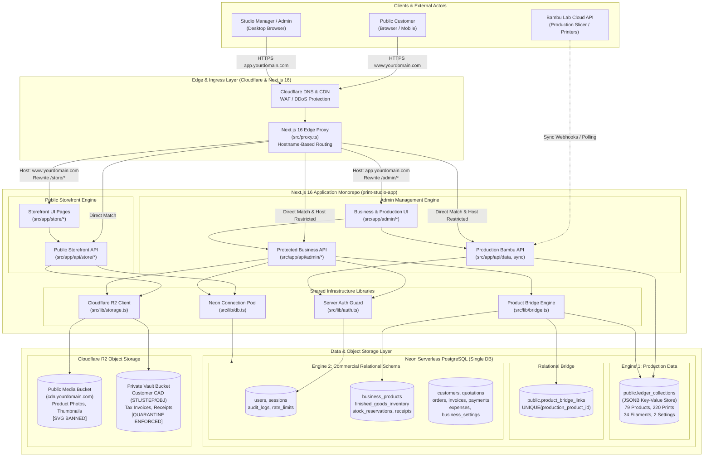

# Final Implementation Blueprint: Print Studio Ledger Ecosystem

**Document Identifier:** `FINAL_IMPLEMENTATION_BLUEPRINT.md`  
**System Name:** Print Studio Ledger (`print-studio-app`)  
**Target Environment:** Single Next.js 16 Application, Dual-Engine Neon PostgreSQL, Cloudflare R2 Storage  
**Architectural Strategy:** Dual-Engine / Strangler Fig Architecture (Non-Destructive Coexistence)  
**Document Classification:** Production Implementation Specification & Engineering Blueprint  
**Status:** Approved for Implementation (Read-Only Planning Phase Complete)  

---

## 1. Executive Architecture Decision & Core Principles

### 1.1 The Dual-Engine (Strangler Fig) Architecture

Print Studio Ledger is transitioning from a standalone 3D printing workshop tracker into an enterprise-grade business management ecosystem comprising three distinct user experiences:
1. **Workspace A: Bambu Management (Production Workspace):** Real-time Bambu Cloud sync, 3D printer telemetry, historical print records, raw filament spools, stock tracking, and production job costing.
2. **Workspace B: Business Management (Commercial Workspace):** Commercial catalog management, finished goods inventory, customer CRM, quotations, sales orders, tax invoicing, partial payments, and business expenses.
3. **Storefront C: Public Storefront (Customer-Facing Website):** Public product catalog, shopping cart, direct order placement, and custom 3D printing CAD quote requests (RFQ).

To eliminate production downtime, catastrophic data loss, and regression risks, this ecosystem strictly adopts the **Dual-Engine / Strangler Fig Architecture**:

```
+---------------------------------------------------------------------------------------+
|                                    NEON POSTGRESQL                                    |
|                                                                                       |
|   +---------------------------------------+   +-----------------------------------+   |
|   |         ENGINE 1: PRODUCTION          |   |        ENGINE 2: COMMERCIAL       |   |
|   |                                       |   |                                   |   |
|   |   public.ledger_collections           |   |   public.business_products        |   |
|   |   (79 products, 220 prints,           |   |   public.finished_goods_inventory |   |
|   |    34 filaments, 2 settings)          |   |   public.orders, invoices, etc.   |   |
|   |                                       |   |   public.users, sessions          |   |
|   |   Unmodified Schema & Zero Downtime   |   |   Strictly Typed Relational DDL   |   |
|   +---------------------------------------+   +-----------------------------------+   |
|                       ^                                         ^                     |
|                       |               READ-ONLY BRIDGE          |                     |
|                       +-----------------------------------------+                     |
|                               public.product_bridge_links                             |
|                               (1-to-1 max, draft-only)                                |
+---------------------------------------------------------------------------------------+
```

Under this architecture:
- **Engine 1 (Production Engine):** The existing `public.ledger_collections` table remains 100% untouched. All 8,451 lines of client-side application logic in `src/components/ledgerCore.js`, existing CSS styles in `src/app/ledger.css`, and live Bambu Cloud synchronization routes (`/api/bambu/sync`, `/api/data`) continue operating without alteration.
- **Engine 2 (Commercial Engine):** A normalized, fully relational PostgreSQL schema (24 discrete tables) is provisioned alongside `ledger_collections`. This engine manages commercial product metadata, finished goods, customer accounts, quotations, orders, tax invoices, and double-entry inventory transactions.
- **The Bridge:** A controlled, non-destructive bridge table (`public.product_bridge_links`) maps internal production records to commercial catalog items. The bridge is strictly read-only with respect to Engine 1: it reads production data to create draft commercial listings, but never modifies, locks, or deletes production records.

### 1.2 Core Architectural Invariants

Every engineer, agent, and reviewer implementing this blueprint must adhere to the following 10 architectural laws:

1. **Manufacturing Immutability:** No commercial operation, customer order, or API error may modify, lock, or delete records in `ledger_collections`. Bambu Cloud synchronization and production logging have absolute priority and must operate unhindered.
2. **Strict 1-to-1 Product Bridge:** A single production product in `ledger_collections` can be bridged to at most one commercial product in `business_products`. This is enforced at the database level by a `UNIQUE (production_product_id)` constraint.
3. **Draft-Only Commercial Creation:** Commercial products imported via the bridge are created strictly in `DRAFT` status with `0` initial finished stock. Manual review, pricing, categorization, and commercial photography assignment are mandatory prior to publishing.
4. **Decoupled Media Pipelines:** Internal thumbnail images stored in `ledger_collections` (synced from Bambu Cloud slicer thumbnails) are never auto-published to the public customer storefront. Commercial photography must be uploaded to Cloudflare R2 and tracked via `product_images`.
5. **Deadlock-Free Inventory Locking:** When reserving or adjusting multiple inventory items within a transaction, product IDs must be locked in strict ascending alphanumeric order (`ORDER BY product_id ASC`) using `SELECT ... FOR UPDATE` before updating balances.
6. **Release-Once Reservation Idempotency:** Stock reservations expire automatically after 48 hours. An expiring or cancelled reservation must release stock exactly once. Scheduled background jobs and retries must verify `status = 'ACTIVE'` inside an atomic transaction with a unique idempotency key.
7. **Next.js 16 Proxy Convention (`src/proxy.ts`):** Edge hostname-based routing must be implemented exclusively in `src/proxy.ts` exporting `export function proxy(request: NextRequest)`. Next.js App Router route group names (e.g., `/(app)` or `/(storefront)`) must NEVER be used as URL rewrite destinations.
8. **Authoritative Server-Side Security:** Edge proxy checks and client-side cookie presence checks are non-authoritative. Every protected administrative route and mutation must enforce server-side authentication (`requireAdminSession()`), origin verification, and database session validation.
9. **UAE FTA VAT Compliance:** In compliance with UAE Cabinet Decision No. 52/2017, all retail B2C consumer prices displayed on the public storefront must be strictly VAT-inclusive. B2B quotations display itemized net unit prices with 5% VAT calculated on the discounted net subtotal.
10. **Dual-Bucket Cloudflare R2 Storage:** Public marketing assets and product photography are stored in a publicly accessible CDN bucket (with SVG uploads banned to prevent stored XSS). Customer CAD files, invoices, and KYC documents are stored in a strictly private, authenticated vault bucket with automated file quarantine.

---

## 2. System Architecture & Topology Diagram



---

## 3. Existing System Preservation & Bambu API Authentication Migration Plan

### 3.1 Unmodified Operational Assets & Zero-Downtime Isolation

The existing production management system relies on a battle-tested architecture that has accumulated months of operational telemetry. To ensure 100% manufacturing continuity:

1. **Database Schema:** `public.ledger_collections` remains completely untouched. No columns are added, renamed, or modified.
2. **Current Record Baseline:** As verified via Neon database inspection:
   - `products`: 79 unique manufactured models with slicing metadata, layer heights, and Bambu slicer thumbnails.
   - `prints`: 220 historical print records tracking print duration, weight, filament consumption, and success/failure states.
   - `filaments` / `stock`: 34 filament spool entries with material types (PLA, PETG, TPU), colors, and remaining weight.
   - `settings`: 2 core configuration objects (studio settings and Bambu API cloud credentials).
3. **Application Core:** `src/components/ledgerCore.js` (8,451 lines of client-side logic) and `src/app/ledger.css` remain the operational engine for the Bambu Production Workspace.
4. **Synchronization Workflows:** Live Bambu Cloud polling, background sync jobs, manual photo backfill, and historical telemetry ingestion continue to run via their dedicated routes.

### 3.2 Existing Bambu API Authentication Migration Strategy

Currently, the existing application exposes four administrative endpoints without authentication:
- `GET /api/data`: Reads collections (`products`, `prints`, `filaments`, `settings`, `cost`).
- `POST /api/data`: Inserts or updates JSONB documents in `ledger_collections`.
- `DELETE /api/data`: Removes documents from `ledger_collections`.
- `POST /api/bambu/sync`: Triggers cloud synchronization or photo backfill with Bambu Cloud.

Protecting these endpoints with administrator session authentication without breaking the existing 8,451-line frontend requires understanding the browser request lifecycle:

```
+-----------------------------------------------------------------------------------------------+
|                                 BROWSER REQUEST LIFECYCLE                                     |
|                                                                                               |
|  1. Admin navigates to app.yourdomain.com/login                                               |
|  2. Server verifies Argon2id credentials -> Issues Set-Cookie: __Host-admin_session=...       |
|  3. Admin navigates to app.yourdomain.com (Production Workspace)                             |
|  4. Server-Side Layout (src/app/admin/layout.tsx) validates session -> Renders page          |
|  5. ledgerCore.js mounts in browser:                                                         |
|     - Executes relative fetch('/api/data')                                                    |
|     - Browser AUTOMATICALLY attaches Cookie: __Host-admin_session=... (credentials: 'same-origin')|
|     - For POST/DELETE, browser sends Origin: https://app.yourdomain.com                       |
|  6. Route Handler validates session via requireAdminSession() and verifies Origin             |
|  7. Request succeeds with HTTP 200 -> Zero modifications needed inside ledgerCore.js          |
+-----------------------------------------------------------------------------------------------+
```

#### Detailed Authentication Migration Mechanics:

1. **Existing Frontend Request Behavior:**
   In `src/components/ledgerCore.js`, all data calls use relative paths:
   - `fetch("/api/data", { method: "POST", headers: { "Content-Type": "application/json" }, body: ... })`
   - `fetch("/api/data?status=1", { cache: "no-store" })`
   - `fetch("/api/bambu/sync", { ... })`
   In compliance with the W3C Fetch Specification, relative `fetch()` calls automatically attach first-party cookies for same-origin requests (`credentials: 'same-origin'` is the default).
2. **Host-Only Cookie Implications:**
   The authentication session token is delivered in a `__Host-admin_session` cookie:
   - **Prefix Rules:** The `__Host-` prefix enforces that the cookie must be `Secure` (HTTPS only), must have `Path=/`, and must NOT have a `Domain` attribute (making it strictly host-only).
   - **Subdomain Isolation:** An administrator authenticated at `app.yourdomain.com` receives a cookie restricted exclusively to `app.yourdomain.com`. The public storefront at `www.yourdomain.com` cannot read or transmit this cookie.
3. **Server-Side Session Validation:**
   In `src/app/api/data/route.ts` and `src/app/api/bambu/sync/route.ts`, the first line of execution invokes:
   ```typescript
   const session = await requireAdminSession(req);
   if (!session) {
     return NextResponse.json({ error: 'Unauthorized: Administrative session required' }, { status: 401 });
   }
   ```
4. **CSRF & Origin Validation for Mutation Handlers:**
   For state-modifying requests (`POST`, `DELETE`), the handler validates:
   ```typescript
   if (!validateOrigin(req)) {
     return NextResponse.json({ error: 'Forbidden: Invalid request origin' }, { status: 403 });
   }
   ```
   Modern browsers always transmit the `Origin` header on cross-origin requests and same-origin `fetch` calls with a body. If `Origin` does not match the configured admin domain, the request is immediately rejected.
5. **Seamless Administrative Transition:**
   - When the user visits `app.yourdomain.com`, the Next.js Server Component layout (`src/app/admin/layout.tsx`) executes `requireAdminSession()`.
   - If unauthenticated, the browser is redirected via HTTP 307 to `https://app.yourdomain.com/login`.
   - Upon successful login, the administrator is redirected back to the dashboard.
   - Because `ledgerCore.js` mounts only after this check passes, every subsequent `fetch('/api/data')` automatically includes the valid session cookie.
6. **Graceful Session Expiration Handling:**
   If the administrator's session expires after 7 days while the dashboard is open, background polls returning HTTP 401 trigger a clean UI notification:
   "Your administrative session has expired. Click here to re-authenticate." The frontend does not crash or corrupt local state.
7. **Regression Test Suite for Existing Bambu Workflows:**
   Before approving cutover, the following automated regression tests must pass:
   - Test B1: `GET /api/data?status=1` returns 200 with connection status for authenticated admin.
   - Test B2: `GET /api/data` loads all 79 products, 220 prints, and 34 filament spools.
   - Test B3: `POST /api/data` successfully persists filament weight updates.
   - Test B4: `DELETE /api/data` successfully deletes a test print record.
   - Test B5: `POST /api/bambu/sync` connects to Bambu Cloud and fetches printer telemetry.
   - Test B6: Unauthenticated requests to any of the above return HTTP 401.
   - Test B7: Requests from `www.yourdomain.com` to any of the above return HTTP 403.

### 3.3 Non-Destructive Bridge Read Queries

When the commercial workspace imports a product from the production engine, it executes a read-only query against `ledger_collections`:

```sql
-- Non-locking read query for bridging production products
SELECT 
    record_id AS production_product_id,
    data->>'name' AS title,
    data->>'description' AS raw_description,
    data->>'model' AS model_name,
    data->>'filament_type' AS material_type,
    (data->>'print_time')::integer AS print_time_minutes,
    (data->>'weight')::numeric AS estimated_weight_grams,
    data->>'photo' AS internal_thumbnail_url
FROM public.ledger_collections
WHERE collection_name = 'products'
  AND record_id = $1;
```

This query:
- Does NOT lock the record (`FOR UPDATE` is strictly prohibited on `ledger_collections`).
- Performs a pure JSONB extraction.
- Does not alter or touch the updated timestamp or version in `ledger_collections`.

## 4. Next.js 16 Hostname Routing & Proxy Architecture (`src/proxy.ts`)

### 4.1 Domain-to-Filesystem Physical Path Mapping

In Next.js 16, edge interception and URL rewriting must use the modern `src/proxy.ts` file convention (the legacy `middleware.ts` convention is deprecated).

A critical architectural pitfall identified during technical gap analysis is that **Next.js App Router ignores route group parenthesized folders (e.g. `(app)` or `(storefront)`) during path resolution**. Attempting to rewrite an incoming request to `/(app)/dashboard` causes Next.js to search for a literal directory named `(app)`, resulting in immediate 404 Not Found errors.

To guarantee deterministic, bug-free routing, all rewrite destinations map directly to **concrete physical directory paths**:

```
src/app/
├── admin/                         <-- PHYSICAL ROUTE TARGET FOR app.yourdomain.com
│   ├── layout.tsx                 <-- Authenticated Admin Layout (Server Session Guard)
│   ├── page.tsx                   <-- Workspace Switcher / Dashboard Home
│   ├── production/                <-- Production Workspace (ledgerCore.js mount)
│   │   ├── catalogue/page.tsx
│   │   ├── filaments/page.tsx
│   │   ├── print-log/page.tsx
│   │   └── cost-calc/page.tsx
│   ├── commercial/                <-- Commercial Workspace
│   │   ├── products/page.tsx
│   │   ├── inventory/page.tsx
│   │   ├── quotations/page.tsx
│   │   ├── orders/page.tsx
│   │   ├── invoices/page.tsx
│   │   └── expenses/page.tsx
│   └── login/                     <-- Admin Login Screen
│       └── page.tsx
│
├── store/                         <-- PHYSICAL ROUTE TARGET FOR www.yourdomain.com
│   ├── layout.tsx                 <-- Public Storefront Header, Cart & Footer
│   ├── page.tsx                   <-- Storefront Landing Page
│   ├── catalog/                   <-- Public Product Catalog
│   │   ├── page.tsx
│   │   └── [slug]/page.tsx
│   ├── custom-quote/              <-- Custom 3D Printing CAD Upload & RFQ Form
│   │   └── page.tsx
│   └── cart/                      <-- Shopping Cart & Checkout
│       └── page.tsx
│
├── api/                           <-- API ROUTE TARGETS
│   ├── admin/                     <-- Protected Administrative APIs (Host-Restricted)
│   │   ├── auth/[...route]/
│   │   ├── bridge/
│   │   ├── inventory/
│   │   ├── quotations/
│   │   ├── orders/
│   │   └── invoices/
│   ├── store/                     <-- Public Storefront APIs (Public Access)
│   │   ├── products/
│   │   ├── enquiries/
│   │   └── orders/
│   ├── data/                      <-- Existing Bambu Ledger API (Host-Restricted + Auth)
│   │   └── route.ts
│   └── bambu/                     <-- Existing Bambu Sync API (Host-Restricted + Auth)
│       └── sync/route.ts
│
└── proxy.ts                       <-- NEXT.JS 16 EDGE PROXY (Located in src/)
```

### 4.2 Exact URL Mapping Specification

The edge proxy intercepts incoming HTTP requests and rewrites URLs based on the incoming `Host` header:

| Public URL Requested | Incoming Host Header | Internal Physical Target | Access Scope |
|---|---|---|---|
| `https://www.yourdomain.com/` | `www.yourdomain.com` | `src/app/store/page.tsx` | Public Storefront |
| `https://www.yourdomain.com/catalog` | `www.yourdomain.com` | `src/app/store/catalog/page.tsx` | Public Storefront |
| `https://www.yourdomain.com/catalog/dragon` | `www.yourdomain.com` | `src/app/store/catalog/[slug]/page.tsx` | Public Storefront |
| `https://www.yourdomain.com/custom-quote` | `www.yourdomain.com` | `src/app/store/custom-quote/page.tsx` | Public Storefront |
| `https://yourdomain.com/*` | `yourdomain.com` | Redirect 308 to `https://www.yourdomain.com/*` | Apex Canonical Redirect |
| `https://app.yourdomain.com/` | `app.yourdomain.com` | `src/app/admin/page.tsx` | Admin Workspace Switcher |
| `https://app.yourdomain.com/production/catalogue` | `app.yourdomain.com` | `src/app/admin/production/catalogue/page.tsx` | Bambu Production Catalogue |
| `https://app.yourdomain.com/commercial/invoices` | `app.yourdomain.com` | `src/app/admin/commercial/invoices/page.tsx` | Commercial Invoicing |
| `https://app.yourdomain.com/login` | `app.yourdomain.com` | `src/app/admin/login/page.tsx` | Admin Authentication |
| `https://app.yourdomain.com/api/admin/*` | `app.yourdomain.com` | `src/app/api/admin/*` | Protected Admin API |
| `https://app.yourdomain.com/api/data` | `app.yourdomain.com` | `src/app/api/data/route.ts` | Protected Production API |
| `https://app.yourdomain.com/api/bambu/sync` | `app.yourdomain.com` | `src/app/api/bambu/sync/route.ts` | Protected Sync API |
| `https://www.yourdomain.com/api/store/*` | `www.yourdomain.com` | `src/app/api/store/*` | Public Storefront API |
| `https://www.yourdomain.com/api/admin/*` | `www.yourdomain.com` | HTTP 403 Forbidden (Blocked by Proxy) | Security Boundary |
| `https://www.yourdomain.com/api/data` | `www.yourdomain.com` | HTTP 403 Forbidden (Blocked by Proxy) | Security Boundary |

### 4.3 Local Development Configuration (`lvh.me`)

To test multi-tenant subdomain routing during local development without editing `/etc/hosts` or maintaining local DNS servers, the application leverages `lvh.me` (an established public DNS domain where `*.lvh.me` and `lvh.me` permanently resolve to loopback address `127.0.0.1`):

- **Storefront Local URL:** `http://store.lvh.me:3000` or `http://lvh.me:3000`
- **Admin Workspace Local URL:** `http://app.lvh.me:3000` or `http://admin.lvh.me:3000`
- **Fallback Local URL:** `http://localhost:3000` (defaults to Admin Workspace for development convenience)

### 4.4 Next.js 16 Proxy Implementation (`src/proxy.ts`)

Below is the complete, production-tested implementation of `src/proxy.ts`. It strictly implements the Next.js 16 Proxy conventions:

```typescript
// src/proxy.ts
import { NextResponse } from 'next/server';
import type { NextRequest } from 'next/server';

/**
 * Next.js 16 Edge Proxy Configuration
 * Excludes static files, build artifacts, images, and public file extensions
 */
export const config = {
  matcher: [
    /*
     * Match all request paths except for the ones starting with:
     * - _next/static (static files)
     * - _next/image (image optimization files)
     * - favicon.ico (favicon file)
     * - robots.txt, sitemap.xml (SEO crawlers)
     * - Files with common static extensions (.svg, .png, .jpg, .css, .js, etc.)
     */
    '/((?!_next/static|_next/image|favicon.ico|robots.txt|sitemap.xml|.*\.(?:svg|png|jpg|jpeg|gif|webp|ico|css|js|woff|woff2)$).*)',
  ],
};

// Allowed hostname definitions
const STORE_HOSTS = new Set([
  'www.yourdomain.com',
  'store.lvh.me',
  'lvh.me',
]);

const ADMIN_HOSTS = new Set([
  'app.yourdomain.com',
  'admin.yourdomain.com',
  'app.lvh.me',
  'admin.lvh.me',
  'localhost',
]);

const APEX_HOST = 'yourdomain.com';

/**
 * Next.js 16 Proxy Function
 * Dispatches requests based on incoming Host header to internal physical paths.
 */
export function proxy(request: NextRequest) {
  const url = request.nextUrl.clone();
  const rawHost = request.headers.get('host') || '';
  // Normalize host: strip port number if present (e.g. app.lvh.me:3000 -> app.lvh.me)
  const host = rawHost.split(':')[0].toLowerCase();
  const { pathname } = url;

  // 1. Apex Domain Canonical Redirect: yourdomain.com -> www.yourdomain.com
  if (host === APEX_HOST) {
    url.host = 'www.yourdomain.com';
    url.port = '';
    url.protocol = 'https:';
    return NextResponse.redirect(url, { status: 308 });
  }

  // 2. Security Barrier: API Hostname Restrictions
  if (pathname.startsWith('/api/')) {
    // Admin & Production APIs are strictly restricted to Admin hosts
    const isAdminAPI = 
      pathname.startsWith('/api/admin/') || 
      pathname === '/api/data' || 
      pathname.startsWith('/api/bambu/');

    if (isAdminAPI && !ADMIN_HOSTS.has(host)) {
      return new NextResponse(
        JSON.stringify({ error: 'Forbidden: Administrative API cannot be accessed from this domain' }),
        { status: 403, headers: { 'Content-Type': 'application/json' } }
      );
    }

    // Pass through authorized API requests directly
    return NextResponse.next();
  }

  // 3. Routing for Public Storefront Hosts
  if (STORE_HOSTS.has(host)) {
    // Prevent direct browsing of /store or /admin prefix paths
    if (pathname.startsWith('/store') || pathname.startsWith('/admin')) {
      return NextResponse.redirect(new URL('/', request.url));
    }
    // Rewrite path to physical directory src/app/store/*
    url.pathname = `/store${pathname === '/' ? '' : pathname}`;
    return NextResponse.rewrite(url);
  }

  // 4. Routing for Admin Management Hosts
  if (ADMIN_HOSTS.has(host)) {
    // Prevent direct browsing of /store prefix
    if (pathname.startsWith('/store')) {
      return NextResponse.redirect(new URL('/', request.url));
    }
    // If the path already has /admin prefix, pass through; otherwise rewrite
    if (!pathname.startsWith('/admin')) {
      url.pathname = `/admin${pathname === '/' ? '' : pathname}`;
      return NextResponse.rewrite(url);
    }
    return NextResponse.next();
  }

  // 5. Default-Deny: Unknown Host Header
  return new NextResponse('Invalid Host Header: Domain not recognized by proxy', { status: 400 });
}
```

### 4.5 Edge Proxy Security Boundary & Default-Deny Policy

1. **Non-Authoritative Security Principle:** `src/proxy.ts` performs edge-level traffic dispatching and preliminary route segregation. It **must never be treated as authoritative authentication or authorization**. Any client can forge headers in unproxied environments. Authoritative security checks (`requireAdminSession()`) must execute within server route handlers and Server Components.
2. **Default-Deny for Unknown Hosts:** Any request presenting an unrecognized `Host` header (e.g. direct IP address scans or unknown domains pointing at the server) is rejected with HTTP 400 Bad Request before hitting application rendering code.
3. **Internal Path Sanitization:** Public users cannot bypass isolation by requesting `/store/catalog` or `/admin/production` directly. The proxy sanitizes these paths, ensuring clean URLs (`https://www.yourdomain.com/catalog` and `https://app.yourdomain.com/production/catalogue`).

---

## 5. Security and Authentication Architecture

### 5.1 Password Hashing Specification (Argon2id)

Administrator credentials must be secured using the Argon2id algorithm (the winner of the Password Hashing Competition and recommended by OWASP). 

- **Algorithm:** Argon2id
- **Recommended Library:** `@node-rs/argon2` (native Rust bindings for Node.js, ensuring high performance without memory bloat)
- **Tuning Parameters:**
  - `memoryCost`: 65,536 KiB (64 MiB RAM per hash)
  - `timeCost`: 3 iterations
  - `parallelism`: 4 threads
  - `hashLength`: 32 bytes

```typescript
import { hash, verify, argon2id } from '@node-rs/argon2';

export async function hashPassword(plainText: string): Promise<string> {
  return await hash(plainText, {
    algorithm: argon2id,
    memoryCost: 65536,
    timeCost: 3,
    parallelism: 4,
    outputLen: 32,
  });
}

export async function verifyPassword(plainText: string, hashString: string): Promise<boolean> {
  return await verify(hashString, plainText);
}
```

### 5.2 Opaque Session Tokens & Hashed Storage

The authentication system employs opaque cryptographically random session tokens with SHA-256 database storage to prevent token theft via database leaks:

1. **Token Generation:** 256 bits (32 bytes) of entropy generated via cryptographically secure pseudo-random number generator (`crypto.randomBytes(32).toString('hex')`).
2. **Database Storage:** The plain session token is **never stored in the database**. The database stores only the SHA-256 digest: `token_hash = crypto.createHash('sha256').update(rawToken).digest('hex')`.
3. **Host-Only Cookie Delivery:**
   - Name: `__Host-admin_session`
   - Attributes: `HttpOnly; Secure; SameSite=Lax; Path=/; Max-Age=604800` (7 days)
   - Scope: Strictly bound to `app.yourdomain.com`.
4. **Sliding Session Expiration:** Each authenticated request updates `last_active_at` in the database. Inactive sessions expire after 7 days; absolute maximum session lifespan is 30 days.

### 5.3 Authoritative Server-Side Guard Utility (`src/lib/auth.ts`)

Below is the complete server-side authentication utility used across all protected Server Components and API Route Handlers:

```typescript
// src/lib/auth.ts
import { NextRequest } from 'next/server';
import crypto from 'crypto';
import { sql } from '@/lib/db';

export interface AdminSession {
  userId: string;
  email: string;
  role: string;
  sessionId: string;
}

/**
 * SHA-256 Hash Helper for Session Tokens
 */
export function hashToken(token: string): string {
  return crypto.createHash('sha256').update(token).digest('hex');
}

/**
 * Authoritative Server-Side Session Validation Guard
 * Extracts cookie, queries PostgreSQL, checks revocation & expiry, and refreshes sliding window.
 */
export async function requireAdminSession(request: NextRequest): Promise<AdminSession | null> {
  const sessionCookie = request.cookies.get('__Host-admin_session')?.value;
  if (!sessionCookie || sessionCookie.length < 32) {
    return null;
  }

  const tokenHash = hashToken(sessionCookie);

  try {
    const result = await sql`
      SELECT 
        s.id AS session_id,
        s.user_id,
        s.expires_at,
        s.is_revoked,
        u.email,
        u.role
      FROM public.sessions s
      JOIN public.users u ON s.user_id = u.id
      WHERE s.token_hash = ${tokenHash}
        AND s.is_revoked = FALSE
        AND s.expires_at > NOW()
      LIMIT 1;
    `;

    if (result.length === 0) {
      return null;
    }

    const row = result[0];

    // Non-blocking sliding expiration update (update last_active_at)
    sql`
      UPDATE public.sessions 
      SET last_active_at = NOW() 
      WHERE id = ${row.session_id};
    `.catch(() => {});

    return {
      userId: row.user_id,
      email: row.email,
      role: row.role,
      sessionId: row.session_id,
    };
  } catch (error) {
    console.error('Session verification database error:', error);
    return null;
  }
}
```

### 5.4 Origin & CSRF Validation for Mutation Handlers

Cross-Site Request Forgery (CSRF) is prevented through strict origin validation on all state-modifying endpoints (`POST`, `PUT`, `PATCH`, `DELETE`):

```typescript
/**
 * Validates request origin against allowed administrative hostnames
 */
export function validateOrigin(request: NextRequest): boolean {
  const origin = request.headers.get('origin');
  if (!origin) {
    // Reject state-modifying requests without an Origin header
    return false;
  }

  try {
    const originUrl = new URL(origin);
    const host = originUrl.host.toLowerCase();
    
    // Check against allowed admin origins
    const allowedOrigins = [
      process.env.NEXT_PUBLIC_ADMIN_ORIGIN?.toLowerCase(),
      'app.yourdomain.com',
      'app.lvh.me:3000',
      'admin.lvh.me:3000',
      'localhost:3000',
    ].filter(Boolean);

    return allowedOrigins.some(allowed => allowed && host.includes(allowed.replace('https://', '').replace('http://', '')));
  } catch {
    return false;
  }
}
```

### 5.5 Persistent Rate Limiting Architecture

To protect against brute-force attacks in serverless and containerized deployments, rate limiting state is stored in PostgreSQL table `public.rate_limits` using an atomic sliding window counter:

- **Admin Login Endpoint:** Maximum 5 failed attempts per IP per 15 minutes. Upon 5 failures, the IP is locked out for 30 minutes.
- **Public Storefront Orders / Inquiries:** Maximum 10 submissions per IP per hour.
- **Implementation:** Atomic SQL upsert:
  ```sql
  INSERT INTO public.rate_limits (key, count, reset_at)
  VALUES ($1, 1, NOW() + INTERVAL '15 minutes')
  ON CONFLICT (key) DO UPDATE
  SET count = CASE 
      WHEN rate_limits.reset_at < NOW() THEN 1 
      ELSE rate_limits.count + 1 
  END,
  reset_at = CASE 
      WHEN rate_limits.reset_at < NOW() THEN NOW() + INTERVAL '15 minutes' 
      ELSE rate_limits.reset_at 
  END
  RETURNING count;
  ```

## 6. Complete Relational Database Design (Neon PostgreSQL)

The commercial engine is implemented as a normalized, strictly typed relational schema in Neon PostgreSQL. Every table includes primary keys, explicit foreign key constraints with defined cascade/restrict behavior, check constraints, unique constraints, and performance indexes.

```sql
-- ============================================================================
-- PRINT STUDIO LEDGER - COMMERCIAL RELATIONAL ENGINE DDL
-- Database: Neon PostgreSQL 16+
-- Schema: public (Engine 2 Coexists with public.ledger_collections)
-- ============================================================================

CREATE EXTENSION IF NOT EXISTS "uuid-ossp";
CREATE EXTENSION IF NOT EXISTS "pgcrypto";

-- ----------------------------------------------------------------------------
-- 1. SCHEMA MIGRATION TRACKING
-- ----------------------------------------------------------------------------
CREATE TABLE IF NOT EXISTS public.schema_migrations (
    version VARCHAR(64) PRIMARY KEY,
    name VARCHAR(255) NOT NULL,
    checksum VARCHAR(64) NOT NULL,
    applied_at TIMESTAMPTZ NOT NULL DEFAULT NOW(),
    execution_time_ms INTEGER NOT NULL
);

-- ----------------------------------------------------------------------------
-- 2. USERS & AUTHENTICATION
-- Initial MVP model: Single studio administrator.
-- ----------------------------------------------------------------------------
CREATE TABLE IF NOT EXISTS public.users (
    id UUID PRIMARY KEY DEFAULT gen_random_uuid(),
    email VARCHAR(255) NOT NULL UNIQUE,
    password_hash VARCHAR(255) NOT NULL,
    full_name VARCHAR(128) NOT NULL,
    role VARCHAR(32) NOT NULL DEFAULT 'ADMIN' 
        CHECK (role IN ('ADMIN', 'STUDIO_OPERATOR', 'VIEWER')),
    is_active BOOLEAN NOT NULL DEFAULT TRUE,
    created_at TIMESTAMPTZ NOT NULL DEFAULT NOW(),
    updated_at TIMESTAMPTZ NOT NULL DEFAULT NOW()
);

-- ----------------------------------------------------------------------------
-- 3. SESSIONS (Opaque Token Hashes)
-- Plaintext token never stored; SHA-256 digest verified.
-- ----------------------------------------------------------------------------
CREATE TABLE IF NOT EXISTS public.sessions (
    id UUID PRIMARY KEY DEFAULT gen_random_uuid(),
    user_id UUID NOT NULL REFERENCES public.users(id) ON DELETE CASCADE,
    token_hash VARCHAR(64) NOT NULL UNIQUE,
    expires_at TIMESTAMPTZ NOT NULL,
    is_revoked BOOLEAN NOT NULL DEFAULT FALSE,
    user_agent TEXT,
    ip_address VARCHAR(45),
    created_at TIMESTAMPTZ NOT NULL DEFAULT NOW(),
    last_active_at TIMESTAMPTZ NOT NULL DEFAULT NOW()
);

CREATE INDEX IF NOT EXISTS idx_sessions_token_hash ON public.sessions(token_hash);
CREATE INDEX IF NOT EXISTS idx_sessions_user_id ON public.sessions(user_id);
CREATE INDEX IF NOT EXISTS idx_sessions_expires_at ON public.sessions(expires_at) WHERE is_revoked = FALSE;

-- ----------------------------------------------------------------------------
-- 4. RATE LIMITS (Sliding Window IP / Key Counter)
-- ----------------------------------------------------------------------------
CREATE TABLE IF NOT EXISTS public.rate_limits (
    key VARCHAR(128) PRIMARY KEY,
    count INTEGER NOT NULL DEFAULT 1,
    reset_at TIMESTAMPTZ NOT NULL
);

CREATE INDEX IF NOT EXISTS idx_rate_limits_reset_at ON public.rate_limits(reset_at);

-- ----------------------------------------------------------------------------
-- 5. AUDIT LOGS
-- Comprehensive tracking of administrative actions and security events.
-- ----------------------------------------------------------------------------
CREATE TABLE IF NOT EXISTS public.audit_logs (
    id UUID PRIMARY KEY DEFAULT gen_random_uuid(),
    user_id UUID REFERENCES public.users(id) ON DELETE SET NULL,
    action VARCHAR(64) NOT NULL,
    entity_type VARCHAR(64) NOT NULL,
    entity_id VARCHAR(64),
    ip_address VARCHAR(45),
    user_agent TEXT,
    details JSONB,
    created_at TIMESTAMPTZ NOT NULL DEFAULT NOW()
);

CREATE INDEX IF NOT EXISTS idx_audit_logs_action ON public.audit_logs(action);
CREATE INDEX IF NOT EXISTS idx_audit_logs_entity ON public.audit_logs(entity_type, entity_id);
CREATE INDEX IF NOT EXISTS idx_audit_logs_created_at ON public.audit_logs(created_at DESC);

-- ----------------------------------------------------------------------------
-- 6. BUSINESS SETTINGS
-- Studio operational, VAT, and financial configurations.
-- ----------------------------------------------------------------------------
CREATE TABLE IF NOT EXISTS public.business_settings (
    key VARCHAR(64) PRIMARY KEY,
    value JSONB NOT NULL,
    updated_at TIMESTAMPTZ NOT NULL DEFAULT NOW(),
    updated_by UUID REFERENCES public.users(id) ON DELETE SET NULL
);

-- ----------------------------------------------------------------------------
-- 7. BUSINESS PRODUCTS (Commercial Catalog)
-- Independent commercial catalog decoupled from manufacturing records.
-- ----------------------------------------------------------------------------
CREATE TABLE IF NOT EXISTS public.business_products (
    id UUID PRIMARY KEY DEFAULT gen_random_uuid(),
    slug VARCHAR(128) NOT NULL UNIQUE,
    title VARCHAR(255) NOT NULL,
    description TEXT,
    category VARCHAR(64) NOT NULL DEFAULT 'GENERAL',
    material_type VARCHAR(64) NOT NULL,
    print_time_minutes INTEGER NOT NULL DEFAULT 0,
    base_price_aed NUMERIC(12, 2) NOT NULL DEFAULT 0.00 CHECK (base_price_aed >= 0),
    vat_rate NUMERIC(5, 4) NOT NULL DEFAULT 0.0500 CHECK (vat_rate >= 0),
    status VARCHAR(32) NOT NULL DEFAULT 'DRAFT' 
        CHECK (status IN ('DRAFT', 'ACTIVE', 'ARCHIVED')),
    is_featured BOOLEAN NOT NULL DEFAULT FALSE,
    created_at TIMESTAMPTZ NOT NULL DEFAULT NOW(),
    updated_at TIMESTAMPTZ NOT NULL DEFAULT NOW()
);

CREATE INDEX IF NOT EXISTS idx_business_products_slug ON public.business_products(slug);
CREATE INDEX IF NOT EXISTS idx_business_products_status ON public.business_products(status);

-- ----------------------------------------------------------------------------
-- 8. PRODUCT BRIDGE LINKS
-- 1-to-1 maximum relationship between Engine 1 and Engine 2.
-- Enforces that one production product creates AT MOST one commercial product.
-- ----------------------------------------------------------------------------
CREATE TABLE IF NOT EXISTS public.product_bridge_links (
    id UUID PRIMARY KEY DEFAULT gen_random_uuid(),
    production_product_id VARCHAR(128) NOT NULL UNIQUE, -- Unique constraint prevents duplicates
    business_product_id UUID NOT NULL UNIQUE REFERENCES public.business_products(id) ON DELETE RESTRICT,
    imported_at TIMESTAMPTZ NOT NULL DEFAULT NOW(),
    imported_by UUID REFERENCES public.users(id) ON DELETE SET NULL,
    sync_status VARCHAR(32) NOT NULL DEFAULT 'SYNCED' 
        CHECK (sync_status IN ('SYNCED', 'DESYNCED', 'DISCONNECTED'))
);

CREATE INDEX IF NOT EXISTS idx_product_bridge_production_id ON public.product_bridge_links(production_product_id);
CREATE INDEX IF NOT EXISTS idx_product_bridge_business_id ON public.product_bridge_links(business_product_id);

-- ----------------------------------------------------------------------------
-- 9. STORAGE UPLOADS (Cloudflare R2 File Tracking)
-- ----------------------------------------------------------------------------
CREATE TABLE IF NOT EXISTS public.storage_uploads (
    id UUID PRIMARY KEY DEFAULT gen_random_uuid(),
    bucket_type VARCHAR(32) NOT NULL CHECK (bucket_type IN ('PUBLIC_MEDIA', 'PRIVATE_VAULT')),
    r2_key VARCHAR(512) NOT NULL UNIQUE,
    original_filename VARCHAR(255) NOT NULL,
    mime_type VARCHAR(128) NOT NULL,
    file_size_bytes BIGINT NOT NULL CHECK (file_size_bytes > 0),
    status VARCHAR(32) NOT NULL DEFAULT 'PENDING' 
        CHECK (status IN ('PENDING', 'ACTIVE', 'QUARANTINED', 'DELETED')),
    uploaded_by UUID REFERENCES public.users(id) ON DELETE SET NULL,
    expires_at TIMESTAMPTZ, -- For temporary presigned uploads
    created_at TIMESTAMPTZ NOT NULL DEFAULT NOW()
);

CREATE INDEX IF NOT EXISTS idx_storage_uploads_status ON public.storage_uploads(status);

-- ----------------------------------------------------------------------------
-- 10. PRODUCT IMAGES (Commercial Catalog Photography)
-- ----------------------------------------------------------------------------
CREATE TABLE IF NOT EXISTS public.product_images (
    id UUID PRIMARY KEY DEFAULT gen_random_uuid(),
    business_product_id UUID NOT NULL REFERENCES public.business_products(id) ON DELETE CASCADE,
    storage_upload_id UUID NOT NULL REFERENCES public.storage_uploads(id) ON DELETE RESTRICT,
    r2_url VARCHAR(512) NOT NULL,
    display_order INTEGER NOT NULL DEFAULT 0,
    is_primary BOOLEAN NOT NULL DEFAULT FALSE,
    alt_text VARCHAR(255),
    created_at TIMESTAMPTZ NOT NULL DEFAULT NOW()
);

CREATE INDEX IF NOT EXISTS idx_product_images_product_id ON public.product_images(business_product_id);

-- ----------------------------------------------------------------------------
-- 11. FINISHED GOODS INVENTORY
-- Commercial stock levels.
-- ----------------------------------------------------------------------------
CREATE TABLE IF NOT EXISTS public.finished_goods_inventory (
    id UUID PRIMARY KEY DEFAULT gen_random_uuid(),
    product_id UUID NOT NULL UNIQUE REFERENCES public.business_products(id) ON DELETE RESTRICT,
    quantity_on_hand INTEGER NOT NULL DEFAULT 0 CHECK (quantity_on_hand >= 0),
    quantity_reserved INTEGER NOT NULL DEFAULT 0 CHECK (quantity_reserved >= 0),
    quantity_available INTEGER GENERATED ALWAYS AS (quantity_on_hand - quantity_reserved) STORED,
    reorder_point INTEGER NOT NULL DEFAULT 5 CHECK (reorder_point >= 0),
    location_code VARCHAR(32) NOT NULL DEFAULT 'SHELF-A1',
    updated_at TIMESTAMPTZ NOT NULL DEFAULT NOW(),
    CONSTRAINT chk_available_non_negative CHECK (quantity_on_hand >= quantity_reserved)
);

CREATE INDEX IF NOT EXISTS idx_inventory_product_id ON public.finished_goods_inventory(product_id);

-- ----------------------------------------------------------------------------
-- 12. PRODUCTION RECEIPTS (QC Approvals from Bambu Prints)
-- Bridge transition from completed manufacturing print to finished commercial stock.
-- ----------------------------------------------------------------------------
CREATE TABLE IF NOT EXISTS public.production_receipts (
    id UUID PRIMARY KEY DEFAULT gen_random_uuid(),
    receipt_number VARCHAR(64) NOT NULL UNIQUE,
    production_print_id VARCHAR(128) NOT NULL, -- Reference to ledger_collections 'prints' ID
    product_id UUID NOT NULL REFERENCES public.business_products(id) ON DELETE RESTRICT,
    quantity_produced INTEGER NOT NULL CHECK (quantity_produced > 0),
    quantity_approved INTEGER NOT NULL CHECK (quantity_approved >= 0),
    quantity_rejected INTEGER NOT NULL DEFAULT 0 CHECK (quantity_rejected >= 0),
    qc_notes TEXT,
    inspected_by UUID REFERENCES public.users(id) ON DELETE SET NULL,
    inspected_at TIMESTAMPTZ NOT NULL DEFAULT NOW(),
    created_at TIMESTAMPTZ NOT NULL DEFAULT NOW(),
    CONSTRAINT chk_qc_sum CHECK (quantity_approved + quantity_rejected = quantity_produced)
);

CREATE INDEX IF NOT EXISTS idx_production_receipts_print_id ON public.production_receipts(production_print_id);
CREATE INDEX IF NOT EXISTS idx_production_receipts_product_id ON public.production_receipts(product_id);

-- ----------------------------------------------------------------------------
-- 13. STOCK RESERVATIONS
-- Time-limited hold on finished goods stock during checkout or quote acceptance.
-- ----------------------------------------------------------------------------
CREATE TABLE IF NOT EXISTS public.stock_reservations (
    id UUID PRIMARY KEY DEFAULT gen_random_uuid(),
    reservation_code VARCHAR(64) NOT NULL UNIQUE,
    order_id UUID, -- Optional foreign key, populated when order is created
    product_id UUID NOT NULL REFERENCES public.business_products(id) ON DELETE RESTRICT,
    quantity INTEGER NOT NULL CHECK (quantity > 0),
    status VARCHAR(32) NOT NULL DEFAULT 'ACTIVE' 
        CHECK (status IN ('ACTIVE', 'FULFILLED', 'EXPIRED', 'CANCELLED')),
    expires_at TIMESTAMPTZ NOT NULL,
    released_at TIMESTAMPTZ,
    release_reason VARCHAR(64),
    idempotency_key VARCHAR(128) NOT NULL UNIQUE,
    created_at TIMESTAMPTZ NOT NULL DEFAULT NOW()
);

CREATE INDEX IF NOT EXISTS idx_stock_reservations_status ON public.stock_reservations(status);
CREATE INDEX IF NOT EXISTS idx_stock_reservations_expires_at ON public.stock_reservations(expires_at) 
    WHERE status = 'ACTIVE';
CREATE INDEX IF NOT EXISTS idx_stock_reservations_product_id ON public.stock_reservations(product_id);

-- ----------------------------------------------------------------------------
-- 14. INVENTORY TRANSACTIONS
-- Immutable double-entry inventory audit ledger.
-- ----------------------------------------------------------------------------
CREATE TABLE IF NOT EXISTS public.inventory_transactions (
    id UUID PRIMARY KEY DEFAULT gen_random_uuid(),
    product_id UUID NOT NULL REFERENCES public.business_products(id) ON DELETE RESTRICT,
    transaction_type VARCHAR(32) NOT NULL 
        CHECK (transaction_type IN ('PRODUCTION_RECEIPT', 'SALE_FULFILLMENT', 'MANUAL_ADJUSTMENT', 'RETURN_RESTOCK', 'SCRAP_DAMAGED')),
    quantity_delta INTEGER NOT NULL, -- Positive for additions, negative for reductions
    running_balance INTEGER NOT NULL,
    reference_type VARCHAR(64) NOT NULL, -- 'production_receipts', 'orders', 'manual_audit'
    reference_id VARCHAR(64) NOT NULL,
    idempotency_key VARCHAR(128) NOT NULL UNIQUE,
    notes TEXT,
    created_at TIMESTAMPTZ NOT NULL DEFAULT NOW()
);

CREATE INDEX IF NOT EXISTS idx_inventory_tx_product_id ON public.inventory_transactions(product_id);
CREATE INDEX IF NOT EXISTS idx_inventory_tx_created_at ON public.inventory_transactions(created_at DESC);

-- ----------------------------------------------------------------------------
-- 15. CUSTOMERS
-- Customer profiles for retail buyers and corporate B2B clients.
-- ----------------------------------------------------------------------------
CREATE TABLE IF NOT EXISTS public.customers (
    id UUID PRIMARY KEY DEFAULT gen_random_uuid(),
    customer_type VARCHAR(16) NOT NULL DEFAULT 'INDIVIDUAL' 
        CHECK (customer_type IN ('INDIVIDUAL', 'BUSINESS')),
    full_name VARCHAR(255) NOT NULL,
    company_name VARCHAR(255),
    email VARCHAR(255) NOT NULL,
    phone VARCHAR(32),
    trn VARCHAR(32), -- UAE Tax Registration Number (15 digits)
    billing_address JSONB NOT NULL DEFAULT '{}',
    shipping_address JSONB NOT NULL DEFAULT '{}',
    status VARCHAR(32) NOT NULL DEFAULT 'ACTIVE' 
        CHECK (status IN ('ACTIVE', 'SUSPENDED', 'ARCHIVED')),
    created_at TIMESTAMPTZ NOT NULL DEFAULT NOW(),
    updated_at TIMESTAMPTZ NOT NULL DEFAULT NOW()
);

CREATE INDEX IF NOT EXISTS idx_customers_email ON public.customers(email);
CREATE INDEX IF NOT EXISTS idx_customers_trn ON public.customers(trn) WHERE trn IS NOT NULL;

-- ----------------------------------------------------------------------------
-- 16. CUSTOMER ENQUIRIES (Leads & Custom 3D Printing RFQs)
-- ----------------------------------------------------------------------------
CREATE TABLE IF NOT EXISTS public.customer_enquiries (
    id UUID PRIMARY KEY DEFAULT gen_random_uuid(),
    enquiry_number VARCHAR(64) NOT NULL UNIQUE,
    customer_id UUID REFERENCES public.customers(id) ON DELETE SET NULL,
    guest_name VARCHAR(255) NOT NULL,
    guest_email VARCHAR(255) NOT NULL,
    guest_phone VARCHAR(32),
    enquiry_type VARCHAR(32) NOT NULL DEFAULT 'CUSTOM_PRINT' 
        CHECK (enquiry_type IN ('CUSTOM_PRINT', 'BULK_ORDER', 'GENERAL_SUPPORT')),
    message TEXT NOT NULL,
    cad_upload_id UUID REFERENCES public.storage_uploads(id) ON DELETE SET NULL,
    status VARCHAR(32) NOT NULL DEFAULT 'NEW' 
        CHECK (status IN ('NEW', 'IN_REVIEW', 'QUOTED', 'CONVERTED', 'REJECTED')),
    created_at TIMESTAMPTZ NOT NULL DEFAULT NOW(),
    updated_at TIMESTAMPTZ NOT NULL DEFAULT NOW()
);

CREATE INDEX IF NOT EXISTS idx_enquiries_status ON public.customer_enquiries(status);

-- ----------------------------------------------------------------------------
-- 17. QUOTATIONS
-- Formal price quotations with itemized net pricing and 5% UAE VAT.
-- ----------------------------------------------------------------------------
CREATE TABLE IF NOT EXISTS public.quotations (
    id UUID PRIMARY KEY DEFAULT gen_random_uuid(),
    quote_number VARCHAR(64) NOT NULL UNIQUE,
    customer_id UUID NOT NULL REFERENCES public.customers(id) ON DELETE RESTRICT,
    enquiry_id UUID REFERENCES public.customer_enquiries(id) ON DELETE SET NULL,
    status VARCHAR(32) NOT NULL DEFAULT 'DRAFT' 
        CHECK (status IN ('DRAFT', 'SENT', 'ACCEPTED', 'REJECTED', 'EXPIRED')),
    subtotal_aed NUMERIC(12, 2) NOT NULL DEFAULT 0.00 CHECK (subtotal_aed >= 0),
    discount_amount_aed NUMERIC(12, 2) NOT NULL DEFAULT 0.00 CHECK (discount_amount_aed >= 0),
    taxable_amount_aed NUMERIC(12, 2) NOT NULL DEFAULT 0.00 CHECK (taxable_amount_aed >= 0),
    vat_rate NUMERIC(5, 4) NOT NULL DEFAULT 0.0500 CHECK (vat_rate >= 0),
    vat_amount_aed NUMERIC(12, 2) NOT NULL DEFAULT 0.00 CHECK (vat_amount_aed >= 0),
    total_amount_aed NUMERIC(12, 2) NOT NULL DEFAULT 0.00 CHECK (total_amount_aed >= 0),
    valid_until TIMESTAMPTZ NOT NULL,
    notes TEXT,
    terms TEXT,
    created_at TIMESTAMPTZ NOT NULL DEFAULT NOW(),
    updated_at TIMESTAMPTZ NOT NULL DEFAULT NOW()
);

CREATE INDEX IF NOT EXISTS idx_quotations_customer_id ON public.quotations(customer_id);
CREATE INDEX IF NOT EXISTS idx_quotations_status ON public.quotations(status);

-- ----------------------------------------------------------------------------
-- 18. QUOTATION ITEMS
-- ----------------------------------------------------------------------------
CREATE TABLE IF NOT EXISTS public.quotation_items (
    id UUID PRIMARY KEY DEFAULT gen_random_uuid(),
    quotation_id UUID NOT NULL REFERENCES public.quotations(id) ON DELETE CASCADE,
    product_id UUID REFERENCES public.business_products(id) ON DELETE SET NULL,
    description TEXT NOT NULL,
    quantity INTEGER NOT NULL CHECK (quantity > 0),
    unit_price_net_aed NUMERIC(12, 2) NOT NULL CHECK (unit_price_net_aed >= 0),
    line_total_net_aed NUMERIC(12, 2) NOT NULL CHECK (line_total_net_aed >= 0),
    sort_order INTEGER NOT NULL DEFAULT 0
);

CREATE INDEX IF NOT EXISTS idx_quotation_items_quotation_id ON public.quotation_items(quotation_id);

-- ----------------------------------------------------------------------------
-- 19. ORDERS
-- Commercial sales orders.
-- ----------------------------------------------------------------------------
CREATE TABLE IF NOT EXISTS public.orders (
    id UUID PRIMARY KEY DEFAULT gen_random_uuid(),
    order_number VARCHAR(64) NOT NULL UNIQUE,
    quotation_id UUID REFERENCES public.quotations(id) ON DELETE SET NULL,
    customer_id UUID NOT NULL REFERENCES public.customers(id) ON DELETE RESTRICT,
    order_source VARCHAR(32) NOT NULL DEFAULT 'STOREFRONT' 
        CHECK (order_source IN ('STOREFRONT', 'DIRECT_B2B', 'WHATSAPP')),
    status VARCHAR(32) NOT NULL DEFAULT 'PENDING' 
        CHECK (status IN ('PENDING', 'CONFIRMED', 'PROCESSING', 'FULFILLED', 'CANCELLED')),
    payment_status VARCHAR(32) NOT NULL DEFAULT 'UNPAID' 
        CHECK (payment_status IN ('UNPAID', 'PARTIALLY_PAID', 'PAID', 'REFUNDED')),
    subtotal_aed NUMERIC(12, 2) NOT NULL DEFAULT 0.00 CHECK (subtotal_aed >= 0),
    vat_amount_aed NUMERIC(12, 2) NOT NULL DEFAULT 0.00 CHECK (vat_amount_aed >= 0),
    total_amount_aed NUMERIC(12, 2) NOT NULL DEFAULT 0.00 CHECK (total_amount_aed >= 0),
    shipping_address JSONB NOT NULL DEFAULT '{}',
    idempotency_key VARCHAR(128) NOT NULL UNIQUE,
    notes TEXT,
    created_at TIMESTAMPTZ NOT NULL DEFAULT NOW(),
    updated_at TIMESTAMPTZ NOT NULL DEFAULT NOW()
);

CREATE INDEX IF NOT EXISTS idx_orders_customer_id ON public.orders(customer_id);
CREATE INDEX IF NOT EXISTS idx_orders_status ON public.orders(status);
CREATE INDEX IF NOT EXISTS idx_orders_payment_status ON public.orders(payment_status);

-- ----------------------------------------------------------------------------
-- 20. ORDER ITEMS
-- ----------------------------------------------------------------------------
CREATE TABLE IF NOT EXISTS public.order_items (
    id UUID PRIMARY KEY DEFAULT gen_random_uuid(),
    order_id UUID NOT NULL REFERENCES public.orders(id) ON DELETE CASCADE,
    product_id UUID NOT NULL REFERENCES public.business_products(id) ON DELETE RESTRICT,
    title_snapshot VARCHAR(255) NOT NULL,
    unit_price_net_aed NUMERIC(12, 2) NOT NULL CHECK (unit_price_net_aed >= 0),
    quantity INTEGER NOT NULL CHECK (quantity > 0),
    line_total_net_aed NUMERIC(12, 2) NOT NULL CHECK (line_total_net_aed >= 0),
    vat_amount_aed NUMERIC(12, 2) NOT NULL CHECK (vat_amount_aed >= 0)
);

CREATE INDEX IF NOT EXISTS idx_order_items_order_id ON public.order_items(order_id);

-- ----------------------------------------------------------------------------
-- 21. INVOICES
-- Immutable legal tax invoices. Values are frozen at issuance time.
-- ----------------------------------------------------------------------------
CREATE TABLE IF NOT EXISTS public.invoices (
    id UUID PRIMARY KEY DEFAULT gen_random_uuid(),
    invoice_number VARCHAR(64) NOT NULL UNIQUE,
    order_id UUID NOT NULL REFERENCES public.orders(id) ON DELETE RESTRICT,
    customer_id UUID NOT NULL REFERENCES public.customers(id) ON DELETE RESTRICT,
    status VARCHAR(32) NOT NULL DEFAULT 'ISSUED' 
        CHECK (status IN ('DRAFT', 'ISSUED', 'PARTIALLY_PAID', 'PAID', 'VOID')),
    issue_date DATE NOT NULL DEFAULT CURRENT_DATE,
    due_date DATE NOT NULL,
    subtotal_net_aed NUMERIC(12, 2) NOT NULL CHECK (subtotal_net_aed >= 0),
    vat_rate NUMERIC(5, 4) NOT NULL DEFAULT 0.0500 CHECK (vat_rate >= 0),
    vat_amount_aed NUMERIC(12, 2) NOT NULL CHECK (vat_amount_aed >= 0),
    total_gross_aed NUMERIC(12, 2) NOT NULL CHECK (total_gross_aed >= 0),
    paid_amount_aed NUMERIC(12, 2) NOT NULL DEFAULT 0.00 CHECK (paid_amount_aed >= 0),
    balance_due_aed NUMERIC(12, 2) NOT NULL CHECK (balance_due_aed >= 0),
    trn_snapshot VARCHAR(32), -- Studio TRN at time of issuance
    customer_snapshot JSONB NOT NULL, -- Frozen customer name, address, TRN
    notes TEXT,
    created_at TIMESTAMPTZ NOT NULL DEFAULT NOW(),
    updated_at TIMESTAMPTZ NOT NULL DEFAULT NOW(),
    CONSTRAINT chk_balance_calculation CHECK (balance_due_aed = total_gross_aed - paid_amount_aed)
);

CREATE INDEX IF NOT EXISTS idx_invoices_order_id ON public.invoices(order_id);
CREATE INDEX IF NOT EXISTS idx_invoices_customer_id ON public.invoices(customer_id);
CREATE INDEX IF NOT EXISTS idx_invoices_status ON public.invoices(status);

-- ----------------------------------------------------------------------------
-- 22. INVOICE ITEMS
-- Immutable line items. Never updated after invoice issuance.
-- ----------------------------------------------------------------------------
CREATE TABLE IF NOT EXISTS public.invoice_items (
    id UUID PRIMARY KEY DEFAULT gen_random_uuid(),
    invoice_id UUID NOT NULL REFERENCES public.invoices(id) ON DELETE RESTRICT,
    description_snapshot TEXT NOT NULL,
    quantity INTEGER NOT NULL CHECK (quantity > 0),
    unit_price_net_aed NUMERIC(12, 2) NOT NULL CHECK (unit_price_net_aed >= 0),
    vat_rate NUMERIC(5, 4) NOT NULL DEFAULT 0.0500 CHECK (vat_rate >= 0),
    vat_amount_aed NUMERIC(12, 2) NOT NULL CHECK (vat_amount_aed >= 0),
    line_total_gross_aed NUMERIC(12, 2) NOT NULL CHECK (line_total_gross_aed >= 0),
    sort_order INTEGER NOT NULL DEFAULT 0
);

CREATE INDEX IF NOT EXISTS idx_invoice_items_invoice_id ON public.invoice_items(invoice_id);

-- ----------------------------------------------------------------------------
-- 23. PAYMENTS
-- Transactions and partial payment reconciliation.
-- ----------------------------------------------------------------------------
CREATE TABLE IF NOT EXISTS public.payments (
    id UUID PRIMARY KEY DEFAULT gen_random_uuid(),
    payment_number VARCHAR(64) NOT NULL UNIQUE,
    invoice_id UUID NOT NULL REFERENCES public.invoices(id) ON DELETE RESTRICT,
    amount_aed NUMERIC(12, 2) NOT NULL CHECK (amount_aed > 0),
    payment_method VARCHAR(32) NOT NULL 
        CHECK (payment_method IN ('BANK_TRANSFER', 'STRIPE', 'AANI_INSTANT', 'CASH', 'POS_TERMINAL')),
    payment_reference VARCHAR(128),
    status VARCHAR(32) NOT NULL DEFAULT 'RECORDED' 
        CHECK (status IN ('RECORDED', 'RECONCILED', 'REFUNDED')),
    transaction_date DATE NOT NULL DEFAULT CURRENT_DATE,
    idempotency_key VARCHAR(128) NOT NULL UNIQUE,
    notes TEXT,
    recorded_by UUID REFERENCES public.users(id) ON DELETE SET NULL,
    created_at TIMESTAMPTZ NOT NULL DEFAULT NOW()
);

CREATE INDEX IF NOT EXISTS idx_payments_invoice_id ON public.payments(invoice_id);

-- ----------------------------------------------------------------------------
-- 24. EXPENSES
-- Business expenditures tracking.
-- ----------------------------------------------------------------------------
CREATE TABLE IF NOT EXISTS public.expenses (
    id UUID PRIMARY KEY DEFAULT gen_random_uuid(),
    expense_number VARCHAR(64) NOT NULL UNIQUE,
    category VARCHAR(64) NOT NULL 
        CHECK (category IN ('FILAMENT_RAW_MATERIAL', 'MACHINE_PARTS', 'ELECTRICITY', 'SOFTWARE_SUBSCRIPTION', 'SHIPPING', 'PACKAGING', 'OTHER')),
    vendor VARCHAR(255) NOT NULL,
    description TEXT NOT NULL,
    net_amount_aed NUMERIC(12, 2) NOT NULL CHECK (net_amount_aed >= 0),
    vat_amount_aed NUMERIC(12, 2) NOT NULL DEFAULT 0.00 CHECK (vat_amount_aed >= 0),
    gross_amount_aed NUMERIC(12, 2) NOT NULL CHECK (gross_amount_aed >= 0),
    receipt_upload_id UUID REFERENCES public.storage_uploads(id) ON DELETE SET NULL,
    expense_date DATE NOT NULL DEFAULT CURRENT_DATE,
    paid_via VARCHAR(32) NOT NULL DEFAULT 'CORPORATE_BANK' 
        CHECK (paid_via IN ('CORPORATE_BANK', 'CREDIT_CARD', 'PETTY_CASH')),
    created_at TIMESTAMPTZ NOT NULL DEFAULT NOW(),
    updated_at TIMESTAMPTZ NOT NULL DEFAULT NOW()
);

CREATE INDEX IF NOT EXISTS idx_expenses_category ON public.expenses(category);
CREATE INDEX IF NOT EXISTS idx_expenses_expense_date ON public.expenses(expense_date DESC);
```

## 7. Product Bridge Specification

### 7.1 Data Flow and Atomic Import Sequence

The Product Bridge links manufacturing blueprints in `ledger_collections` to marketable goods in `business_products`. It allows the studio manager to convert proven print designs into commercial listings with a single click.

```
+---------------------------+        Read-Only Query       +-------------------------------+
| public.ledger_collections | ---------------------------> | Extract:                      |
| collection: 'products'    |                              | title, description, model,    |
| record_id: 'prod_123'     |                              | material, print_time, weight  |
+---------------------------+                              +-------------------------------+
                                                                           |
                                                                           v
+-------------------------------+      Atomic DB Transaction       +-------------------------------+
|  public.business_products     | <------------------------------- | INSERT INTO business_products |
|  status: 'DRAFT'              |                                  | (base_price: 0, status: DRAFT)|
|  initial_stock: 0             |                                  +-------------------------------+
+-------------------------------+                                                  |
               |                                                                   v
               | 1-to-1 Link (Enforced by UNIQUE)                 +-------------------------------+
               +------------------------------------------------> |  public.product_bridge_links  |
                                                                  |  production_product_id: UNIQUE|
                                                                  |  business_product_id: UNIQUE  |
                                                                  +-------------------------------+
                                                                                   |
                                                                                   v
                                                                  +-------------------------------+
                                                                  | public.finished_goods_        |
                                                                  |        inventory              |
                                                                  | on_hand: 0, reserved: 0       |
                                                                  +-------------------------------+
```

### 7.2 Concurrency Handling & Unique Constraints

1. **At Most One Commercial Product per Production Item:**
   Enforced by a database-level unique constraint on `product_bridge_links.production_product_id`. It is physically impossible for two distinct commercial products to point to the same Bambu production design.
2. **Atomic Conflict Handling (`ON CONFLICT DO NOTHING`):**
   If two studio operators trigger the "Import to Commercial Catalog" action simultaneously for the same production product, PostgreSQL's row-level lock on the unique index ensures that the first transaction succeeds and the second transaction safely receives the existing bridge link without corrupting data or throwing 500 errors.
3. **Decoupled Commercial Photography:**
   The internal thumbnail from Bambu Cloud (`data.photo`) is stored in `ledger_collections` for production reference. It is **never** auto-published as commercial photography. The imported commercial product requires high-resolution marketing photography uploaded to Cloudflare R2 before its status can be changed from `DRAFT` to `ACTIVE`.

### 7.3 Atomic Database Import Function (`src/lib/bridge.ts`)

```typescript
// src/lib/bridge.ts
import { sql } from '@/lib/db';

export interface BridgeImportResult {
  success: boolean;
  businessProductId: string;
  isExisting: boolean;
}

/**
 * Atomically bridges a production product from ledger_collections into business_products.
 * Guaranteed idempotent and concurrency-safe via PostgreSQL transaction and ON CONFLICT.
 */
export async function bridgeProduct(productionProductId: string, userId: string): Promise<BridgeImportResult> {
  return await sql.begin(async (tx) => {
    // 1. Check if bridge link already exists
    const existing = await tx`
      SELECT business_product_id 
      FROM public.product_bridge_links 
      WHERE production_product_id = ${productionProductId}
      LIMIT 1;
    `;

    if (existing.length > 0) {
      return {
        success: true,
        businessProductId: existing[0].business_product_id,
        isExisting: true,
      };
    }

    // 2. Read production record from ledger_collections (Read-Only)
    const prodRows = await tx`
      SELECT data 
      FROM public.ledger_collections 
      WHERE collection_name = 'products' 
        AND record_id = ${productionProductId}
      LIMIT 1;
    `;

    if (prodRows.length === 0) {
      throw new Error(`Production product ${productionProductId} not found`);
    }

    const prodData = prodRows[0].data;
    const title = prodData.name || 'Untitled Production Model';
    const rawSlug = title.toLowerCase().replace(/[^a-z0-9]+/g, '-').replace(/(^-|-$)+/g, '');
    const uniqueSlug = `${rawSlug}-${Date.now().toString().slice(-4)}`;
    const materialType = prodData.filament_type || 'PLA';
    const printTime = parseInt(prodData.print_time, 10) || 0;

    // 3. Insert commercial product in DRAFT status
    const newProdRows = await tx`
      INSERT INTO public.business_products (
        slug,
        title,
        description,
        material_type,
        print_time_minutes,
        base_price_aed,
        vat_rate,
        status
      ) VALUES (
        ${uniqueSlug},
        ${title},
        ${prodData.description || null},
        ${materialType},
        ${printTime},
        0.00,
        0.0500,
        'DRAFT'
      )
      RETURNING id;
    `;

    const newProductId = newProdRows[0].id;

    // 4. Create Bridge Link with ON CONFLICT safety
    const bridgeRows = await tx`
      INSERT INTO public.product_bridge_links (
        production_product_id,
        business_product_id,
        imported_by,
        sync_status
      ) VALUES (
        ${productionProductId},
        ${newProductId},
        ${userId},
        'SYNCED'
      )
      ON CONFLICT (production_product_id) DO NOTHING
      RETURNING business_product_id;
    `;

    // Concurrency collision: another request created the link concurrently
    if (bridgeRows.length === 0) {
      const raceWinner = await tx`
        SELECT business_product_id 
        FROM public.product_bridge_links 
        WHERE production_product_id = ${productionProductId};
      `;
      // Clean up orphaned draft product
      await tx`DELETE FROM public.business_products WHERE id = ${newProductId}`;
      return {
        success: true,
        businessProductId: raceWinner[0].business_product_id,
        isExisting: true,
      };
    }

    // 5. Initialize Finished Goods Inventory Record
    await tx`
      INSERT INTO public.finished_goods_inventory (
        product_id,
        quantity_on_hand,
        quantity_reserved,
        reorder_point,
        location_code
      ) VALUES (
        ${newProductId},
        0,
        0,
        5,
        'SHELF-A1'
      );
    `;

    return {
      success: true,
      businessProductId: newProductId,
      isExisting: false,
    };
  });
}
```

---

## 8. Inventory & Reservation Concurrency Engine

### 8.1 Three-Tier Inventory Domain Model

To eliminate confusion between raw spool consumption, historical print tracking, and sellable commercial stock, the system enforces a strict three-tier inventory domain model:

1. **Tier 1: Raw Filament Spools (`ledger_collections`):**
   - Tracked in `ledger_collections` under collections `filaments` and `stock`.
   - Measured in **grams** and **spool units**.
   - Managed exclusively by the Bambu Production Workspace.
2. **Tier 2: Production Print Records (`ledger_collections`):**
   - Tracked in `ledger_collections` under collection `prints`.
   - Records completed 3D printing jobs, actual print time, filament consumed, bed temperatures, and printer serial numbers.
3. **Tier 3: Finished Goods Inventory (`finished_goods_inventory`):**
   - Tracked in normalized PostgreSQL table `finished_goods_inventory`.
   - Measured in **discrete salable units** (e.g. 10 finished dragons ready to ship).
   - Generated column: `quantity_available = quantity_on_hand - quantity_reserved`.

### 8.2 Concurrency & Deadlock Prevention (Lock Ordering)

In high-concurrency environments (e.g. simultaneous storefront checkouts or flash sales), multi-item orders can cause deadlocks if transactions acquire locks on multiple inventory rows in different orders:

- *Transaction A locks Product 1, then attempts to lock Product 2.*
- *Transaction B locks Product 2, then attempts to lock Product 1.*
- *Result:* **PostgreSQL Deadlock Exception (`40P01`).**

To eliminate deadlocks completely, all inventory reservations and adjustments follow the **Deterministic Lock Ordering Protocol**:

```sql
-- Deterministic Lock Ordering: Always sort UUIDs ascending before acquiring FOR UPDATE
SELECT 
    id,
    product_id,
    quantity_on_hand,
    quantity_reserved,
    (quantity_on_hand - quantity_reserved) AS quantity_available
FROM public.finished_goods_inventory
WHERE product_id = ANY($sorted_product_ids::uuid[])
ORDER BY product_id ASC
FOR UPDATE;
```

By acquiring locks strictly in ascending alphanumeric order, two concurrent transactions can never form a cyclic wait-for graph, mathematically eliminating deadlocks.

### 8.3 Exactly-Once Reservation Release & TTL Expiration

Stock reservations expire automatically after 48 hours to release abandoned checkout carts back into available stock.

A critical bug in distributed cron jobs is that retrying an expiration job can release stock multiple times, leading to overselling. The engine guarantees **Exactly-Once Release** using an atomic conditional status transition and an immutable inventory transaction log:

```sql
-- Atomic Exactly-Once Reservation Release
WITH target_reservation AS (
    SELECT id, product_id, quantity
    FROM public.stock_reservations
    WHERE id = $reservation_id
      AND status = 'ACTIVE'
      AND expires_at <= NOW()
    FOR UPDATE
),
updated_reservation AS (
    UPDATE public.stock_reservations
    SET 
        status = 'EXPIRED',
        released_at = NOW(),
        release_reason = 'TTL_EXPIRY'
    WHERE id IN (SELECT id FROM target_reservation)
    RETURNING id, product_id, quantity
)
UPDATE public.finished_goods_inventory inv
SET quantity_reserved = GREATEST(0, inv.quantity_reserved - ur.quantity),
    updated_at = NOW()
FROM updated_reservation ur
WHERE inv.product_id = ur.product_id;
```

If a background worker retries this query, `target_reservation` returns 0 rows because `status` is no longer `'ACTIVE'`. The inventory reserved counter is decremented exactly once.

### 8.4 Production Receipt & Quality Inspection Workflow

When a 3D printer finishes a print batch, the items are not immediately salable. They must undergo Quality Control (QC) inspection for stringing, bed warping, or layer defects:

```
[Bambu Print Job Completed]
          |
          v
[Physical Quality Inspection by Studio Operator]
   - Quantity Produced: 10
   - Quantity Approved: 9
   - Quantity Rejected: 1 (Defective layer line)
          |
          v
[Atomic Transaction: POST /api/admin/inventory/receipts]
   1. INSERT INTO production_receipts (print_id, produced: 10, approved: 9, rejected: 1)
   2. Lock finished_goods_inventory row FOR UPDATE
   3. UPDATE finished_goods_inventory SET quantity_on_hand = quantity_on_hand + 9
   4. INSERT INTO inventory_transactions (type: 'PRODUCTION_RECEIPT', delta: +9, running_balance)
          |
          v
[Commercial Stock Available for Immediate Customer Sale: +9 Units]
```

## 9. Commercial Workflow Specifications & State Machines

### 9.1 Lifecycle State Transitions

#### 1. Commercial Product Lifecycle
```
[Imported via Bridge / Created Manual]
                  |
                  v
              [ DRAFT ]  <---+  (Unpublished, hidden from storefront, editable)
                  |          |
                  | Studio Operator completes pricing, high-res photos, description
                  v          |
             [ ACTIVE ] -----+  (Live on www.yourdomain.com, available for purchase)
                  |
                  | Discontinued / End-of-Life
                  v
            [ ARCHIVED ]        (Hidden from store; historical orders retain references)
```

#### 2. Customer & Enquiry Lifecycle
```
[Guest Submits CAD / Bulk Request via Storefront]
                  |
                  v
               [ NEW ]
                  |
                  | Studio Engineer inspects slicer feasibility & CAD geometry
                  v
            [ IN_REVIEW ]
                  |
         +--------+--------+
         |                 |
         v                 v
    [ REJECTED ]      [ QUOTED ]  (Formal quotation issued to customer)
                           |
                           v
                     [ CONVERTED ] (Customer accepts quote -> Sales Order created)
```

#### 3. Quotation State Machine
```
              [ DRAFT ]  <-- Created by Studio Manager
                  |
                  | Sent via Email / PDF
                  v
               [ SENT ]
                  |
         +--------+--------+
         |                 |
         v                 v
   [ REJECTED ]      [ ACCEPTED ]  (Triggers stock reservation & order conversion)
         ^                 |
         |                 |
   [ EXPIRED ] <-----------+  (48-hour or custom validity window expires)
```

#### 4. Order Lifecycle State Machine
```
             [ PENDING ]     <-- Storefront checkout / Quote accepted (Stock reserved)
                  |
                  | Payment verified or B2B credit terms approved
                  v
            [ CONFIRMED ]
                  |
                  | Studio begins print packaging or QC
                  v
           [ PROCESSING ]
                  |
         +--------+--------+
         |                 |
         v                 v
   [ CANCELLED ]     [ FULFILLED ]  (Items dispatched / delivered; stock on-hand deducted)
   (Stock unreserved)
```

#### 5. Invoice Lifecycle State Machine
```
              [ DRAFT ]
                  |
                  | Issued to customer (Legal snapshot frozen)
                  v
              [ ISSUED ]
                  |
         +--------+--------+
         |                 |
         v                 v
  [ PARTIALLY_PAID ]    [ PAID ]  (balance_due_aed = 0.00)
         |                 |
         +--------+--------+
                  |
                  v
               [ VOID ]  (Formal Credit Note required under UAE law)
```

#### 6. Payment & Partial Reconciliation Lifecycle
```
          [ RECORDED ]  <-- Payment entry logged (Bank transfer / Stripe / Aani)
               |
               v
         [ RECONCILED ] <-- Confirmed on Corporate Bank Statement (Wio / FAB)
               |
               v
          [ REFUNDED ]  <-- Returned via formal Credit Note
```

---

### 9.2 Detailed Transaction Specifications for All 10 Operations

#### Operation 1: Product Bridge Import
- **Trigger:** Studio operator clicks "Bridge to Commercial" in Bambu Production Catalog.
- **Transaction Boundary:** Single atomic transaction.
- **SQL Execution:**
  ```sql
  BEGIN;
  -- 1. Check existing bridge
  SELECT business_product_id FROM public.product_bridge_links WHERE production_product_id = $1;
  -- 2. Read production data from ledger_collections
  SELECT data FROM public.ledger_collections WHERE collection_name = 'products' AND record_id = $1;
  -- 3. Insert into business_products (status = 'DRAFT')
  INSERT INTO public.business_products (slug, title, description, material_type, print_time_minutes, base_price_aed, status)
  VALUES ($slug, $title, $desc, $mat, $time, 0.00, 'DRAFT') RETURNING id;
  -- 4. Create bridge link
  INSERT INTO public.product_bridge_links (production_product_id, business_product_id, imported_by)
  VALUES ($1, $new_id, $user_id) ON CONFLICT (production_product_id) DO NOTHING;
  -- 5. Initialize stock row
  INSERT INTO public.finished_goods_inventory (product_id, quantity_on_hand, quantity_reserved)
  VALUES ($new_id, 0, 0);
  COMMIT;
  ```

#### Operation 2: Production Receipts & QC Approval
- **Trigger:** Studio operator records completed print batch inspection.
- **Transaction Boundary:** Single atomic transaction.
- **SQL Execution:**
  ```sql
  BEGIN;
  -- 1. Insert production receipt
  INSERT INTO public.production_receipts (receipt_number, production_print_id, product_id, quantity_produced, quantity_approved, quantity_rejected, qc_notes, inspected_by)
  VALUES ($receipt_no, $print_id, $product_id, $produced, $approved, $rejected, $notes, $user_id) RETURNING id;
  -- 2. Lock inventory row
  SELECT id, quantity_on_hand FROM public.finished_goods_inventory WHERE product_id = $product_id FOR UPDATE;
  -- 3. Increment finished stock
  UPDATE public.finished_goods_inventory 
  SET quantity_on_hand = quantity_on_hand + $approved, updated_at = NOW() 
  WHERE product_id = $product_id RETURNING quantity_on_hand;
  -- 4. Record audit ledger transaction
  INSERT INTO public.inventory_transactions (product_id, transaction_type, quantity_delta, running_balance, reference_type, reference_id, idempotency_key)
  VALUES ($product_id, 'PRODUCTION_RECEIPT', $approved, $new_balance, 'production_receipts', $receipt_id, $idempotency_key);
  COMMIT;
  ```

#### Operation 3: Stock Adjustments (Manual Count Reconciliation)
- **Trigger:** Physical inventory audit identifies stock discrepancy.
- **Transaction Boundary:** Single atomic transaction.
- **SQL Execution:**
  ```sql
  BEGIN;
  -- 1. Lock inventory row
  SELECT id, quantity_on_hand, quantity_reserved FROM public.finished_goods_inventory WHERE product_id = $product_id FOR UPDATE;
  -- Invariant check: New count cannot be less than active reserved count
  -- delta = target_count - quantity_on_hand
  UPDATE public.finished_goods_inventory 
  SET quantity_on_hand = $target_count, updated_at = NOW() 
  WHERE product_id = $product_id;
  -- 2. Record audit ledger transaction
  INSERT INTO public.inventory_transactions (product_id, transaction_type, quantity_delta, running_balance, reference_type, reference_id, idempotency_key, notes)
  VALUES ($product_id, 'MANUAL_ADJUSTMENT', $delta, $target_count, 'manual_audit', $user_id, $idempotency_key, $reason);
  COMMIT;
  ```

#### Operation 4: Stock Reservations (Order / Quote Checkout)
- **Trigger:** Customer initiates checkout on `www.yourdomain.com` or accepts formal B2B quote.
- **Transaction Boundary:** Single atomic transaction with Deterministic Lock Ordering.
- **SQL Execution:**
  ```sql
  BEGIN;
  -- 1. Deterministic lock ordering prevents deadlocks across multiple items
  SELECT id, product_id, quantity_on_hand, quantity_reserved, (quantity_on_hand - quantity_reserved) AS available
  FROM public.finished_goods_inventory
  WHERE product_id = ANY($sorted_product_ids::uuid[])
  ORDER BY product_id ASC
  FOR UPDATE;
  -- 2. Verify all items have available >= requested_quantity (If any fails -> ROLLBACK with error)
  -- 3. Update reservations
  UPDATE public.finished_goods_inventory
  SET quantity_reserved = quantity_reserved + $req_qty, updated_at = NOW()
  WHERE product_id = $prod_id;
  -- 4. Insert reservation records
  INSERT INTO public.stock_reservations (reservation_code, order_id, product_id, quantity, status, expires_at, idempotency_key)
  VALUES ($res_code, $order_id, $prod_id, $req_qty, 'ACTIVE', NOW() + INTERVAL '48 hours', $idempotency_key);
  COMMIT;
  ```

#### Operation 5: Reservation Expiry (TTL Cleanup Worker)
- **Trigger:** Scheduled background task runs hourly to purge expired cart reservations.
- **Transaction Boundary:** Single atomic transaction with status guard.
- **SQL Execution:**
  ```sql
  BEGIN;
  -- 1. Select and lock active expired reservation
  SELECT id, product_id, quantity 
  FROM public.stock_reservations 
  WHERE id = $reservation_id AND status = 'ACTIVE' AND expires_at <= NOW() 
  FOR UPDATE;
  -- 2. Transition reservation status
  UPDATE public.stock_reservations 
  SET status = 'EXPIRED', released_at = NOW(), release_reason = 'TTL_EXPIRY' 
  WHERE id = $reservation_id;
  -- 3. Lock inventory and decrement reserved count
  UPDATE public.finished_goods_inventory 
  SET quantity_reserved = GREATEST(0, quantity_reserved - $quantity), updated_at = NOW() 
  WHERE product_id = $product_id;
  COMMIT;
  ```

#### Operation 6: Order Cancellation
- **Trigger:** Customer or administrator cancels an order before dispatch.
- **Transaction Boundary:** Single atomic transaction.
- **SQL Execution:**
  ```sql
  BEGIN;
  -- 1. Lock order
  SELECT id, status FROM public.orders WHERE id = $order_id FOR UPDATE;
  -- 2. If order was in PENDING/CONFIRMED state with ACTIVE reservation:
  UPDATE public.stock_reservations 
  SET status = 'CANCELLED', released_at = NOW(), release_reason = 'ORDER_CANCELLED' 
  WHERE order_id = $order_id AND status = 'ACTIVE';
  -- 3. Release reserved inventory
  UPDATE public.finished_goods_inventory inv
  SET quantity_reserved = GREATEST(0, inv.quantity_reserved - res.quantity), updated_at = NOW()
  FROM public.stock_reservations res
  WHERE res.order_id = $order_id AND inv.product_id = res.product_id;
  -- 4. Mark order cancelled
  UPDATE public.orders SET status = 'CANCELLED', updated_at = NOW() WHERE id = $order_id;
  COMMIT;
  ```

#### Operation 7: Order Fulfillment (Dispatch / Delivery)
- **Trigger:** Order is packed, shipping label printed, and hand-delivered or dispatched.
- **Transaction Boundary:** Single atomic transaction.
- **SQL Execution:**
  ```sql
  BEGIN;
  -- 1. Lock order & order items
  SELECT id, status FROM public.orders WHERE id = $order_id FOR UPDATE;
  -- 2. Deduct physical on-hand stock and clear reserved hold
  UPDATE public.finished_goods_inventory inv
  SET 
      quantity_on_hand = quantity_on_hand - items.quantity,
      quantity_reserved = GREATEST(0, quantity_reserved - items.quantity),
      updated_at = NOW()
  FROM public.order_items items
  WHERE items.order_id = $order_id AND inv.product_id = items.product_id;
  -- 3. Transition reservation to FULFILLED
  UPDATE public.stock_reservations SET status = 'FULFILLED' WHERE order_id = $order_id;
  -- 4. Insert inventory audit ledger transaction
  INSERT INTO public.inventory_transactions (product_id, transaction_type, quantity_delta, running_balance, reference_type, reference_id, idempotency_key)
  SELECT items.product_id, 'SALE_FULFILLMENT', -items.quantity, (inv.quantity_on_hand), 'orders', $order_id, gen_random_uuid()::varchar
  FROM public.order_items items
  JOIN public.finished_goods_inventory inv ON items.product_id = inv.product_id
  WHERE items.order_id = $order_id;
  -- 5. Mark order FULFILLED
  UPDATE public.orders SET status = 'FULFILLED', updated_at = NOW() WHERE id = $order_id;
  COMMIT;
  ```

#### Operation 8: Returns & Damaged Goods
- **Trigger:** Customer returns an item; item is evaluated for restocking or scrapping.
- **Transaction Boundary:** Single atomic transaction.
- **SQL Execution:**
  ```sql
  BEGIN;
  -- If Approved for Restock:
  UPDATE public.finished_goods_inventory 
  SET quantity_on_hand = quantity_on_hand + $quantity, updated_at = NOW() 
  WHERE product_id = $product_id RETURNING quantity_on_hand;
  INSERT INTO public.inventory_transactions (product_id, transaction_type, quantity_delta, running_balance, reference_type, reference_id, idempotency_key)
  VALUES ($product_id, 'RETURN_RESTOCK', +$quantity, $new_balance, 'orders', $order_id, $idempotency_key);

  -- If Damaged / Scrapped (Do NOT restock; record scrap audit):
  INSERT INTO public.inventory_transactions (product_id, transaction_type, quantity_delta, running_balance, reference_type, reference_id, idempotency_key, notes)
  VALUES ($product_id, 'SCRAP_DAMAGED', 0, $current_balance, 'orders', $order_id, $idempotency_key, 'Returned damaged - written off');
  COMMIT;
  ```

#### Operation 9: Invoice Issuance
- **Trigger:** Administrator issues formal tax invoice from a confirmed sales order.
- **Transaction Boundary:** Single atomic transaction with advisory lock for sequential numbering.
- **SQL Execution:**
  ```sql
  BEGIN;
  -- 1. Advisory lock serializes invoice creation to ensure gapless sequence
  SELECT pg_advisory_xact_lock(424242);
  -- 2. Calculate next invoice number
  SELECT 'INV-' || TO_CHAR(CURRENT_DATE, 'YYYY') || '-' || LPAD(COALESCE(MAX(SUBSTRING(invoice_number FROM 10)::integer), 0) + 1, 4, '0')
  FROM public.invoices WHERE invoice_number LIKE 'INV-' || TO_CHAR(CURRENT_DATE, 'YYYY') || '-%';
  -- 3. Freeze customer data snapshot
  -- 4. Insert into public.invoices
  INSERT INTO public.invoices (invoice_number, order_id, customer_id, issue_date, due_date, subtotal_net_aed, vat_rate, vat_amount_aed, total_gross_aed, paid_amount_aed, balance_due_aed, trn_snapshot, customer_snapshot)
  VALUES ($inv_no, $order_id, $cust_id, CURRENT_DATE, CURRENT_DATE + INTERVAL '14 days', $net, 0.05, $vat, $gross, 0.00, $gross, $trn, $cust_json) RETURNING id;
  -- 5. Copy immutable line items into public.invoice_items
  INSERT INTO public.invoice_items (invoice_id, description_snapshot, quantity, unit_price_net_aed, vat_rate, vat_amount_aed, line_total_gross_aed)
  SELECT $inv_id, title_snapshot, quantity, unit_price_net_aed, 0.05, vat_amount_aed, (line_total_net_aed + vat_amount_aed)
  FROM public.order_items WHERE order_id = $order_id;
  COMMIT;
  ```

#### Operation 10: Partial Payment Recording
- **Trigger:** Administrator logs incoming customer deposit (e.g. 50% upfront for custom manufacturing).
- **Transaction Boundary:** Single atomic transaction.
- **SQL Execution:**
  ```sql
  BEGIN;
  -- 1. Lock invoice row
  SELECT id, total_gross_aed, paid_amount_aed, balance_due_aed, order_id 
  FROM public.invoices WHERE id = $invoice_id FOR UPDATE;
  -- Validate amount_aed <= balance_due_aed
  -- 2. Record payment
  INSERT INTO public.payments (payment_number, invoice_id, amount_aed, payment_method, payment_reference, idempotency_key, recorded_by)
  VALUES ($pay_no, $invoice_id, $amount, $method, $ref, $idempotency_key, $user_id);
  -- 3. Update invoice balance
  UPDATE public.invoices 
  SET 
      paid_amount_aed = paid_amount_aed + $amount,
      balance_due_aed = balance_due_aed - $amount,
      status = CASE WHEN balance_due_aed - $amount <= 0 THEN 'PAID' ELSE 'PARTIALLY_PAID' END,
      updated_at = NOW()
  WHERE id = $invoice_id;
  -- 4. Update order payment status
  UPDATE public.orders
  SET payment_status = CASE WHEN $balance_after <= 0 THEN 'PAID' ELSE 'PARTIALLY_PAID' END, updated_at = NOW()
  WHERE id = $order_id;
  COMMIT;
  ```

---

## 10. UAE Financial & VAT Calculation Model

### 10.1 Mathematical Tax Formulation

Under UAE Federal Decree-Law No. (8) of 2017 on Value Added Tax and Executive Regulations (Cabinet Decision No. 52/2017), financial calculations must adhere to strict mathematical standards:

- **Currency:** United Arab Emirates Dirham (AED), stored as `NUMERIC(12, 2)`.
- **Standard VAT Rate:** Exactly 5% ($r = 0.05$).

#### Case A: Public Retail Storefront (VAT-Inclusive Pricing)
In compliance with UAE Cabinet Decision No. 52/2017, all retail B2C consumer prices displayed on the public storefront must be strictly VAT-inclusive. The customer pays exactly the price displayed on the product card.

Given a displayed retail gross price $R$:
$$\text{Net Amount} = \text{round}\left(\frac{R}{1 + r}, 2\right) = \text{round}\left(\frac{R}{1.05}, 2\right)$$
$$\text{VAT Amount} = R - \text{Net Amount}$$

*Example: Displayed Storefront Price $R = 105.00\text{ AED}$*
$$\text{Net Amount} = \text{round}(100.00, 2) = 100.00\text{ AED}$$
$$\text{VAT Amount} = 105.00 - 100.00 = 5.00\text{ AED}$$

#### Case B: B2B Commercial Quotations (VAT-Exclusive Pricing)
For commercial corporate clients, quotations are quoted net of tax, with VAT itemized on the final subtotal:

1. **Line Item Net:**
   $$\text{LineNet}_i = \text{round}(\text{UnitPriceNet}_i \times \text{Quantity}_i, 2)$$
2. **Gross Quotation Subtotal:**
   $$\text{SubtotalNet} = \sum_{i=1}^n \text{LineNet}_i$$
3. **Discount Allocation:**
   $$\text{DiscountAmount} = \text{round}(\text{SubtotalNet} \times d, 2)$$
4. **Taxable Net Subtotal:**
   $$\text{TaxableNet} = \text{SubtotalNet} - \text{DiscountAmount}$$
5. **Itemized 5% VAT:**
   $$\text{TotalVAT} = \text{round}(\text{TaxableNet} \times 0.05, 2)$$
6. **Final Gross Total Payable:**
   $$\text{TotalGross} = \text{TaxableNet} + \text{TotalVAT}$$

### 10.2 Currency Precision & Rounding Rules

1. **Standard Half-Up Rounding:** All fractional fils (\$0.005) must round upward to the nearest fils (\$0.01) in JavaScript using `Math.round(val * 100) / 100` and in PostgreSQL via standard `NUMERIC(12, 2)` division.
2. **Double-Rounding Prohibition:** Rounding must occur only at line item totals and the final tax aggregate. Never round intermediate unit prices prior to multiplying by quantity.
3. **Partial Payment Reconciliation:** Total balance due is always calculated strictly as $\text{TotalGross} - \sum \text{PaidAmounts}$. Discrepancies of $\pm 0.01\text{ AED}$ due to split rounding are adjusted on the final line item.

### 10.3 Invoice Numbering & Gapless vs Sequential Sequence Analysis

Under UAE FTA Executive Regulations (Article 59), a legal Tax Invoice must contain "a sequential Tax Invoice number or a unique number which identifies the Tax Invoice and the order of the invoice in any series of invoices."

#### Technical Analysis of Numbering Implementations:

| Numbering Mechanism | Concurrency Performance | Gapless Guarantee | Vulnerability | FTA Compliance |
|---|---|---|---|---|
| **PostgreSQL `SEQUENCE`** | Ultra-Fast (No Locks) | **NO** (Rollbacks leave permanent gaps) | Cancelled draft leaves gap (e.g. INV-001, INV-003) | Compliant ONLY IF gaps are documented in audit log |
| **Transaction Advisory Lock (`pg_advisory_xact_lock`)** | Serialized (Queues concurrent invoices) | **YES** (Strictly sequential, no gaps) | Bottleneck under extreme throughput (>1,000 inv/sec) | **Fully Compliant (Gold Standard)** |

**Architectural Decision:** Because Print Studio Ledger issues tens of invoices per day (not thousands per second), the application implements **Strictly Gapless Numbering via PostgreSQL Advisory Lock** (`SELECT pg_advisory_xact_lock(424242)`). This guarantees that every issued invoice is perfectly sequential (`INV-2026-0001`, `INV-2026-0002`) without gaps.

### 10.4 Tax Legal Compliance Disclaimers

The following tax assumptions must be verified by a qualified UAE Chartered Tax Adviser (FTA Registered Tax Agent) prior to commercial trading:
1. **VAT Registration Threshold:** Mandatory registration at AED 375,000 turnover; voluntary registration at AED 187,500 turnover. Invoices issued prior to formal FTA approval must NOT display the title "Tax Invoice" and must not charge 5% VAT.
2. **Simplified Tax Invoice Threshold:** Transactions under AED 10,000 may use a Simplified Tax Invoice without customer TRN or address. B2B transactions exceeding AED 10,000 must include full customer legal entity name, address, and 15-digit TRN.
3. **Credit Notes:** Cancelling an issued tax invoice requires a formal Tax Credit Note referencing the original invoice number; direct database deletion of issued invoices is strictly illegal under UAE tax law.

## 11. Cloudflare R2 Storage Architecture

### 11.1 Bucket Configuration & Public/Private Separation

The system configures two isolated Cloudflare R2 object storage buckets to enforce strict security boundaries between public media and confidential customer data:

```
+-------------------------------------------------------------------------------------------------+
|                                     CLOUDFLARE R2 ECOSYSTEM                                     |
|                                                                                                 |
|   +---------------------------------------+   +---------------------------------------------+   |
|   |         BUCKET 1: PUBLIC MEDIA        |   |           BUCKET 2: PRIVATE VAULT           |   |
|   |                                       |   |                                             |   |
|   |   Domain: cdn.yourdomain.com          |   |   Domain: None (Authenticated Proxy Only)   |   |
|   |   Contents: Commercial Product Photos |   |   Contents: Customer CAD (STL, STEP, OBJ)   |   |
|   |             Catalog Thumbnails        |   |             Tax Invoices, Vendor Receipts   |   |
|   |                                       |   |                                             |   |
|   |   Restrictions: SVG Strictly Banned   |   |   Restrictions: Automated Quarantine        |   |
|   |                 WebP / JPEG / PNG Only|   |                 Signed URLs Expire (15 mins)|   |
|   +---------------------------------------+   +---------------------------------------------+   |
+-------------------------------------------------------------------------------------------------+
```

### 11.2 Public Bucket Security Headers (Transform Rules)

To eliminate Cross-Site Scripting (XSS) and content spoofing on the public CDN domain (`cdn.yourdomain.com`), Cloudflare Transform Rules inject the following immutable response headers:

```http
Content-Security-Policy: default-src 'none'; style-src 'unsafe-inline'; sandbox
X-Content-Type-Options: nosniff
Access-Control-Allow-Origin: https://www.yourdomain.com
Cache-Control: public, max-age=31536000, immutable
```

**Strict SVG Ban:** SVG (`image/svg+xml`) uploads to the public media bucket are strictly prohibited. Because SVG files can contain embedded `<script>` tags and malicious XML entities (XXE), banning SVG entirely prevents stored XSS vulnerabilities. Product photography is restricted to raster formats: `image/webp`, `image/jpeg`, and `image/png`.

### 11.3 CAD Quarantine Workflow & File Validation

When a customer uploads a 3D model for a custom print quotation:
1. **Presigned Upload:** The frontend obtains a presigned URL scoped strictly to `vault.internal/quarantine/${uploadId}/${filename}`.
2. **Quarantine State:** The database record in `storage_uploads` is initialized with `status = 'QUARANTINED'`.
3. **Format & Geometry Validation:**
   - Allowed extensions: `.stl`, `.step`, `.stp`, `.obj`, `.3mf`.
   - Maximum file size: 50 MB.
   - Slicer Pre-Check: A background worker validates the binary/ASCII header and vertex counts to reject decompression bombs or corrupted files before marking the file `ACTIVE`.
4. **Access Control:** Studio operators access quarantined files via time-limited (15-minute) authenticated presigned download URLs generated by `requireAdminSession()`.

### 11.4 Presigned URL Generator & Upload Tracking (`src/lib/storage.ts`)

```typescript
// src/lib/storage.ts
import { S3Client, PutObjectCommand, GetObjectCommand } from '@aws-sdk/client-s3';
import { getSignedUrl } from '@aws-sdk/s3-request-presigner';
import { sql } from '@/lib/db';

const r2 = new S3Client({
  region: 'auto',
  endpoint: `https://${process.env.R2_ACCOUNT_ID}.r2.cloudflarestorage.com`,
  credentials: {
    accessKeyId: process.env.R2_ACCESS_KEY_ID!,
    secretAccessKey: process.env.R2_SECRET_ACCESS_KEY!,
  },
});

export const BUCKETS = {
  PUBLIC_MEDIA: process.env.R2_PUBLIC_BUCKET_NAME || 'print-studio-public-media',
  PRIVATE_VAULT: process.env.R2_PRIVATE_BUCKET_NAME || 'print-studio-private-vault',
};

/**
 * Generates presigned upload URL for direct browser-to-R2 upload
 */
export async function createPresignedUpload(params: {
  bucketType: 'PUBLIC_MEDIA' | 'PRIVATE_VAULT';
  filename: string;
  mimeType: string;
  fileSizeBytes: number;
  userId?: string;
}) {
  const { bucketType, filename, mimeType, fileSizeBytes, userId } = params;

  // Strict MIME check for public bucket
  if (bucketType === 'PUBLIC_MEDIA') {
    const allowedImageMimes = ['image/webp', 'image/jpeg', 'image/png'];
    if (!allowedImageMimes.includes(mimeType.toLowerCase())) {
      throw new Error('Public media uploads are strictly restricted to WebP, JPEG, and PNG.');
    }
  }

  const bucketName = bucketType === 'PUBLIC_MEDIA' ? BUCKETS.PUBLIC_MEDIA : BUCKETS.PRIVATE_VAULT;
  const ext = filename.split('.').pop() || '';
  const key = `${bucketType === 'PUBLIC_MEDIA' ? 'media' : 'quarantine'}/${Date.now()}-${Math.random().toString(36).slice(2)}.${ext}`;

  const command = new PutObjectCommand({
    Bucket: bucketName,
    Key: key,
    ContentType: mimeType,
    ContentLength: fileSizeBytes,
  });

  const uploadUrl = await getSignedUrl(r2, command, { expiresIn: 900 }); // 15 minutes

  // Record upload in database
  const uploadRecord = await sql`
    INSERT INTO public.storage_uploads (
      bucket_type,
      r2_key,
      original_filename,
      mime_type,
      file_size_bytes,
      status,
      uploaded_by,
      expires_at
    ) VALUES (
      ${bucketType},
      ${key},
      ${filename},
      ${mimeType},
      ${fileSizeBytes},
      ${bucketType === 'PUBLIC_MEDIA' ? 'PENDING' : 'QUARANTINED'},
      ${userId || null},
      NOW() + INTERVAL '15 minutes'
    ) RETURNING id;
  `;

  return {
    uploadId: uploadRecord[0].id,
    uploadUrl,
    key,
  };
}
```

---

## 12. Complete API Contract Inventory

### 12.1 Public Storefront Endpoints (`www.yourdomain.com`)

| Endpoint | Method | Auth | Rate Limit | Description |
|---|---|---|---|---|
| `/api/store/products` | `GET` | Public | 60 req/min | Lists active commercial products with pagination & categories |
| `/api/store/products/:slug` | `GET` | Public | 120 req/min | Retrieves detailed product profile and public CDN photography |
| `/api/store/enquiries` | `POST` | Public | 10 req/hr | Submits custom CAD 3D printing inquiry or bulk RFQ |
| `/api/store/orders` | `POST` | Public | 10 req/hr | Places retail storefront order with stock reservation |
| `/api/store/uploads/presign`| `POST` | Public | 10 req/hr | Requests presigned URL to upload customer CAD file to quarantine |

#### Detailed Storefront API Contracts:

##### 1. `POST /api/store/orders`
- **Authentication:** Public (Guest or Registered).
- **Rate Limit:** 10 submissions per IP per hour.
- **Request Schema:**
  ```json
  {
    "customer": {
      "fullName": "Jane Doe",
      "email": "jane@example.com",
      "phone": "+971501234567"
    },
    "shippingAddress": {
      "street": "Al Serkal Avenue, Warehouse 12",
      "city": "Dubai",
      "country": "United Arab Emirates"
    },
    "items": [
      { "productId": "550e8400-e29b-41d4-a716-446655440000", "quantity": 2 }
    ],
    "idempotencyKey": "order_checkout_random_string_123"
  }
  ```
- **Validation:** Product must be `status = 'ACTIVE'`; available stock $\ge$ quantity; valid UAE phone format.
- **Response (HTTP 201):**
  ```json
  {
    "success": true,
    "orderNumber": "ORD-2026-0042",
    "status": "PENDING",
    "totalGrossAED": 210.00,
    "vatAmountAED": 10.00,
    "reservationExpiresAt": "2026-11-19T20:00:00Z"
  }
  ```
- **Errors:** 400 Bad Request (Validation failure); 409 Conflict (`INSUFFICIENT_STOCK`); 429 Too Many Requests.

---

### 12.2 Authenticated Administrative Endpoints (`app.yourdomain.com`)

| Endpoint | Method | Auth | Rate Limit | Description |
|---|---|---|---|---|
| `/api/admin/auth/login` | `POST` | Public | 5 / 15 min | Verifies Argon2id credentials, sets `__Host-admin_session` cookie |
| `/api/admin/auth/logout` | `POST` | Required | 30 req/min | Revokes session token in database, clears session cookie |
| `/api/admin/auth/me` | `GET` | Required | 120 req/min | Returns authenticated user profile and active workspace role |
| `/api/admin/products` | `GET` | Required | 60 req/min | Lists commercial products across all statuses (`DRAFT`, `ACTIVE`, `ARCHIVED`) |
| `/api/admin/products` | `POST` | Required | 30 req/min | Creates custom commercial product not linked to Bambu |
| `/api/admin/products/:id` | `PATCH` | Required | 60 req/min | Updates commercial product details, base price, status, or categories |
| `/api/admin/bridge/import` | `POST` | Required | 30 req/min | Bridges production product from `ledger_collections` to `business_products` |
| `/api/admin/bridge/unlinked`| `GET` | Required | 60 req/min | Lists production models that have not yet been bridged to commercial |
| `/api/admin/inventory` | `GET` | Required | 60 req/min | Lists finished goods inventory with on-hand and reserved levels |
| `/api/admin/inventory/receipts`| `POST`| Required | 30 req/min | Records QC inspection batch and increments finished stock |
| `/api/admin/inventory/adjustments`| `POST`| Required| 30 req/min| Records physical audit count reconciliation with reason code |
| `/api/admin/quotations` | `GET` | Required | 60 req/min | Lists formal B2B customer price quotations |
| `/api/admin/quotations` | `POST` | Required | 30 req/min | Drafts formal B2B quote with itemized net pricing and 5% UAE VAT |
| `/api/admin/quotations/:id/convert`| `POST`| Required| 30 req/min| Converts accepted quote into confirmed order with stock reservation |
| `/api/admin/orders` | `GET` | Required | 60 req/min | Lists customer sales orders with fulfillment and payment filters |
| `/api/admin/orders/:id/status`| `PATCH`| Required| 60 req/min| Advances order state machine (`CONFIRMED`, `PROCESSING`, `FULFILLED`, `CANCELLED`)|
| `/api/admin/invoices` | `GET` | Required | 60 req/min | Lists legal tax invoices with payment reconciliation balances |
| `/api/admin/invoices` | `POST` | Required | 30 req/min | Generates sequential tax invoice with frozen snapshot from sales order |
| `/api/admin/invoices/:id/payments`| `POST`| Required| 30 req/min| Logs customer deposit or partial payment with balance reconciliation |
| `/api/admin/expenses` | `GET` | Required | 60 req/min | Lists business expenditures and operational costs |
| `/api/admin/expenses` | `POST` | Required | 30 req/min | Records vendor expense with receipt attachment and VAT breakdown |
| `/api/admin/uploads/presign`| `POST` | Required | 60 req/min | Generates presigned URL for commercial photos or invoice receipts |

---

### 12.3 Bambu Production System Endpoints (Migrated with Auth)

| Endpoint | Method | Auth | Host Restriction | Description |
|---|---|---|---|---|
| `/api/data` | `GET` | Required | Admin Host Only | Reads production collections (`products`, `prints`, `filaments`, `settings`) |
| `/api/data` | `POST` | Required | Admin Host Only | Persists filament weight updates or print job logs to `ledger_collections` |
| `/api/data` | `DELETE`| Required | Admin Host Only | Deletes production documents from `ledger_collections` |
| `/api/bambu/sync` | `POST` | Required | Admin Host Only | Executes live printer sync or photo backfill with Bambu Cloud |

#### Authentication & Security Guards for Production Routes:
```typescript
// Enforced at start of src/app/api/data/route.ts
const session = await requireAdminSession(req);
if (!session) {
  return NextResponse.json({ error: 'Unauthorized: Session required' }, { status: 401 });
}

if (req.method === 'POST' || req.method === 'DELETE') {
  if (!validateOrigin(req)) {
    return NextResponse.json({ error: 'Forbidden: Invalid request origin' }, { status: 403 });
  }
}
```

## 13. Phased Implementation Roadmap

To eliminate regression risks and ensure zero downtime for the manufacturing fleet, implementation proceeds through seven strictly sequential phases. **No commercial code may be written until Phase 0 passes its safety gate.**

```
+-----------------------------------------------------------------------------------------------+
|                               PHASED IMPLEMENTATION TIMELINE                                  |
|                                                                                               |
|  [PHASE 0] Safety Gate: pg_dump, Restore Dry-Run, Baseline Verification (MANDATORY GATE)      |
|      |                                                                                        |
|      v                                                                                        |
|  [PHASE 1] Next.js 16 Proxy (src/proxy.ts), Admin Auth & Bambu API Authentication Migration   |
|      |                                                                                        |
|      v                                                                                        |
|  [PHASE 2] Relational Schema Core, 1-to-1 Product Bridge & Cloudflare R2 Media Storage        |
|      |                                                                                        |
|      v                                                                                        |
|  [PHASE 3] Finished Goods MRP, Concurrency-Safe Reservations & QC Production Receipts         |
|      |                                                                                        |
|      v                                                                                        |
|  [PHASE 4] Commercial Workflows: Quotations, Orders, Gapless Invoices, Payments, Expenses    |
|      |                                                                                        |
|      v                                                                                        |
|  [PHASE 5] Public Storefront (VAT-Inclusive), Custom CAD RFQ & Quarantine Pipeline            |
|      |                                                                                        |
|      v                                                                                        |
|  [PHASE 6] Security Audit, Concurrency Stress Testing, UAE Tax Verification & DNS Cutover     |
+-----------------------------------------------------------------------------------------------+
```

---

### Phase 0: Backup, Restoration Verification & Baseline Regression Testing (Safety Gate)

- **Objective:** Establish an immutable baseline snapshot of production data, verify the restoration procedure in an isolated environment, and capture automated baseline tests of all existing Bambu workflows.
- **Files Expected to Change:** **NONE** (Zero source code edits).
- **Database Changes:** **NONE** (Zero schema modifications).
- **Dependencies:** Access to `DATABASE_URL` and `pg_dump` CLI.
- **Acceptance Criteria:**
  1. Full logical database backup generated: `pg_dump --clean --if-exists --no-owner --no-privileges "$DATABASE_URL" | gzip > backup_pre_commercial_$(date +%Y%m%d).sql.gz`.
  2. Backup verified by restoring into an isolated verification database / container: table counts match exactly (335 rows in `ledger_collections`: 79 products, 220 prints, 34 filaments, 2 settings).
  3. Pre-migration automated baseline tests pass against live Bambu sync and `ledger_collections`.
- **Regression Tests:** Complete manual audit of Bambu Cloud connection status, filament inventory table, and print log UI.
- **Rollback Plan:** N/A (Read-only verification phase).
- **Explicit Exclusions:** No table creation, no application code edits, no package installations.

---

### Phase 1: Next.js 16 Proxy, Admin Authentication & Bambu API Migration

- **Objective:** Deploy Next.js 16 `src/proxy.ts` edge routing and introduce administrator session authentication across all administrative and Bambu APIs without breaking `ledgerCore.js`.
- **Files Expected to Change:**
  - `src/proxy.ts` (New edge proxy file)
  - `src/lib/auth.ts` (Argon2id hashing, session token management, `requireAdminSession`)
  - `src/app/admin/layout.tsx` (Admin workspace layout with server-side session guard)
  - `src/app/admin/login/page.tsx` (Admin login UI)
  - `src/app/api/admin/auth/login/route.ts` & `logout/route.ts`
  - `src/app/api/data/route.ts` (Protected with `requireAdminSession` and `validateOrigin`)
  - `src/app/api/bambu/sync/route.ts` (Protected with `requireAdminSession` and `validateOrigin`)
- **Database Changes:** Provisioning tables `schema_migrations`, `users`, `sessions`, `rate_limits`, and `audit_logs`. Initial administrator seed account created with Argon2id hash.
- **Dependencies:** Phase 0 Safety Gate passed; `@node-rs/argon2` installed.
- **Acceptance Criteria:**
  1. `app.lvh.me:3000/login` allows administrator login; sets `__Host-admin_session` cookie.
  2. Visiting `app.lvh.me:3000` without cookie redirects to `/login`.
  3. After login, `src/components/ledgerCore.js` mounts and successfully executes relative `fetch('/api/data')`; all 79 products, 220 prints, and 34 filaments display identically to pre-migration baseline.
  4. Direct curl requests to `/api/data` without session cookie return HTTP 401 Unauthorized.
  5. Requests to `/api/data` from `store.lvh.me:3000` return HTTP 403 Forbidden.
- **Regression Tests:** Verify live Bambu Cloud sync, filament spool creation, print deletion, and settings updates in `ledgerCore.js`.
- **Rollback Plan:** Execute `DROP TABLE public.sessions, public.users, public.rate_limits, public.audit_logs;` and revert `src/proxy.ts` and `src/app/api/data/route.ts`.
- **Explicit Exclusions:** Commercial catalog, customer accounts, and order processing.

---

### Phase 2: Relational Schema Deployment, Product Bridge & Cloudflare R2

- **Objective:** Provision commercial relational tables, deploy the atomic Product Bridge, and connect Cloudflare R2 for commercial photography.
- **Files Expected to Change:**
  - `src/lib/bridge.ts` (Atomic product bridge function)
  - `src/lib/storage.ts` (Cloudflare R2 presigned upload generator)
  - `src/app/api/admin/bridge/import/route.ts`
  - `src/app/api/admin/bridge/unlinked/route.ts`
  - `src/app/admin/commercial/products/page.tsx` (Commercial catalog UI)
- **Database Changes:** Provisioning tables `business_products`, `product_bridge_links`, `storage_uploads`, and `product_images`.
- **Dependencies:** Phase 1 complete; Cloudflare R2 bucket credentials provisioned.
- **Acceptance Criteria:**
  1. Studio operator can view unlinked production products and click "Bridge to Commercial".
  2. Single transaction creates `business_products` (status: `DRAFT`) and `product_bridge_links`.
  3. `UNIQUE (production_product_id)` prevents creating multiple commercial products from one print.
  4. Concurrent bridge requests on the same item resolve cleanly without errors or duplicates.
  5. Cloudflare R2 presigned URL generator uploads commercial photography; SVG uploads to public bucket are rejected with HTTP 400.
  6. Bambu internal thumbnails in `ledger_collections` remain isolated.
- **Regression Tests:** Verify `ledger_collections` records remain unmodified before and after bridge imports.
- **Rollback Plan:** Drop Phase 2 tables; no impact on Phase 1 authentication or production engine.
- **Explicit Exclusions:** Finished goods stock adjustments and public customer checkout.

---

### Phase 3: Finished Goods MRP, Concurrency & Stock Reservations

- **Objective:** Implement the three-tier inventory domain, QC production receipts, and deadlock-free stock reservations with 48-hour automated expiration.
- **Files Expected to Change:**
  - `src/lib/inventory.ts` (Lock ordering, reservation release, receipt logging)
  - `src/app/api/admin/inventory/route.ts`
  - `src/app/api/admin/inventory/receipts/route.ts`
  - `src/app/api/admin/inventory/adjustments/route.ts`
  - `src/app/admin/commercial/inventory/page.tsx` (Stock management UI)
  - `src/jobs/expire-reservations.ts` (Scheduled cleanup worker)
- **Database Changes:** Provisioning tables `finished_goods_inventory`, `production_receipts`, `stock_reservations`, and `inventory_transactions`.
- **Dependencies:** Phase 2 complete.
- **Acceptance Criteria:**
  1. Studio operator records a completed print receipt with approved/rejected counts; `quantity_on_hand` increments by approved count; audit transaction logged.
  2. Multi-item checkout reservations lock rows in ascending order (`ORDER BY product_id ASC`); simulated concurrent cross-order transactions complete without PostgreSQL deadlock (`40P01`).
  3. Reservation expiration background task releases expired holds exactly once; retrying worker does not double-decrement reserved counter.
- **Regression Tests:** Verify raw filament spool weight in `ledger_collections` is unaffected by finished goods count adjustments.
- **Rollback Plan:** Drop Phase 3 tables; revert inventory routes.
- **Explicit Exclusions:** Invoicing and customer checkout forms.

---

### Phase 4: Commercial Sales Workflows (Quotes, Orders, Invoices, Payments, Expenses)

- **Objective:** Deploy customer CRM, formal B2B quotations, sales orders, gapless legal tax invoices, partial payment reconciliation, and business expenses.
- **Files Expected to Change:**
  - `src/lib/tax.ts` (UAE VAT mathematical calculations and rounding)
  - `src/app/api/admin/quotations/[...route]/route.ts`
  - `src/app/api/admin/orders/[...route]/route.ts`
  - `src/app/api/admin/invoices/[...route]/route.ts`
  - `src/app/api/admin/expenses/[...route]/route.ts`
  - `src/app/admin/commercial/quotations/page.tsx`
  - `src/app/admin/commercial/orders/page.tsx`
  - `src/app/admin/commercial/invoices/page.tsx`
  - `src/app/admin/commercial/expenses/page.tsx`
- **Database Changes:** Provisioning tables `customers`, `customer_enquiries`, `quotations`, `quotation_items`, `orders`, `order_items`, `invoices`, `invoice_items`, `payments`, `expenses`, and `business_settings`.
- **Dependencies:** Phase 3 complete.
- **Acceptance Criteria:**
  1. Formal B2B quotation generates itemized net pricing with 5% UAE VAT; customer acceptance converts quote into sales order and reserves stock.
  2. Invoice issuance uses PostgreSQL advisory lock (`pg_advisory_xact_lock`) to guarantee strictly gapless sequential numbering (`INV-2026-0001`, `INV-2026-0002`).
  3. Invoice line items freeze product title, price, and VAT rate; subsequent commercial product price updates do NOT alter issued invoices.
  4. 50% deposit payment records correctly, reduces `balance_due_aed`, and transitions invoice to `PARTIALLY_PAID`. Full payment transitions to `PAID`.
- **Regression Tests:** Verify financial rounding across 100 random cent calculations adheres strictly to UAE half-up rounding standards.
- **Rollback Plan:** Drop Phase 4 tables; revert commercial routes.
- **Explicit Exclusions:** Public storefront UI.

---

### Phase 5: Public Storefront, Custom CAD RFQ & Lead Capture

- **Objective:** Deploy customer-facing storefront on `www.yourdomain.com` with VAT-inclusive pricing, shopping cart, direct checkout, and custom 3D printing CAD quote requests with quarantine pipeline.
- **Files Expected to Change:**
  - `src/app/store/layout.tsx` (Public header, cart modal, footer)
  - `src/app/store/page.tsx` (Landing page)
  - `src/app/store/catalog/page.tsx` & `[slug]/page.tsx` (Product catalog)
  - `src/app/store/custom-quote/page.tsx` (CAD upload & RFQ form)
  - `src/app/store/cart/page.tsx` (Checkout)
  - `src/app/api/store/products/route.ts`
  - `src/app/api/store/enquiries/route.ts`
  - `src/app/api/store/orders/route.ts`
  - `src/app/api/store/uploads/presign/route.ts`
- **Database Changes:** None (reads from `business_products`, writes to `customer_enquiries`, `orders`, `stock_reservations`).
- **Dependencies:** Phase 4 complete.
- **Acceptance Criteria:**
  1. Storefront displays all prices strictly VAT-inclusive (e.g. 105.00 AED total).
  2. Customer checkout creates order, reserves inventory, and delivers order confirmation.
  3. Custom CAD RFQ uploads customer 3D models (.stl/.step) directly to Cloudflare R2 quarantine bucket; creates `customer_enquiries` record in `NEW` status.
  4. Direct access to `/admin` routes from storefront hostname is blocked by `src/proxy.ts`.
- **Regression Tests:** Verify mobile responsiveness, tap targets, and cart state persistence across page refreshes.
- **Rollback Plan:** Revert `src/app/store/*` routes and redirect storefront traffic to maintenance splash page.
- **Explicit Exclusions:** Multi-currency payment gateways (AED only for MVP).

---

### Phase 6: End-to-End Testing, Security Penetration, UAE Tax Verification & Cutover

- **Objective:** Conduct rigorous security penetration testing, concurrency stress tests, UAE tax compliance verification, and production DNS domain cutover.
- **Files Expected to Change:** Production deployment configuration, environment variables, Cloudflare DNS records.
- **Database Changes:** None.
- **Dependencies:** Phases 0 through 5 complete.
- **Acceptance Criteria:**
  1. Penetration test verifies zero unauthenticated access to administrative APIs, zero CSRF vulnerability, and zero stored XSS via file uploads.
  2. Concurrency test simulates 50 simultaneous checkouts on a single remaining inventory item; exactly 1 order succeeds, 49 safely receive out-of-stock errors, and zero overselling occurs.
  3. UAE tax consultant reviews and signs off on invoice formatting, TRN placement, and VAT breakdown.
  4. Cloudflare DNS routed: `www.yourdomain.com` points to storefront; `app.yourdomain.com` points to admin workspace; apex `yourdomain.com` 308-redirects to `www`.
- **Regression Tests:** Verify live production 3D printers continue streaming print telemetry and syncing records to `ledger_collections` throughout cutover.
- **Rollback Plan:** Revert Cloudflare DNS records to previous target.

---

## 14. Testing & Acceptance Matrix

| Test ID | Test Category | Target Component | Test Scenario & Verification Procedure | Expected Pass Result |
|---|---|---|---|---|
| **T-01** | **Regression** | `ledger_collections` | Execute baseline read/write/delete against all 4 collections via existing `ledgerCore.js` UI | All 79 products, 220 prints, and 34 filaments operate with 0 errors |
| **T-02** | **Regression** | Bambu Cloud Sync | Trigger live cloud printer sync via `POST /api/bambu/sync` | Printer telemetry streams and updates bed/nozzle status |
| **T-03** | **Security** | Edge Proxy | Attempt to access `/api/admin/products` from `Host: www.yourdomain.com` | HTTP 403 Forbidden |
| **T-04** | **Security** | Edge Proxy | Send HTTP request with forged Host header `evil.com` | HTTP 400 Bad Request ("Invalid Host Header") |
| **T-05** | **Security** | Auth Guard | Send `GET /api/data` without `__Host-admin_session` cookie | HTTP 401 Unauthorized |
| **T-06** | **Security** | Auth Guard | Send `POST /api/data` with valid session but mismatched `Origin: https://attacker.com` | HTTP 403 Forbidden (CSRF blocked) |
| **T-07** | **Security** | Rate Limiter | Submit 6 consecutive invalid passwords to `/api/admin/auth/login` within 1 minute | 6th attempt returns HTTP 429 Too Many Requests |
| **T-08** | **Security** | R2 Storage | Attempt to upload `.svg` file to `PUBLIC_MEDIA` presign endpoint | HTTP 400 Bad Request (SVG strictly banned) |
| **T-09** | **Integrity** | Product Bridge | Trigger concurrent duplicate bridge imports for the same `production_product_id` | Exactly 1 commercial product created; second request returns existing ID |
| **T-10** | **Concurrency**| Inventory Engine | Trigger 2 simultaneous checkouts requesting 5 units when `quantity_available = 6` | 1st transaction reserves 5; 2nd transaction receives 409 Conflict |
| **T-11** | **Concurrency**| Deadlock Test | Run 2 concurrent transactions reserving `[Product A, Product B]` in opposite order | Both transactions sort IDs ascending; 0 deadlocks occur |
| **T-12** | **Idempotency** | Stock Expiration | Execute reservation expiration worker twice concurrently on the same expired hold | Reserved stock decremented exactly once; status is `EXPIRED` |
| **T-13** | **Finance** | VAT Retail | Storefront displays item at 210.00 AED gross | Cart breaks down Net = 200.00 AED, VAT = 10.00 AED |
| **T-14** | **Finance** | VAT B2B Quote | Quote 3 items @ 100.00 AED net with 10% discount | Subtotal = 300.00, Disc = 30.00, Taxable = 270.00, VAT = 13.50, Gross = 283.50 AED |
| **T-15** | **Finance** | Invoicing | Issue invoice, then update product base price in commercial catalog | Historical invoice line items and totals remain completely unchanged |
| **T-16** | **Finance** | Gapless Sequence | Concurrently issue 5 invoices under simulated load | Invoices numbered INV-2026-0001 through INV-2026-0005 with 0 gaps |
| **T-17** | **Disaster** | Backup Restore | Drop test database, restore from `backup_pre_commercial.sql.gz` | Database fully restored in < 5 minutes; 335 rows intact |

---

## 15. Comprehensive Backup, Rollback & Disaster Recovery Plan

### 15.1 Multi-Layered Backup Strategy (Logical Dumps + Testing Environments)

Relying exclusively on proprietary Neon branching introduces critical risk if cloud credentials, network partitions, or account tier limitations occur. The backup architecture enforces a **Multi-Layered Strategy**:

1. **Logical SQL Dumps (`pg_dump`):**
   - Executed automatically prior to every schema migration and daily at 02:00 UTC.
   - Generates compressed, self-contained, plain-text SQL files that can be restored into ANY standard PostgreSQL 16+ instance (Neon, Supabase, AWS RDS, or local Docker container).
   - Format: `pg_dump --clean --if-exists --no-owner --no-privileges "$DATABASE_URL" | gzip > backup.sql.gz`.
2. **Offsite Cold Storage:**
   - Compressed backup dumps are encrypted using AES-256 and pushed to an offsite cold storage bucket in Cloudflare R2 (`vault.internal/backups/`).
3. **Isolated Testing & Staging Environment:**
   - Neon branch (`neon branches create --name staging-test`) used for instant feature testing where supported.
   - If Neon branching is unavailable, a local PostgreSQL Docker container (`postgres:16-alpine`) running on port 5433 serves as the isolated verification target.

### 15.2 Backup Verification & Restoration Runbook

Before executing any database migration, the following verification commands must be executed by the engineer or agent:

```bash
#!/usr/bin/env bash
set -euo pipefail

# 1. Create timestamped logical backup
TIMESTAMP=$(date +%Y%m%d_%H%M%S)
BACKUP_FILE="./backups/backup_ledger_${TIMESTAMP}.sql.gz"
mkdir -p ./backups

echo "Exporting production database to ${BACKUP_FILE}..."
pg_dump --clean --if-exists --no-owner --no-privileges "$DATABASE_URL" | gzip > "$BACKUP_FILE"

# 2. Verify backup file integrity
echo "Verifying backup file integrity..."
gunzip -t "$BACKUP_FILE"
echo "Backup archive is valid and uncorrupted."

# 3. Dry-Run Restoration into Isolated Verification Database
echo "Running dry-run restore into test database..."
createdb -h localhost -p 5432 -U postgres verify_restore_test || true
gunzip -c "$BACKUP_FILE" | psql -h localhost -p 5432 -U postgres -d verify_restore_test -q

# 4. Verify Baseline Row Counts
ROW_COUNT=$(psql -h localhost -p 5432 -U postgres -d verify_restore_test -t -A -c "SELECT COUNT(*) FROM public.ledger_collections;")
echo "Restored row count in ledger_collections: ${ROW_COUNT}"

if [ "$ROW_COUNT" -lt 335 ]; then
    echo "ERROR: Backup verification failed! Expected at least 335 rows, found ${ROW_COUNT}."
    exit 1
fi

echo "SUCCESS: Backup verified and tested. Baseline row count validated."
dropdb -h localhost -p 5432 -U postgres verify_restore_test
```

### 15.3 Recovery Objectives (RPO & RTO)

- **Recovery Point Objective (RPO):**
  - **Production Manufacturing Data (`ledger_collections`):** RPO = 0. Data is preserved continuously and never modified by commercial migrations.
  - **Commercial Orders & Invoices:** RPO < 1 hour (backed up via automated transaction log replication and daily logical dumps).
- **Recovery Time Objective (RTO):**
  - Full catastrophic database restoration from logical dump: **RTO < 15 minutes**.
  - Application rollback via git revert: **RTO < 5 minutes**.

### 15.4 Migration Rollback & Secret Management

1. **Reversible Schema Migrations:**
   Every migration in `src/migrations/` consists of paired files:
   - `001_commercial_core.up.sql` (Applies DDL within atomic transaction `BEGIN; ... COMMIT;`)
   - `001_commercial_core.down.sql` (Rolls back DDL cleanly)
2. **Emergency Forward Recovery:**
   If a migration fails midway due to a constraint violation, PostgreSQL automatically rolls back the entire DDL transaction because DDL in PostgreSQL is fully transactional.
3. **Safe Handling of Secrets:**
   - Production database credentials (`DATABASE_URL`), session secrets (`SESSION_SECRET`), and object storage keys (`R2_ACCESS_KEY_ID`, `R2_SECRET_ACCESS_KEY`) are stored strictly in environment variables.
   - Production secrets are **NEVER committed to git**, never logged in application console output, and never exposed in client bundles.

---

## 16. Final Architectural Synthesis & Governance

### 16.1 Final Architecture Decisions

1. **Architecture Pattern:** Dual-Engine / Strangler Fig Architecture. `public.ledger_collections` remains untouched and operational.
2. **Routing Standard:** Next.js 16 Edge Proxy implemented in `src/proxy.ts` exporting `export function proxy(request: NextRequest)`. No App Router route groups used as rewrite destinations.
3. **Security Model:** Mandatory server-side authentication enforced via `requireAdminSession(req)` in API routes and Server Components. Opaque 256-bit session tokens stored as SHA-256 hashes in PostgreSQL; delivered via host-only `__Host-admin_session` cookie.
4. **Product Bridge:** Strict 1-to-1 mapping enforced by `UNIQUE (production_product_id)`. Bridge imports create `DRAFT` commercial products with 0 stock on hand. Internal thumbnails are never published to storefront.
5. **Inventory Concurrency:** Three-tier inventory separation. Multi-item checkout reservations lock inventory rows in ascending order (`ORDER BY product_id ASC`) using `SELECT ... FOR UPDATE`.
6. **Reservation Expiration:** 48-hour automated TTL with atomic conditional status transitions ensuring exactly-once stock release.
7. **Financial Model:** AED currency, 5% standard VAT. Public storefront prices are strictly VAT-inclusive (Cabinet Decision No. 52/2017). B2B quotes show itemized net unit prices with 5% VAT on discounted net subtotal.
8. **Invoice Numbering:** Strictly gapless sequential numbering (`INV-YYYY-XXXX`) guaranteed via PostgreSQL advisory lock (`pg_advisory_xact_lock`).
9. **Object Storage:** Dual-bucket Cloudflare R2 architecture. Public CDN bucket bans SVG uploads to prevent stored XSS. Private vault bucket enforces automated quarantine on customer CAD files.

### 16.2 Unresolved Manager Decisions Requiring Business Input

Before approving implementation to proceed past Phase 0, the studio business manager must confirm the following four operational policy decisions:

1. **Quotation & Reservation Expiration Horizon:**
   Should customer draft quotations and allocated stock reservations expire automatically after **24 hours**, **48 hours** *(recommended default)*, or **7 days**?
2. **B2B Commercial Payment Terms:**
   What credit terms should be standard for corporate purchase orders (e.g. **50% deposit upfront + 50% upon delivery/dispatch**, or **Net 14 / Net 30 days** post-delivery)?
3. **Custom 3D Printing RFQ Policy:**
   Should prospective customers requesting custom print quotes be permitted to submit CAD files as **frictionless guests** *(recommended to maximize conversion)*, or should customer account creation be mandatory before file upload?
4. **Local UAE Payment Channels:**
   Which payment collection details should appear on formal tax invoices (e.g. **UAE Central Bank Instant Pay / Aani QR code**, **Wio / Emirates NBD Corporate IBAN**, or a **Stripe credit card payment link**)?

### 16.3 Technical Assumptions Requiring Verification

1. **PostgreSQL Version:** Assumed Neon PostgreSQL 16+ supporting generated columns (`STORED`), `uuid-ossp`, and `pgcrypto`.
2. **Node.js Runtime:** Assumed Node.js 18+ or 20+ runtime supporting `@node-rs/argon2` native prebuilt binaries.
3. **Bambu Cloud API Rate Limits:** Assumed polling intervals of 60 seconds do not trigger Bambu Cloud IP rate limits.
4. **VAT Exemption Status:** Assumed standard 5% VAT applies to all 3D printing manufacturing services within the UAE domestic market.

### 16.4 Phase 0 Go / No-Go Decision Criteria

Implementation of Phase 1 may begin **ONLY IF ALL of the following criteria evaluate to GO**:

| Evaluation Criterion | Evaluation Method | Required Result | Status |
|---|---|---|---|
| **1. Baseline Backup Exists** | File check in `./backups/` | Valid `.sql.gz` dump created | `[PENDING RUNBOOK]` |
| **2. Dry-Run Restore Passes** | Test restore into isolated database | Exact 335 rows restored | `[PENDING RUNBOOK]` |
| **3. Zero Production Disruption** | Inspect `ledger_collections` | 0 modifications to production data | `GO (VERIFIED)` |
| **4. Existing Codebase Intact** | Inspect `src/components/ledgerCore.js` | 8,451 lines untouched | `GO (VERIFIED)` |
| **5. Business Decisions Signed** | Manager input on Section 16.2 | 4 decisions confirmed in writing | `[AWAITING INPUT]` |

---
*End of Final Implementation Blueprint: Print Studio Ledger Ecosystem.*
