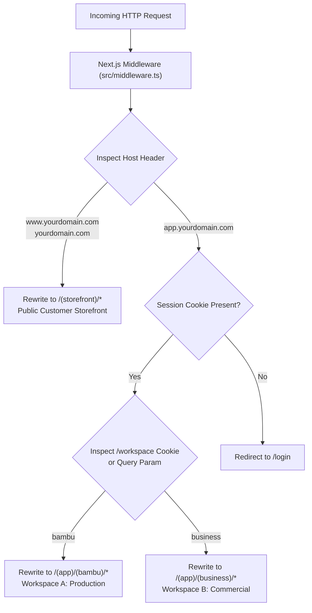
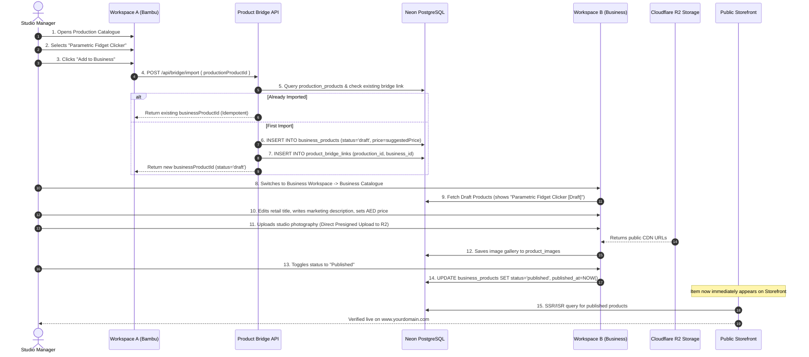
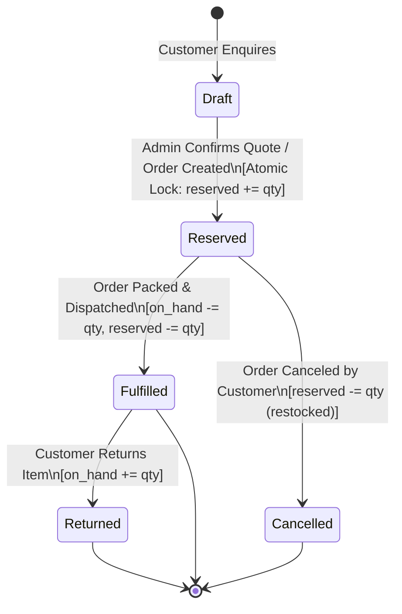
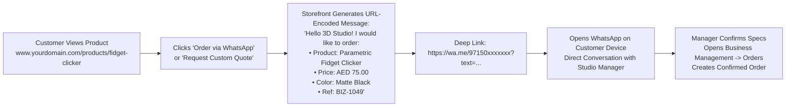
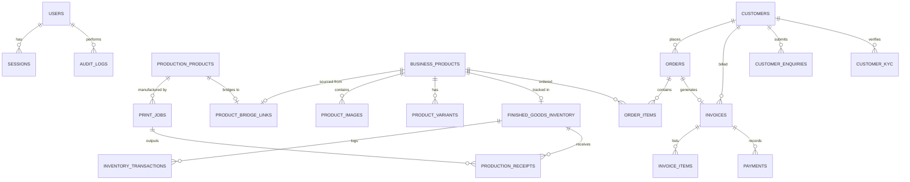
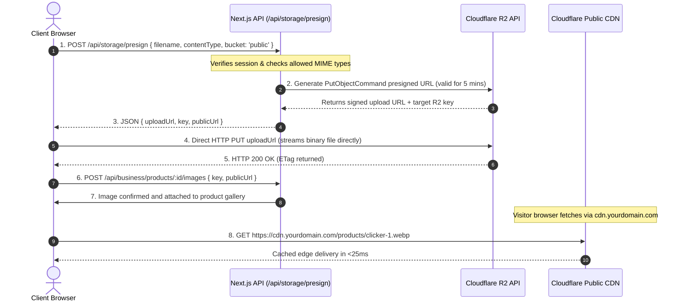
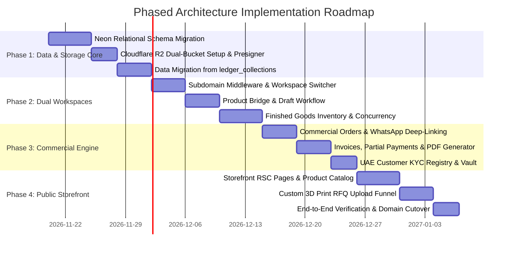

# Target System Architecture: Unified 3D Printing Business Ecosystem
**Document Identifier:** `TARGET_SYSTEM_ARCHITECTURE.md`  
**Author:** Principal SaaS Architect & Product Systems Designer  
**Status:** Approved Architectural Blueprint  
**Target Platform:** Next.js 16 (App Router), React 19, Neon Lakebase PostgreSQL, Cloudflare R2  
**Workspaces:** Bambu Management (Production) · Business Management (Commercial) · Public Storefront  

---

## 1. Executive Product Vision & Architectural Tenets

### 1.1 The Triad Ecosystem
The target system transforms the standalone production tool into a unified three-tier business ecosystem operating on a single code repository and database engine:

```
┌────────────────────────────────────────────────────────────────────────────────────────┐
│                                UNIFIED CLOUD ECOSYSTEM                                 │
├──────────────────────────────┬──────────────────────────────┬──────────────────────────┤
│   A. BAMBU MANAGEMENT        │   B. BUSINESS MANAGEMENT     │   C. PUBLIC STOREFRONT   │
│   (Production Workspace)     │   (Commercial Workspace)     │   (Customer Facing)      │
├──────────────────────────────┼──────────────────────────────┼──────────────────────────┤
│ • Production Catalogue (79)  │ • Business Catalogue         │ • High-Conversion Store  │
│ • Filament Inventory (34)    │ • Finished Goods Stock (MRP) │ • Published Product Grid │
│ • Print Log (220 Bambu Jobs) │ • Sales Orders & Invoices    │ • Product Specs & Gallery│
│ • Slicer Cost Calculator     │ • Customers & UAE KYC        │ • WhatsApp Direct Order  │
│ • Bambu Cloud Sync Engine    │ • Quotations & Enquiries     │ • Custom 3D Print RFQ    │
│ • Machine Telemetry (P2S)    │ • Expenses & P&L Reports     │ • Brand Identity & Story │
├──────────────────────────────┴──────────────────────────────┴──────────────────────────┤
│                PRODUCTION-TO-BUSINESS BRIDGE & FINISHED GOODS INVENTORY                 │
├────────────────────────────────────────────────────────────────────────────────────────┤
│                     SHARED DATA, AUTH & CLOUD STORAGE INFRASTRUCTURE                   │
│         Neon Serverless PostgreSQL  ·  Cloudflare R2 Object Vault  ·  Next.js 16       │
└────────────────────────────────────────────────────────────────────────────────────────┘
```

### 1.2 Core Architectural Tenets
1. **Separation of Concerns:** Manufacturing telemetry (grams extruded, nozzle temps, bed leveling, fail codes) must never be conflated with commercial retail data (stock on hand, retail pricing, marketing copy, VAT invoices).
2. **Production-to-Business Bridge:** Physical manufacturing output enters the commercial catalogue only through explicit, deliberate manager actions. No printed object is automatically listed for sale.
3. **Three-Tier Inventory Integrity:** Filament raw materials ($g$), production print runs ($jobs$), and finished sellable units ($pcs$) are tracked in distinct, non-overlapping ledgers.
4. **Non-Technical Operational Simplicity:** The business manager must not be encumbered with mandatory SKU codes, nested barcode hierarchies, or complex manufacturing parameters. Workflows default to sensible conventions while permitting deep customization.
5. **Zero-Overhead Unified Monorepo:** One Next.js 16 deployment manages all three experiences via intelligent hostname middleware routing, minimizing hosting costs and deployment synchronization friction.

---

## 2. Infrastructure & Subdomain Routing Architecture

### 2.1 Unified Next.js Codebase Analysis
A critical architectural decision is whether to split the three experiences into separate micro-frontends or maintain a unified Next.js 16 application.

| Architectural Dimension | Micro-Frontends / Multi-Repo | Unified Next.js Monorepo (Chosen) | Strategic Rationale |
|---|---|---|---|
| **Database Connection Pool**| Multiple client pools competing for Neon serverless connections | Single pooled HTTP/WebSocket client (`@neondatabase/serverless`) | Eliminates connection exhaustion and minimizes cold starts on Neon scale-to-zero compute. |
| **Code & Type Sharing** | Requires npm publishing or Git submodules for shared types | Direct TypeScript import between production, commercial, and storefront models | Instant type safety across the Product Bridge and inventory mutations. |
| **Deployment Complexity** | 3 independent CI/CD pipelines, coordinate release schedules | Single deployment on Vercel or Node/Docker cluster | Atomic deployments: a database schema change deploys simultaneously across all 3 experiences. |
| **Operational Overhead** | High (multiple domains, CORS preflight, separate secrets) | Low (subdomain cookie sharing, internal route rewrites) | The single administrator manages the entire business from one authenticated session. |

### 2.2 Hostname Middleware Routing Engine
Next.js 16 App Router Route Groups cleanly isolate the experiences while Next.js Middleware (`src/middleware.ts`) inspects the incoming `Host` header and rewrites the request internally:



#### Middleware Implementation Specification (`src/middleware.ts`)
```typescript
import { NextRequest, NextResponse } from "next/server";

export const config = {
  matcher: [
    /*
     * Match all paths except:
     * 1. /api routes
     * 2. /_next (Next.js internals)
     * 3. /_static, favicon.ico, images, robots.txt
     */
    "/((?!api/|_next/|_static/|[\\w-]+\\.\\w+).*)",
  ],
};

export default function middleware(req: NextRequest) {
  const url = req.nextUrl;
  const hostname = req.headers.get("host") || "";
  
  // Define environment hostnames
  const STOREFRONT_HOST = process.env.NEXT_PUBLIC_STOREFRONT_HOST || "yourdomain.com";
  const APP_HOST = process.env.NEXT_PUBLIC_APP_HOST || "app.yourdomain.com";

  // 1. Storefront Subdomain Routing (www.yourdomain.com or apex domain)
  if (hostname === STOREFRONT_HOST || hostname === `www.${STOREFRONT_HOST}` || hostname.startsWith("store.")) {
    return NextResponse.rewrite(new URL(`/(storefront)${url.pathname}${url.search}`, req.url));
  }

  // 2. Admin Management Application Routing (app.yourdomain.com)
  if (hostname === APP_HOST || hostname.startsWith("app.")) {
    const sessionToken = req.cookies.get("__Host-session")?.value;
    const isAuthRoute = url.pathname.startsWith("/login") || url.pathname.startsWith("/auth");

    if (!sessionToken && !isAuthRoute) {
      return NextResponse.redirect(new URL("/login", req.url));
    }
    if (sessionToken && isAuthRoute) {
      return NextResponse.redirect(new URL("/business/dashboard", req.url));
    }

    return NextResponse.rewrite(new URL(`/(app)${url.pathname}${url.search}`, req.url));
  }

  // Local development fallback (localhost:3000)
  return NextResponse.next();
}
```

---

## 3. Workspace Navigation & UX Anatomy

### 3.1 Global Workspace Switcher
The administrative shell provides a high-level context toggle positioned at the apex of the sidebar navigation. This allows the administrator to toggle seamlessly between factory floor operations and commercial back-office tasks without losing active filters or page contexts.

```
┌──────────────────────────────────────────────┐
│  [ 3D STUDIO ECOSYSTEM ]                     │
│  ┌────────────────────────────────────────┐  │
│  │ 🏭 Workspace: Bambu Management      ▾ │  │  <-- Global Workspace Switcher
│  └────────────────────────────────────────┘  │
│                                              │
│  WORKSPACE A: BAMBU MANAGEMENT               │
│  • Production Dashboard                      │
│  • Production Catalogue (79)                 │
│  • Filament Inventory (34)                   │
│  • Print Log (220 Jobs)                      │
│  • Slicer Cost Calculator                    │
│  • Cloud Sync Telemetry                      │
└──────────────────────────────────────────────┘
                     ↕ SWITCH WORKSPACE
┌──────────────────────────────────────────────┐
│  [ 3D STUDIO ECOSYSTEM ]                     │
│  ┌────────────────────────────────────────┐  │
│  │ 💼 Workspace: Business Management    ▾ │  │  <-- Global Workspace Switcher
│  └────────────────────────────────────────┘  │
│                                              │
│  WORKSPACE B: BUSINESS MANAGEMENT            │
│  • Commercial Dashboard                      │
│  • Business Catalogue                        │
│  • Finished Goods Stock                      │
│  • Orders & Customer Pipeline                │
│  • Invoices & Payments (AED)                 │
│  • Customers & UAE KYC                       │
│  • Storefront CMS & Showcase                 │
└──────────────────────────────────────────────┘
```

### 3.2 Information Architecture Comparison

| Feature Dimension | Workspace A: Bambu Management | Workspace B: Business Management |
|---|---|---|
| **Primary User Persona**| Machine Operator / Production Technician | Business Owner / Studio Manager |
| **Primary Metric** | Grams extruded, print hours, bed failure % | Gross revenue, cash received, available finished units |
| **Catalog Entity** | `production_products` (Slicer-oriented) | `business_products` (Retail & Wholesale-oriented) |
| **Image Representation**| Bambu Cloud slicing thumbnail (Base64) | Commercial high-res photography gallery (Cloudflare R2) |
| **Item Identifiers** | Bambu MD5 Hash (`prod_059aaf0ad5b57a42`) | Human-readable Title, Category, Optional Retail SKU |
| **Cost Basis** | Raw material weight + power kW + machine wear | True Cost of Goods Sold (COGS) + Selling Price (AED) |
| **Inventory Unit** | Spool weight remaining ($g$) | Packaged finished units on the shelf ($pcs$) |

---

## 4. Production-to-Business Product Bridge

The **Product Bridge** is the operational core connecting manufacturing output with retail merchandising. It provides a human-in-the-loop transition from 3D models to sellable catalog items.



### 4.1 Strict Bridge Invariants
1. **Never Automatically Publish:** Imported production designs are strictly committed as `status = 'draft'`. They are invisible to the storefront until the manager manually publishes them.
2. **Strict Idempotency:** Invoking "Add to Business" multiple times for the same production product checks `product_bridge_links`. It immediately returns the existing commercial product ID without creating duplicate entries.
3. **No Image Pollution:** Bambu Cloud Base64 slicing thumbnails are **never** copied into the commercial product gallery. The manager must upload authentic product photography to ensure storefront quality.
4. **Standalone Commercial Products:** Products can be created directly in Business Management (e.g., outsourced metal hardware, post-processing services, acrylic stands) without requiring any parent production record.
5. **Decoupled Deletion Lifecycle:** Archiving or deleting a commercial product removes it from the store, but **never** deletes the underlying print logs, slicer metrics, or Bambu task records in Workspace A.

---

## 5. Three-Tier Inventory Separation & Concurrency Model

### 5.1 Distinct Inventory Layers
Manufacturing businesses fail when raw materials, work-in-progress, and finished stock are lumped into a single number. The target architecture establishes three physical and conceptual tiers:

```
┌──────────────────────────────────────────────────────────────────────────────────┐
│                         TIER 1: RAW FILAMENT INVENTORY                           │
│  Tracked by: Grams (g) and Spool Units                                           │
│  Data Source: S.filament_stock & S.filaments                                     │
│  Mutation: Manual spool purchases (+1,000g) / Bambu sync audit telemetry        │
└────────────────────────────────────────┬─────────────────────────────────────────┘
                                         │ Consumed during printing
                                         ▼
┌──────────────────────────────────────────────────────────────────────────────────┐
│                        TIER 2: PRODUCTION PRINT HISTORY                          │
│  Tracked by: Print Runs & Batch Job Output                                       │
│  Data Source: S.prints (bambu_xxxx)                                              │
│  Mutation: Incremental Bambu Cloud sync (Success / Failed / Canceled)            │
└────────────────────────────────────────┬─────────────────────────────────────────┘
                                         │ Quality Inspection & Production Receipt
                                         ▼
┌──────────────────────────────────────────────────────────────────────────────────┐
│                      TIER 3: FINISHED GOODS INVENTORY (MRP)                      │
│  Tracked by: Sellable Physical Units (pcs) on the shelf                          │
│  Data Source: finished_goods_inventory & inventory_transactions                  │
│  Mutation: Production Receipts (+), Sales Orders (-), Cycle Counts (±)           │
└──────────────────────────────────────────────────────────────────────────────────┘
```

### 5.2 The Production Receipt Workflow
A successful print job in Bambu Management does **not** automatically increment finished goods inventory. A print may suffer bed warping, layer delamination, stringing, or fail quality inspection.

**The Workflow:**
1. Bambu printer completes a 5-unit print job of "Fidget Clicker".
2. Bambu Management logs 5 finished parts in `print_jobs`.
3. The operator removes parts from the PEI plate, cleans supports, and performs QC inspection.
4. The operator enters Workspace B -> Finished Goods -> **"Log Production Receipt"**:
   - Source Job: `PRN-0028` (Batch of 5)
   - Accepted Quality Count: `4 pcs`
   - Scrapped / Defect Count: `1 pc`
   - Destination: `Shelf A • Retail Bin 4`
5. Database executes an atomic transaction:
   - Increments `finished_goods_inventory.on_hand` by `+4`.
   - Records an immutable audit row in `inventory_transactions`.

### 5.3 Concurrency Control & Overselling Prevention
When multiple customers submit enquiries or staff process orders simultaneously, race conditions can lead to negative inventory.

The target system enforces **Pessimistic Row-Level Locking** within an atomic PostgreSQL transaction during order stock reservation:

```sql
-- Atomic Stock Reservation Query executed inside a transaction:
BEGIN;

-- 1. Lock the inventory row for update to serialize concurrent transactions
SELECT product_id, on_hand, reserved, (on_hand - reserved) AS available
FROM finished_goods_inventory
WHERE product_id = $1
FOR UPDATE;

-- 2. Validate availability and conditionally update
UPDATE finished_goods_inventory
SET 
    reserved = reserved + $requested_qty,
    updated_at = NOW()
WHERE 
    product_id = $1 
    AND (on_hand - reserved) >= $requested_qty;

-- Check if row was updated; if rows affected == 0, abort and throw InsufficientStockException
-- 3. Record reservation entry in order_items
INSERT INTO order_items (order_id, product_id, quantity, unit_price_aed, reservation_status)
VALUES ($order_id, $1, $requested_qty, $unit_price, 'reserved');

COMMIT;
```

#### Order Stock Lifecycle State Machine:


---

## 6. Public Storefront Architecture

### 6.1 Storefront Anatomy & Merchandising
The customer-facing storefront on `www.yourdomain.com` is designed for performance, high visual appeal, and conversion without the complexity of automated merchant processing in the initial release.

- **Technology:** Next.js Server Components (RSC) with Incremental Static Regeneration (ISR, `revalidate = 60`).
- **Data Filtering:** Server components strictly query `business_products WHERE status = 'published'`. Draft and archived items are completely excluded at the database query level.
- **Hero & Categorization:** Showcases featured 3D printed lifestyle products, architectural models, prototypes, and tabletop gaming accessories.
- **Photographic Gallery:** Next.js Image (`next/image`) serving optimized modern AVIF/WebP formats directly from Cloudflare R2's global edge network.

### 6.2 WhatsApp Direct Order Conversion Flow
In the UAE and GCC regions, conversational commerce via WhatsApp is the dominant conversion channel for boutique design and fabrication studios.



### 6.3 Custom 3D Printing Request (RFQ) Funnel
For bespoke client models:
1. Customer visits `/custom-print`.
2. Fills out project scope (material: PLA/PETG/ABS/TPU, color preference, infill density, delivery deadline).
3. Uploads 3D file (`.stl`, `.step`, `.3mf`, `.obj`) up to 100MB.
4. Storefront uses a presigned upload URL to stage the file directly into Cloudflare R2's `studio-private-vault/rfq-uploads/`.
5. Database records an enquiry in `customer_enquiries`.
6. Manager reviews the CAD file in Workspace B, opens Slicer Cost Calculator, drafts a formal quotation (`QT-2026-xxx`), and sends the PDF proposal directly to the client via WhatsApp or email.

---

## 7. Complete Relational Database Schema Design (PostgreSQL / Neon)

The target architecture migrates from the single `ledger_collections` JSONB table to a **fully normalized, strongly typed relational schema** while maintaining JSONB flexibility for hardware telemetry and slicing profiles.



### 7.1 Schema DDL Specification

```sql
-- Enable necessary PostgreSQL extensions
CREATE EXTENSION IF NOT EXISTS "uuid-ossp";
CREATE EXTENSION IF NOT EXISTS "pgcrypto";

-- ============================================================================
-- 1. AUTHENTICATION & ACCESS CONTROL
-- ============================================================================

CREATE TABLE IF NOT EXISTS users (
    id UUID PRIMARY KEY DEFAULT gen_random_uuid(),
    email TEXT UNIQUE NOT NULL,
    password_hash TEXT NOT NULL,
    full_name TEXT NOT NULL,
    role TEXT NOT NULL DEFAULT 'admin' CHECK (role IN ('admin', 'manager', 'operator')),
    created_at TIMESTAMPTZ NOT NULL DEFAULT NOW(),
    updated_at TIMESTAMPTZ NOT NULL DEFAULT NOW()
);

CREATE TABLE IF NOT EXISTS sessions (
    id TEXT PRIMARY KEY,
    user_id UUID NOT NULL REFERENCES users(id) ON DELETE CASCADE,
    expires_at TIMESTAMPTZ NOT NULL,
    created_at TIMESTAMPTZ NOT NULL DEFAULT NOW()
);

-- ============================================================================
-- 2. WORKSPACE A: PRODUCTION & BAMBU TELEMETRY
-- ============================================================================

CREATE TABLE IF NOT EXISTS production_products (
    id TEXT PRIMARY KEY, -- e.g. 'prod_059aaf0ad5b57a42' (MD5 based)
    name TEXT NOT NULL,
    sku TEXT,
    category TEXT NOT NULL DEFAULT '3D Prints',
    grams NUMERIC(10, 2) NOT NULL DEFAULT 50.0,
    minutes INTEGER NOT NULL DEFAULT 60,
    slicer_settings JSONB DEFAULT '{}'::jsonb, -- layer height, infill, walls
    photo_thumbnail TEXT, -- Legacy base64 or internal R2 thumbnail URL
    notes TEXT,
    production_cost_aed NUMERIC(10, 2) NOT NULL DEFAULT 0.00,
    selling_price_aed NUMERIC(10, 2) NOT NULL DEFAULT 0.00,
    total_printed INTEGER NOT NULL DEFAULT 0,
    created_at TIMESTAMPTZ NOT NULL DEFAULT NOW(),
    updated_at TIMESTAMPTZ NOT NULL DEFAULT NOW()
);

CREATE TABLE IF NOT EXISTS filament_stock (
    id TEXT PRIMARY KEY, -- e.g. 'spool_16_pla_coralorange'
    name TEXT NOT NULL,
    brand TEXT NOT NULL,
    material TEXT NOT NULL, -- 'PLA', 'PETG', 'TPU', 'ABS'
    diameter TEXT NOT NULL DEFAULT '1.75 mm',
    color_name TEXT NOT NULL,
    color_hex TEXT NOT NULL,
    spool_weight_g NUMERIC(10, 2) NOT NULL DEFAULT 1000.0,
    cost_per_spool_aed NUMERIC(10, 2) NOT NULL DEFAULT 75.00,
    quantity_spools INTEGER NOT NULL DEFAULT 1,
    temp_range TEXT,
    location TEXT DEFAULT 'Shelf Storage',
    created_at TIMESTAMPTZ NOT NULL DEFAULT NOW(),
    updated_at TIMESTAMPTZ NOT NULL DEFAULT NOW()
);

CREATE TABLE IF NOT EXISTS print_jobs (
    id TEXT PRIMARY KEY, -- e.g. 'bambu_1357822840'
    bambu_task_id BIGINT UNIQUE,
    product_id TEXT REFERENCES production_products(id) ON DELETE SET NULL,
    date DATE NOT NULL,
    start_time TIMESTAMPTZ,
    end_time TIMESTAMPTZ,
    elapsed_hours NUMERIC(6, 2) NOT NULL DEFAULT 0.00,
    estimated_hours NUMERIC(6, 2),
    grams_used NUMERIC(10, 2) NOT NULL DEFAULT 0.00,
    status_label TEXT NOT NULL CHECK (status_label IN ('Success', 'Printing', 'Canceled', 'Failed')),
    printer_name TEXT NOT NULL, -- e.g. '3DP-22E-489 (P2S)'
    build_plate TEXT DEFAULT 'Textured PEI Plate',
    nozzle TEXT DEFAULT '0.4mm Standard Flow x1',
    plate_name TEXT,
    profile_name TEXT,
    filaments_used JSONB DEFAULT '[]'::jsonb, -- AMS slot details [{ slot, type, color, weightG }]
    error_code INTEGER,
    note TEXT,
    created_at TIMESTAMPTZ NOT NULL DEFAULT NOW(),
    updated_at TIMESTAMPTZ NOT NULL DEFAULT NOW()
);

-- ============================================================================
-- 3. PRODUCT BRIDGE (PRODUCTION <-> BUSINESS LINK)
-- ============================================================================

CREATE TABLE IF NOT EXISTS business_products (
    id UUID PRIMARY KEY DEFAULT gen_random_uuid(),
    slug TEXT UNIQUE NOT NULL,
    title TEXT NOT NULL,
    subtitle TEXT,
    description TEXT,
    category TEXT NOT NULL DEFAULT 'General',
    status TEXT NOT NULL DEFAULT 'draft' CHECK (status IN ('draft', 'published', 'archived')),
    retail_price_aed NUMERIC(10, 2) NOT NULL DEFAULT 0.00,
    wholesale_price_aed NUMERIC(10, 2),
    material_description TEXT,
    dimensions_cm TEXT, -- e.g. '12 x 8 x 15 cm'
    is_featured BOOLEAN NOT NULL DEFAULT FALSE,
    published_at TIMESTAMPTZ,
    created_at TIMESTAMPTZ NOT NULL DEFAULT NOW(),
    updated_at TIMESTAMPTZ NOT NULL DEFAULT NOW()
);

CREATE TABLE IF NOT EXISTS product_bridge_links (
    id UUID PRIMARY KEY DEFAULT gen_random_uuid(),
    production_product_id TEXT NOT NULL REFERENCES production_products(id) ON DELETE RESTRICT,
    business_product_id UUID NOT NULL REFERENCES business_products(id) ON DELETE CASCADE,
    imported_at TIMESTAMPTZ NOT NULL DEFAULT NOW(),
    CONSTRAINT uq_production_business_link UNIQUE (production_product_id, business_product_id)
);

CREATE TABLE IF NOT EXISTS product_images (
    id UUID PRIMARY KEY DEFAULT gen_random_uuid(),
    business_product_id UUID NOT NULL REFERENCES business_products(id) ON DELETE CASCADE,
    r2_key TEXT NOT NULL,
    cdn_url TEXT NOT NULL,
    alt_text TEXT,
    display_order INTEGER NOT NULL DEFAULT 0,
    is_primary BOOLEAN NOT NULL DEFAULT FALSE,
    created_at TIMESTAMPTZ NOT NULL DEFAULT NOW()
);

-- ============================================================================
-- 4. FINISHED GOODS INVENTORY (MRP LAYER)
-- ============================================================================

CREATE TABLE IF NOT EXISTS finished_goods_inventory (
    product_id UUID PRIMARY KEY REFERENCES business_products(id) ON DELETE CASCADE,
    on_hand INTEGER NOT NULL DEFAULT 0 CHECK (on_hand >= 0),
    reserved INTEGER NOT NULL DEFAULT 0 CHECK (reserved >= 0),
    safety_stock INTEGER NOT NULL DEFAULT 2,
    bin_location TEXT DEFAULT 'Shelf A',
    updated_at TIMESTAMPTZ NOT NULL DEFAULT NOW(),
    CONSTRAINT chk_available_non_negative CHECK (on_hand >= reserved)
);

CREATE TABLE IF NOT EXISTS inventory_transactions (
    id UUID PRIMARY KEY DEFAULT gen_random_uuid(),
    product_id UUID NOT NULL REFERENCES business_products(id) ON DELETE CASCADE,
    transaction_type TEXT NOT NULL CHECK (transaction_type IN ('production_receipt', 'sale_fulfillment', 'order_reservation', 'reservation_cancellation', 'manual_adjustment', 'customer_return')),
    quantity_delta INTEGER NOT NULL,
    previous_on_hand INTEGER NOT NULL,
    new_on_hand INTEGER NOT NULL,
    reference_id TEXT, -- order_id, receipt_id, or adjustment note
    performed_by UUID REFERENCES users(id),
    created_at TIMESTAMPTZ NOT NULL DEFAULT NOW()
);

CREATE TABLE IF NOT EXISTS production_receipts (
    id UUID PRIMARY KEY DEFAULT gen_random_uuid(),
    print_job_id TEXT REFERENCES print_jobs(id) ON DELETE SET NULL,
    business_product_id UUID NOT NULL REFERENCES business_products(id) ON DELETE CASCADE,
    quantity_accepted INTEGER NOT NULL CHECK (quantity_accepted > 0),
    quantity_rejected INTEGER NOT NULL DEFAULT 0,
    qc_notes TEXT,
    received_at TIMESTAMPTZ NOT NULL DEFAULT NOW()
);

-- ============================================================================
-- 5. CUSTOMERS, ENQUIRIES & UAE KYC
-- ============================================================================

CREATE TABLE IF NOT EXISTS customers (
    id UUID PRIMARY KEY DEFAULT gen_random_uuid(),
    name TEXT NOT NULL,
    company_name TEXT,
    email TEXT,
    phone TEXT NOT NULL, -- WhatsApp primary communication handle
    entity_type TEXT NOT NULL DEFAULT 'Individual' CHECK (entity_type IN ('Individual', 'B2B Corporate')),
    trn_number TEXT, -- UAE 15-digit Tax Registration Number
    billing_address TEXT,
    shipping_address TEXT,
    channel TEXT NOT NULL DEFAULT 'WhatsApp' CHECK (channel IN ('WhatsApp', 'Website', 'Instagram', 'Direct', 'Walk-in')),
    created_at TIMESTAMPTZ NOT NULL DEFAULT NOW(),
    updated_at TIMESTAMPTZ NOT NULL DEFAULT NOW()
);

CREATE TABLE IF NOT EXISTS customer_kyc (
    id UUID PRIMARY KEY DEFAULT gen_random_uuid(),
    customer_id UUID NOT NULL REFERENCES customers(id) ON DELETE CASCADE,
    tier_level TEXT NOT NULL DEFAULT 'Tier 1' CHECK (tier_level IN ('Tier 1', 'Tier 2 Verified')),
    emirates_id_number TEXT,
    trade_license_number TEXT,
    license_expiry_date DATE,
    r2_document_key TEXT, -- Encrypted path in studio-private-vault
    verification_status TEXT NOT NULL DEFAULT 'Pending' CHECK (verification_status IN ('Pending', 'Approved', 'Rejected')),
    verified_at TIMESTAMPTZ,
    created_at TIMESTAMPTZ NOT NULL DEFAULT NOW()
);

CREATE TABLE IF NOT EXISTS customer_enquiries (
    id UUID PRIMARY KEY DEFAULT gen_random_uuid(),
    customer_id UUID REFERENCES customers(id) ON DELETE SET NULL,
    contact_name TEXT NOT NULL,
    contact_phone TEXT NOT NULL,
    contact_email TEXT,
    enquiry_type TEXT NOT NULL DEFAULT 'General' CHECK (enquiry_type IN ('General', 'Product Order', 'Custom 3D Print RFQ')),
    message TEXT NOT NULL,
    target_business_product_id UUID REFERENCES business_products(id) ON DELETE SET NULL,
    r2_attachment_key TEXT, -- User-uploaded STL / STEP 3D CAD model
    status TEXT NOT NULL DEFAULT 'New' CHECK (status IN ('New', 'Contacted', 'Quoted', 'Converted', 'Closed')),
    created_at TIMESTAMPTZ NOT NULL DEFAULT NOW()
);

-- ============================================================================
-- 6. ORDERS, INVOICES & PAYMENTS
-- ============================================================================

CREATE TABLE IF NOT EXISTS orders (
    id UUID PRIMARY KEY DEFAULT gen_random_uuid(),
    order_number TEXT UNIQUE NOT NULL, -- e.g. 'ORD-2026-1001'
    customer_id UUID NOT NULL REFERENCES customers(id) ON DELETE RESTRICT,
    status TEXT NOT NULL DEFAULT 'draft' CHECK (status IN ('draft', 'confirmed', 'in_production', 'ready_for_pickup', 'dispatched', 'delivered', 'cancelled')),
    subtotal_aed NUMERIC(10, 2) NOT NULL DEFAULT 0.00,
    vat_aed NUMERIC(10, 2) NOT NULL DEFAULT 0.00,
    total_aed NUMERIC(10, 2) NOT NULL DEFAULT 0.00,
    notes TEXT,
    created_at TIMESTAMPTZ NOT NULL DEFAULT NOW(),
    updated_at TIMESTAMPTZ NOT NULL DEFAULT NOW()
);

CREATE TABLE IF NOT EXISTS order_items (
    id UUID PRIMARY KEY DEFAULT gen_random_uuid(),
    order_id UUID NOT NULL REFERENCES orders(id) ON DELETE CASCADE,
    business_product_id UUID NOT NULL REFERENCES business_products(id) ON DELETE RESTRICT,
    quantity INTEGER NOT NULL CHECK (quantity > 0),
    unit_price_aed NUMERIC(10, 2) NOT NULL,
    total_aed NUMERIC(10, 2) NOT NULL,
    reservation_status TEXT NOT NULL DEFAULT 'reserved' CHECK (reservation_status IN ('reserved', 'fulfilled', 'released'))
);

CREATE TABLE IF NOT EXISTS invoices (
    id UUID PRIMARY KEY DEFAULT gen_random_uuid(),
    invoice_number TEXT UNIQUE NOT NULL, -- e.g. 'INV-2026-0042'
    order_id UUID REFERENCES orders(id) ON DELETE SET NULL,
    customer_id UUID NOT NULL REFERENCES customers(id) ON DELETE RESTRICT,
    issue_date DATE NOT NULL DEFAULT CURRENT_DATE,
    due_date DATE NOT NULL DEFAULT (CURRENT_DATE + 7),
    subtotal_aed NUMERIC(10, 2) NOT NULL,
    vat_rate_pct NUMERIC(5, 2) NOT NULL DEFAULT 5.00,
    vat_amount_aed NUMERIC(10, 2) NOT NULL,
    total_amount_aed NUMERIC(10, 2) NOT NULL,
    paid_amount_aed NUMERIC(10, 2) NOT NULL DEFAULT 0.00,
    payment_status TEXT NOT NULL DEFAULT 'Unpaid' CHECK (payment_status IN ('Unpaid', 'Partial', 'Paid')),
    pdf_r2_key TEXT,
    created_at TIMESTAMPTZ NOT NULL DEFAULT NOW()
);

CREATE TABLE IF NOT EXISTS payments (
    id UUID PRIMARY KEY DEFAULT gen_random_uuid(),
    invoice_id UUID NOT NULL REFERENCES invoices(id) ON DELETE CASCADE,
    amount_aed NUMERIC(10, 2) NOT NULL CHECK (amount_aed > 0),
    payment_date DATE NOT NULL DEFAULT CURRENT_DATE,
    payment_method TEXT NOT NULL CHECK (payment_method IN ('Cash', 'Card', 'Bank Transfer', 'Stripe', 'Other')),
    reference_number TEXT,
    notes TEXT,
    created_at TIMESTAMPTZ NOT NULL DEFAULT NOW()
);

CREATE TABLE IF NOT EXISTS expenses (
    id UUID PRIMARY KEY DEFAULT gen_random_uuid(),
    voucher_number TEXT UNIQUE NOT NULL,
    date DATE NOT NULL DEFAULT CURRENT_DATE,
    category TEXT NOT NULL CHECK (category IN ('Filament', 'Maintenance', 'Equipment', 'Electricity', 'Rent', 'Marketing', 'Packaging', 'Other')),
    description TEXT NOT NULL,
    amount_aed NUMERIC(10, 2) NOT NULL CHECK (amount_aed > 0),
    payment_method TEXT NOT NULL,
    receipt_r2_key TEXT,
    created_at TIMESTAMPTZ NOT NULL DEFAULT NOW()
);

-- ============================================================================
-- 7. PERFORMANCE INDEXES
-- ============================================================================

CREATE INDEX IF NOT EXISTS idx_print_jobs_product ON print_jobs(product_id);
CREATE INDEX IF NOT EXISTS idx_print_jobs_date ON print_jobs(date DESC);
CREATE INDEX IF NOT EXISTS idx_business_products_slug ON business_products(slug);
CREATE INDEX IF NOT EXISTS idx_business_products_status ON business_products(status);
CREATE INDEX IF NOT EXISTS idx_inventory_product ON finished_goods_inventory(product_id);
CREATE INDEX IF NOT EXISTS idx_orders_customer ON orders(customer_id);
CREATE INDEX IF NOT EXISTS idx_invoices_customer ON invoices(customer_id);
CREATE INDEX IF NOT EXISTS idx_invoices_status ON invoices(payment_status);
CREATE INDEX IF NOT EXISTS idx_customer_enquiries_status ON customer_enquiries(status);
```

---

## 8. Cloudflare R2 Storage Architecture

### 8.1 Dual-Bucket Topology
To prevent catastrophic leaks of confidential customer KYC records or proprietary CAD models while ensuring lightning-fast public image delivery, Cloudflare R2 is segmented into **two distinct buckets**:

```
┌────────────────────────────────────────────────────────────────────────────────────────┐
│                               CLOUDFLARE R2 TOPOLOGY                                   │
├───────────────────────────────────────────┬────────────────────────────────────────────┤
│   BUCKET 1: studio-public-assets          │   BUCKET 2: studio-private-vault           │
├───────────────────────────────────────────┼────────────────────────────────────────────┤
│ • Access: Public via Global Cloudflare CDN│ • Access: Private (No public CDN domain)   │
│ • Custom Domain: cdn.yourdomain.com       │ • Retrieval: Signed Presigned URLs Only    │
│ • Contents:                               │ • Contents:                                │
│   - Commercial Product Photography        │   - Customer UAE Trade Licenses & IDs      │
│   - Material Swatches & Texture Maps      │   - Proprietary Client STL / STEP Files    │
│   - Brand Logos & Marketing Banners       │   - Official Generated Tax Invoice PDFs    │
│   - Published Model Renders               │   - Studio Expense Vouchers & Receipts     │
└───────────────────────────────────────────┴────────────────────────────────────────────┘
```

### 8.2 Direct-to-R2 Upload Architecture
To prevent heavy multi-megabyte image and 3D model uploads from saturating Next.js serverless functions or causing HTTP timeout errors, all uploads execute **Direct-to-R2 from the client browser** using S3-compatible Presigned Upload URLs:



---

## 9. Answers to the 10 Critical Architecture Questions

### Question 1: How do the three experiences connect?
**Answer:** The three experiences are hosted within a **single Next.js 16 monorepo** sharing a common Neon PostgreSQL database and Cloudflare R2 storage layer. 
- Next.js Middleware detects the incoming request domain: `www.yourdomain.com` rewrites internally to the `(storefront)` route group; `app.yourdomain.com` rewrites to the `(app)` route group.
- Inside `(app)`, a global workspace switcher context toggles between Workspace A (`/bambu/*`) and Workspace B (`/business/*`).
- The **Product Bridge** connects Workspace A to Workspace B (promoting manufacturing designs to commercial drafts).
- The **Published Status Flag** connects Workspace B to the Storefront (surfacing active commercial items to the public website).

### Question 2: How do the two workspaces share authentication?
**Answer:** Both workspaces reside under the same administrative host (`app.yourdomain.com`). 
- When the administrator logs in at `/login`, the server verifies their credentials against the `users` table and issues a cryptographically signed, secure, HTTP-only session cookie named `__Host-session`.
- Because the cookie is bound to the host, it is automatically passed on every HTTP request whether the manager navigates to `/bambu/dashboard` or `/business/orders`.
- The user's active workspace preference (`bambu` or `business`) is stored in an ambient UI cookie (`studio_workspace=business; SameSite=Lax; Path=/`), allowing the sidebar to immediately restore the user's last active workspace upon page reload.

### Question 3: How do production and commercial data remain isolated?
**Answer:** Isolation is enforced at the **database schema level**:
- Manufacturing tables (`production_products`, `print_jobs`, `filament_stock`) contain zero commercial retail fields (no retail markup, no customer information, no storefront slugs).
- Commercial tables (`business_products`, `orders`, `invoices`, `customers`) maintain their own independent lifecycles.
- A commercial product links back to a production product **only** through the `product_bridge_links` intersection table. If a business product is created directly in Workspace B (e.g., outsourced casting or retail merchandise), its bridge record is simply null.
- Deleting, archiving, or discounting a commercial product has **zero cascade effect** on the underlying manufacturing print logs or slicer records.

### Question 4: How does the Product Bridge work?
**Answer:** The Product Bridge operates as a deliberate, transactional promoting workflow:
1. Manager selects a model in Bambu Management and clicks *"Add to Business"*.
2. The server verifies whether a bridge link already exists in `product_bridge_links` for that production ID. If it does, it returns the existing commercial product ID (preventing duplication).
3. If new, it creates a row in `business_products` with `status = 'draft'` and copies baseline technical metadata (suggested price, model dimensions, material family).
4. Slicing thumbnails (Base64) are deliberately **ignored**.
5. The manager enters Workspace B, uploads high-resolution photography to Cloudflare R2, writes marketing descriptions, sets AED retail and wholesale prices, and clicks *"Publish"*.
6. Only upon explicit publication does the item become visible on the public storefront.

### Question 5: How should the database be structured?
**Answer:** The database transitions from the legacy single-table `ledger_collections` JSONB key-value pattern to a **normalized relational schema** in Neon PostgreSQL (detailed in Section 7):
- Strongly typed relational tables with foreign keys and cascading rules prevent orphaned records.
- JSONB is retained only where flexibility is genuinely required: Bambu AMS filament slot details (`print_jobs.filaments_used`) and slicer configuration profiles (`production_products.slicer_settings`).
- Check constraints enforce positive numbers for prices, stock counts, and tare weights.

### Question 6: How does Cloudflare R2 handle public images vs private files?
**Answer:** Through **strict dual-bucket physical isolation**:
- **`studio-public-assets`:** Connected to Cloudflare CDN (`cdn.yourdomain.com`). Objects have public read permissions. Used exclusively for storefront marketing photos and material swatches.
- **`studio-private-vault`:** Has **no public DNS hostname**. All public access is disabled at the Cloudflare bucket policy level. 
- To view an Emirates ID, customer trade license, or tax invoice PDF, the management app requests a temporary signed presigned GET URL from Next.js (authenticated via session cookie) valid for 15 minutes. Once expired, the link cannot be used.

### Question 7: How do orders, invoices, and payments connect?
**Answer:** They form a standard commercial transaction graph:
- A customer enquiry or WhatsApp request is formalized into an **`orders`** record in `draft` status.
- Once confirmed, order items execute atomic stock reservations against `finished_goods_inventory`.
- When ready for billing, the manager generates an **`invoices`** record linked to `order_id` (calculating 5% UAE VAT).
- Payments are logged into **`payments`** as one-to-many child records of the invoice. This natively supports **Partial Payments** (e.g., a customer pays a 50% deposit upon order confirmation, and the remaining 50% upon delivery).
- The invoice payment status automatically transitions: `Unpaid` ($\text{paid} = 0$) $\rightarrow$ `Partial` ($0 < \text{paid} < \text{total}$) $\rightarrow$ `Paid` ($\text{paid} \ge \text{total}$).

### Question 8: How does finished goods inventory work?
**Answer:** Finished goods inventory is managed as an independent MRP ledger:
- **`finished_goods_inventory`** maintains two vital columns: `on_hand` (total physical units in the studio) and `reserved` (units committed to confirmed customer orders).
- The formula $\text{Available} = \text{on\_hand} - \text{reserved}$ determines sellable capacity.
- Stock increments happen exclusively via **Production Receipts** (QC-accepted units from completed print jobs) or manual inventory cycle counts.
- Concurrency protection is achieved using PostgreSQL row-level locks (`SELECT ... FOR UPDATE`) and check constraints (`chk_available_non_negative`), ensuring two concurrent order submissions cannot oversell remaining stock.

### Question 9: How does subdomain routing work?
**Answer:** Handled at the network edge by **Next.js Middleware**:
- `www.yourdomain.com` and `yourdomain.com` are rewritten to `/(storefront)/*`.
- `app.yourdomain.com` is rewritten to `/(app)/*`.
- For local development, `localhost:3000` defaults to the admin application, while `www.localhost:3000` or a query parameter `?preview=storefront` routes to the storefront.
- Wildcard DNS records (`*.yourdomain.com`) point to the deployment CNAME, ensuring seamless zero-configuration subdomain additions.

### Question 10: How can the architecture grow in the future?
**Answer:** The architecture is intentionally designed with clean extension vectors:
1. **Multi-Printer Farm Scaling:** The `print_jobs` table already features `printer_name` and `bambu_task_id`. Adding additional Bambu X1C, P1S, or A1 mini printers simply requires storing device serials and querying cloud tasks by device.
2. **Automated E-Commerce Payments:** Because `orders` and `invoices` already have discrete status state machines, integrating Stripe or Checkout.com in Phase 2 requires only adding a webhook endpoint (`/api/webhooks/stripe`) that marks the invoice as `Paid` and updates `orders.status = 'confirmed'`.
3. **Multi-Staff RBAC:** The `users` table already has a `role` enum (`admin`, `manager`, `operator`). Future features can restrict machine operators to Workspace A while reserving financial ledgers in Workspace B for the manager.
4. **Neon Database Branching:** Development and staging environments can leverage instant copy-on-write Neon branches to test schema migrations against real production data snapshots without risking live studio operations.

---

## 10. Phased Implementation Roadmap



### Phase 1: Data & Storage Foundation
- Provision the normalized relational tables in Neon PostgreSQL alongside existing `ledger_collections`.
- Configure Cloudflare R2 buckets (`studio-public-assets` and `studio-private-vault`).
- Run non-destructive data migration script migrating 79 products, 220 prints, and 34 filaments into relational tables.

### Phase 2: Dual Workspaces & Product Bridge
- Implement Next.js Middleware subdomain router.
- Build the global Workspace Switcher topbar component.
- Implement the Product Bridge API (`/api/bridge/import`) and idempotent draft promotion.
- Build Finished Goods Inventory with atomic row locking.

### Phase 3: Commercial Back-Office
- Build Commercial Product Catalogue with R2 direct multi-image upload.
- Wire Orders and Invoicing with UAE 5% VAT and partial payment reconciliation.
- Deploy Customer KYC document vault with temporary signed URLs.

### Phase 4: Public Storefront Launch
- Build high-performance storefront pages (`/`, `/products`, `/products/[slug]`, `/custom-print`).
- Implement WhatsApp automated enquiry message generator.
- Launch custom CAD model RFQ upload flow with direct R2 upload.
